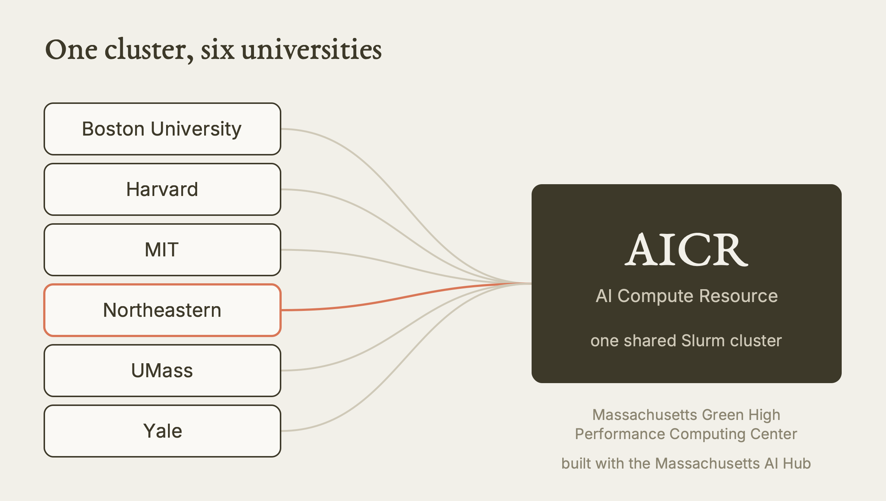
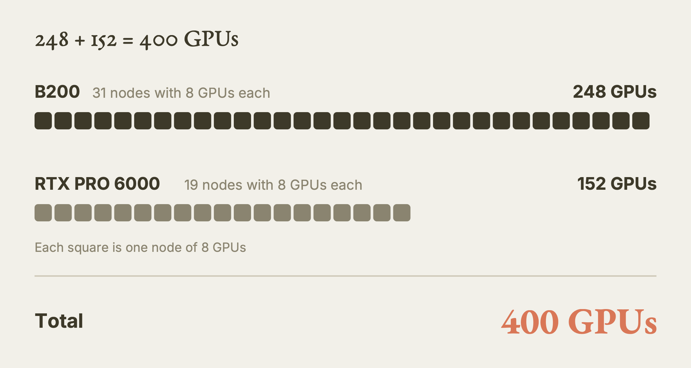
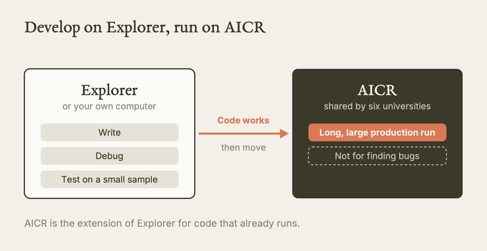
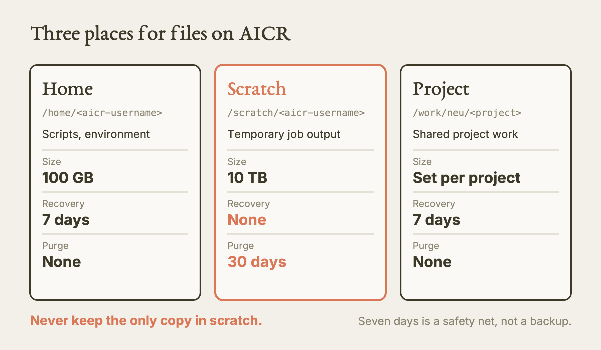
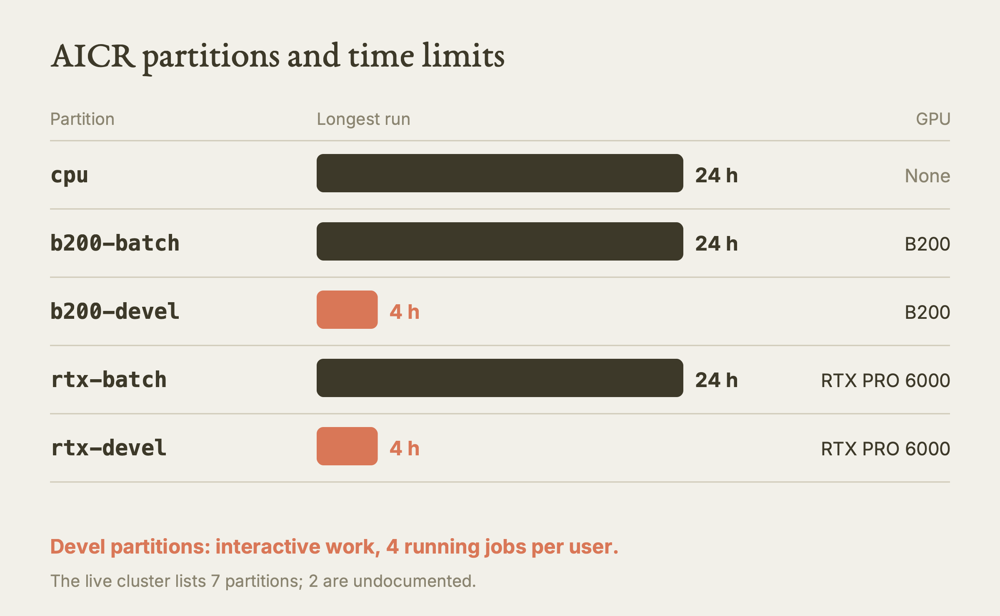

# AICR Introduction

This lesson explains what the AICR GPU cluster is, how a Northeastern researcher gets onto it, where files live, which partitions exist, and how to run a first job.

**Watch the film:** https://youtu.be/TY1xixqUZ_0 (Video 1 of the series "Research Computing on Explorer and AICR"; unlisted link).

**Based on:** Northeastern University Research Computing's training lesson *AICR Introduction*: https://github.com/northeastern-rc-training/AICR-Introduction-2026. **This is our own rewrite, not a copy.** The structure follows our film; the wording, examples and exercises are ours; we added what we learned using it (real output, corrections, gaps). The original remains the authority; it is © its authors (the repository carries no license).

---

**What this is.** A written version of our film about AICR, the AI Compute Resource: a shared GPU cluster in Massachusetts for AI research. It covers the whole path for a first-time user: who it is for, how access starts, the three storage areas, the partitions, the three ways to run work, moving data, and what happens when a project ends.

**Why it matters.** AICR is scarce, shared by six universities, and it cancels GPUs that sit idle. A researcher who treats it like a personal workstation wastes shared capacity and the project's own priority. A researcher who knows the rules before the first job loses much less time.

**What we found.** We checked the original against the live cluster (read-only logins on 2026-10-02 and 2026-10-11) and against the official AICR documentation pages. The original is mostly right. We corrected or flagged these points: the original says GPU nodes have 64 cores, but the cluster reports 128; its prose says "4 GPU partitions" while its own table lists five partitions (one CPU, four GPU); the live cluster has two partitions that neither the original nor the official pages explain; its sbatch example uses `source activate`, which one real AICR job could not survive; its advice to `mkdir -p logs` does not match its own script; and Globus is called the primary transfer method although another official page says the AICR Globus collection was not yet set up.

**What is NOT verified.** We never submitted a job, opened an interactive session on a compute node, or used Open OnDemand after sign-in. Every command that needs a compute node is labelled "from the source, not run by us". Quotas, the purge, the idle-GPU rule and the yearly review are documented rules that we read but did not trigger. AICR describes itself as in alpha and beta, so limits may have changed since the pages we read (May to July 2026).

---

## Act I: What AICR is

AICR stands for AI Compute Resource. Six universities at the Massachusetts Green High Performance Computing Center, together with the Massachusetts AI Hub, built it and share it. The six are Boston University, Harvard, MIT, Northeastern, UMass and Yale (named in the official AICR pages, not in the original lesson).

It is a Slurm cluster, so the workflow looks like any other Slurm cluster: you write a request, a scheduler decides when it runs.



*Six universities, one shared cluster. Our diagram, drawn for this guide. [SVG](images/shared-cluster.svg)*

| Part | What is there |
|---|---|
| NVIDIA B200 GPUs | 248 (31 nodes with 8 each) |
| NVIDIA RTX PRO 6000 GPUs | 152 (19 nodes with 8 each) |
| Total GPUs | 400 |
| CPU-only section | for cleaning and analysing data; 5 nodes live |
| Storage | fast shared storage, with a home, scratch and project area per user (Act III) |
| Software | a modern stack for machine learning, loaded with environment modules |

The node counts match what we saw on the live cluster on 2026-10-02 (31 B200 nodes, 19 RTX nodes).



*248 B200 plus 152 RTX PRO 6000 makes 400 GPUs. Our diagram, drawn for this guide. [SVG](images/gpu-count.svg)*

### The one idea to hold on to

AICR is for **production runs of code that already works**. The original lesson says to treat it as an extension of Northeastern's own cluster, Explorer. You write, debug and test on Explorer (or locally). Only when the code runs correctly do you bring it to AICR for the long, large run. AICR is shared across universities, so it is not the place to find your bugs.

A practical reading: if you have not yet run your code once, on a small sample, somewhere cheaper, you are not ready for AICR.



*Develop on Explorer, then run on AICR. Our diagram, drawn for this guide. [SVG](images/develop-then-run.svg)*

## Act II: Getting on

### Access starts with a faculty member

A student cannot open an AICR account alone. The principal investigator (PI), the faculty member leading the project, submits a short proposal through a request form. Access is attached to that project. The form is linked from the original repository; we did not open it (it asks for a Google sign-in).

### Signing in through the browser

The browser door is Open OnDemand (OOD) at `https://ood.aicr.ai/`. Opening that address sends you to a sign-in page where you first pick your institution (an identity provider), then sign in with your institutional credentials. For Northeastern that is your Northeastern username and password.

**Tested by us (2026-10-02):** a headless browser loaded `https://ood.aicr.ai/` and was redirected to a page titled "Select an Identity Provider". We did not sign in through the browser.

Command-line login uses a different mechanism (a key plus a certificate you download from OOD, no AICR password). That is outside the original lesson; our agent rules cover it in `skills/aicr/AICR.md`, and the key steps are human-only.

### Your AICR username is not your Explorer username

AICR adds an institution suffix so accounts from different universities stay distinct. For Northeastern the original gives this rule: the dot becomes an underscore and `_neu` is added.

| Where | Example username |
|---|---|
| Explorer | `<first>.<last>` style, such as `j.smith` |
| AICR | `j_smith_neu` |

**Tested by us (2026-10-02, 2026-10-11):** the account we logged in with follows this pattern. We still do not guess a username: the format is built from your institutional name, and other characters or collisions are not documented. Read the `User` line in your SSH config or ask your research computing team.

## Act III: Where files live

There are three storage areas, with the same purposes as on Explorer. Their limits are different.

| Area | Path | For | Size | Recovery | Purge |
|---|---|---|---|---|---|
| Home | `/home/<aicr-username>` | small scripts, your environment | 100 GB | 7 days if you delete something | none |
| Scratch | `/scratch/<aicr-username>` | temporary output of running jobs | 10 TB and about 15 million files | none | files older than 30 days |
| Project | `/work/neu/<project>` | shared, longer-term project work | set per project | 7 days | none |



*The three storage areas side by side. Our diagram, drawn for this guide. [SVG](images/storage-map.svg)*

Three habits follow from the table.

1. **Never keep the only copy of anything in scratch.** Nothing there can be recovered, and old files are purged.
2. **Seven days is a short safety net, not a backup.** The documentation says there is no off-site backup. Keep originals somewhere you control.
3. **Environments belong in home, not scratch.** A software environment stored in scratch can be purged under you (inferred from the purge rule).

The official pages write the sizes in GiB and TiB; the original writes GB and TB. We use the original's units. The path of the project area is written three different ways across sources (group name versus project name). Run `ls /work/neu` to see what actually exists instead of guessing (this is the safe reading; we did not run it).

## Act IV: Compute

Work is divided into partitions. A partition is a named group of machines with its own limits.

| Partition | GPU | Max time | Purpose |
|---|---|---|---|
| `cpu` | none | 24 h | data transformation and analysis |
| `b200-batch` | B200 | 24 h | unattended training and inference |
| `b200-devel` | B200 | 4 h | interactive development and OnDemand |
| `rtx-batch` | RTX PRO 6000 | 24 h | unattended training and inference |
| `rtx-devel` | RTX PRO 6000 | 4 h | interactive development and OnDemand |



*Batch partitions run six times longer than devel. Our diagram, drawn for this guide. [SVG](images/partition-limits.svg)*

The `devel` partitions allow 4 running jobs per user. The original also lists 4 running for `cpu`; the official system page says only the devel partitions have that limit. Treat the stricter reading as the safe one.

Every GPU node has about 2.3 TB of memory (the documentation says 2.25 TB; our `sinfo` reading on 2026-10-02 was 2,321,639 MB). The CPU nodes have about 1.1 TB.

### Batch versus devel

| | Batch | Devel |
|---|---|---|
| Use it for | runs that you submit and walk away from | testing, debugging, interactive sessions, OnDemand |
| Longest run | 24 hours | 4 hours |
| Per-user cap | none documented | 4 running jobs |
| Multi-GPU | supported | supported, but keep it small |

### Only ask for GPUs your code uses

Before you ask for more than one GPU, confirm the code can use them: distributed data parallel training, an NCCL-backed reduction, or one MPI rank per GPU. A program that uses one GPU and is given four leaves three idle.

### Idle GPUs are cancelled

A background process watches GPU use and cancels jobs that sit idle. The documentation gives no threshold or grace period, so do not try to guess it. End interactive sessions when you finish. A tool called `jobstats` reports how a finished job used what it asked for. The original says it "will" be deployed; our check on 2026-10-11 found it at `/usr/bin/jobstats` on the login node.

### See the live list yourself

```bash
sinfo -o "%14P %11l %6D"
```

This prints each partition, its time limit and its node count.

**Tested by us (2026-10-02):** on the AICR login node this printed seven partitions:

```
PARTITION      TIMELIMIT   NODES
cpu*           1-00:00:00  5
rtx-batch      1-00:00:00  17
b200-batch     1-00:00:00  25
b200-fullnode  1-00:00:00  4
rtx-devel      4:00:00     2
b200-devel     4:00:00     2
preemptable    1-00:00:00  46
```

Two of these, `b200-fullnode` and `preemptable`, appear in no page we read. We do not know their rules or how they are billed. Do not use them without asking your research computing team. The `*` marks the default partition: a job with no `--partition` lands on `cpu`.

## Act V: Running a job

There are three ways to work: `sbatch` (unattended), `srun` (interactive shell), and Open OnDemand (graphical, in a browser). Never run real computation on the login node, including the OnDemand browser terminal.

### sbatch: a script that runs without you

A batch script has two parts: `#SBATCH` lines that state your request, then ordinary shell commands that do the work. Here is our version of the starting example. It differs from the original in two places, explained below.

```bash
#!/bin/bash
#SBATCH --job-name=first_gpu_test
#SBATCH --account=<slurm-account>
#SBATCH --partition=b200-batch
#SBATCH --nodes=1
#SBATCH --ntasks=1
#SBATCH --cpus-per-task=8
#SBATCH --gres=gpu:1
#SBATCH --mem=16G
#SBATCH --time=00:30:00
#SBATCH --output=first_gpu_test_%j.out
#SBATCH --error=first_gpu_test_%j.err

module purge
module load cuda/13.1
module load miniforge3/25.3.0-3

# Put your environment's programs first on PATH instead of activating it.
export PATH=$HOME/.conda/envs/<env>/bin:$PATH

nvidia-smi -L        # prove a GPU is visible
python training.py
```

What each request line means:

| Line | Meaning |
|---|---|
| `--partition` | which group of machines; this also chooses the GPU model |
| `--gres=gpu:1` | one GPU (the official pages use `--gpus=1`; both worked in real jobs, pick one spelling per script) |
| `--cpus-per-task=8` | CPU cores, mostly for loading data |
| `--mem=16G` | CPU memory, not GPU memory |
| `--time=00:30:00` | the job is stopped at this limit |
| `--account` | the project to charge; ask your PI for the string |

**Where we differ from the original.** (1) We added `--account`. The original omits it; the documentation says to give it when you have more than one project, and every completed real job we have seen set it. (2) We replaced `source activate myenv` with a `PATH` line. One real AICR job died on `source activate` in a non-interactive script; the cause was never confirmed, and the `PATH` form works either way.

**From the source, not run by us:** the original's script with `source activate`. We did not submit any job, ours included. We did confirm on 2026-10-02 that `module load cuda/13.1` resolves to `cuda/13.1.1` and that `miniforge3/25.3.0-3` exists, and on 2026-10-11 that AICR uses Lmod and has no `python` module and no `conda` command on the login PATH before you load miniforge.

Submit and follow the job:

| Command | What it does |
|---|---|
| `sbatch first_gpu_test.slurm` | submits the script and prints a job ID |
| `squeue -u $USER` | lists your queued and running jobs |
| `scancel <jobid>` | cancels one job |
| `sacct -j <jobid> --format=JobID,Elapsed,MaxRSS,State` | shows what a finished job used |

If your script writes output into a folder, create the folder before you submit. Slurm opens the output file first and fails if the folder is missing. (The original says `mkdir -p logs` but its own script writes to the current directory, so the advice only matters if you point `--output` at `logs/`.)

### srun: an interactive shell on a GPU node

```bash
srun -p rtx-devel -N 1 -n 1 -c 8 --mem=16G --gres=gpu:1 --time=01:00:00 --pty bash
```

This asks the RTX devel partition for one node, eight CPU cores, 16 GB of memory and one GPU for one hour, and gives you a shell on it. Always set `--time` so the session ends even if you forget. Type `exit` to give the GPU back.

**From the source, not run by us.**

### Open OnDemand: graphical sessions

OnDemand launches sessions such as JupyterLab or a desktop in your browser. You choose the partition, the time and the resources, and it submits the Slurm job for you. Those sessions count against the devel partition limits, so close a session when you finish.

**From the source, not run by us.**

## Act VI: Data and lifecycle

### Moving data in

The original names Globus as the primary method for large transfers. Northeastern has a Globus subscription, so you can create a Globus account with your Northeastern credentials, then connect a folder on Explorer (or your own computer) to a folder on AICR.

**Caution.** Another official AICR page says the AICR Globus collection was "not yet set up". We could not determine which statement is current. Before you plan a large transfer around Globus, ask your research computing team whether the AICR collection is live. For small files, the OnDemand file browser, `scp` and `rsync` are alternatives; the official transfer page says `scp` and `rsync` may ask for Duo approval, which we did not see on a key-based login.

### Accounts and projects are temporary

Accounts and project directories on AICR are a loan, not a permanent home. Once a year there is a check-in, and the PI renews the request to continue. When the project is done, move the results back to a Northeastern resource. AICR is not permanent storage, and PI projects are treated as ephemeral. Do this during the project too, not only at the end.

Questions go to Research Computing: rchelp@northeastern.edu.

---

## Terms

| Term | Meaning |
|---|---|
| HPC cluster | many computers wired together and shared by many people |
| GPU | a chip that does the matrix math behind AI far faster than a normal processor |
| Slurm | the scheduler: you request resources, it decides when you run |
| Partition | a named group of machines with its own limits |
| PI | principal investigator: the faculty member who leads a project |
| Open OnDemand | a website that gives you the cluster in a browser |
| Scratch | temporary storage for running jobs; purged after 30 days |
| Walltime | the maximum real clock time your job may run |

## Try it

1. **Read the live partition list (read-only).** Log in to the AICR login node and run `sinfo -o "%14P %11l %6D"`. You should see the five documented partitions and possibly more. Write down which ones you cannot find in this lesson. **Tested by us (2026-10-02, 2026-10-11).**
2. **Check what tools exist (read-only).** On the login node run `which jobstats sbatch sacct`. You should see paths under `/usr/bin`. Then run `which nvitop nsys ncu`; on our login node these three printed nothing. **Tested by us (2026-10-11).**
3. **Check the module names (read-only).** Run `module avail cuda` and `module avail miniforge3`. You should see `cuda/13.1.1` and `miniforge3/25.3.0-3` among the results. **Tested by us (2026-10-11).**
4. **Plan your storage.** For a project of your own, write down which files go in home, which in scratch, and which in the project area, and where the second copy of anything irreplaceable lives. No cluster needed. **From the source, not run by us.**
5. **Write a request, do not submit it.** Adapt our `sbatch` script for your code on `rtx-devel` with 30 minutes. For each `#SBATCH` line, write one sentence on why your code needs it. Have your PI or support team look at it before you submit anything. **From the source, not run by us.**
6. **Interactive session on devel.** After a successful test above, run the `srun` command from Act V, run `nvidia-smi`, then `exit`. Confirm the job disappears from `squeue -u $USER`. **From the source, not run by us.**

## What we tested, and what we only read

| Claim | Status |
|---|---|
| `ood.aicr.ai` redirects to an institution picker | Tested (2026-10-02, headless, no sign-in) |
| Partition names, time limits, node counts | Tested (`sinfo`, 2026-10-02 and 2026-10-11) |
| 31 B200 nodes, 19 RTX nodes; 128 CPUs and about 2.3 TB per GPU node | Tested (`sinfo`, 2026-10-02) |
| `cuda/13.1` and `miniforge3/25.3.0-3` exist | Tested (2026-10-02, 2026-10-11) |
| Lmod is the module system; no `python` module; `jobstats` installed | Tested (2026-10-11) |
| Username pattern `<name>_neu` | Tested (our own account) |
| Home 100 GB, scratch 10 TB, purge, 7-day recovery | Read (original, official pages); not triggered |
| Idle-GPU cancellation | Read; not triggered |
| `sbatch`, `srun`, `squeue`, `scancel`, `sacct` behaviour | Read; a test job was blocked by our safety rules, so none was run |
| Open OnDemand sessions after sign-in | Read only |
| Globus transfers to AICR | Read only; status unclear |
| Proposal form, yearly review | Read only |

## Where the original is wrong, outdated, or silent

| Point | What the original says | What we found | What we would do |
|---|---|---|---|
| Cores per GPU node | 64 | `sinfo` and the official system page report 128 (it may be 64 physical cores with two threads each; not stated) | trust `sinfo`; do not size a request from the 64 |
| Number of GPU partitions | "4 GPU based partitions" | the table lists five rows, one of which is CPU-only | say "one CPU, four GPU" |
| Partitions | five | live list has seven (`b200-fullnode`, `preemptable` extra); their rules are undocumented | run `sinfo`; ask before using the extra two |
| `source activate myenv` in the script | shown | one real job died on it in a batch script | prepend the environment's `bin` to `PATH` |
| `mkdir -p logs` | stated | the example script never writes to `logs/` | create the output folder only if `--output` points into one |
| `--account` | omitted | real jobs always set it; the docs say to specify it with more than one project | include it, with the string from your PI |
| GPU request syntax | `--gres=gpu:1` | official pages use `--gpus=1`; both worked | choose one and do not mix |
| Globus | "primary method" | another official page says the collection was not yet set up | ask before relying on it |
| `jobstats` | "will also be deployed" | installed on the login node | use it after batch jobs |
| `cpu` partition limit | 4 running jobs | official page limits only devel partitions | assume the stricter limit |
| Idle-GPU rule | stated | no threshold, delay, warning or appeal documented | treat any idle GPU as at risk |
| Silent on | | how to restore a snapshot; the installed software list; container policy; a quota command; internet access from compute nodes; what happens to unrenewed projects; restricted data on AICR | ask support; do not assume |
| Scratch purge | 30 days | whether it uses modification or access time is not stated | do not touch files to dodge it; move them out |

One more gap worth knowing: the original does not mention the acceptable use policy. Data that is not anonymised, is under a data-use agreement, or has security restrictions should not go on AICR without checking with your institution first.

## Your turn

Paste this into Claude:

> I'm about to run my first production job on a shared GPU cluster that uses Slurm. Here is my training setup: [describe it in two sentences]. Write an sbatch script that asks for one GPU and a 30-minute time limit. Then tell me which of my files belong in home, which in scratch, and which in the project directory. Then check two things yourself. Does every S BATCH line ask only for what your code can use? And is anything you can't afford to lose sitting in scratch?

Note: in the film the phrase "S BATCH" is how the voice spells `#SBATCH`.

## Sources

- Original lesson (repository): https://github.com/northeastern-rc-training/AICR-Introduction-2026
- Northeastern Research Computing, "Using Globus": https://rc-docs.northeastern.edu/en/latest/datamanagement/globus.html
- Official AICR documentation pages (Overview, AICR System, Getting Started, SSH, OnDemand, Slurm Basics, GPU Jobs, CPU Jobs, Monitoring, Transferring data, Acceptable Use), dated May to July 2026
- Our film: https://youtu.be/TY1xixqUZ_0
- Our agent rules: `skills/hpc/HPC.md` and `skills/aicr/AICR.md` in this repository
- Support: rchelp@northeastern.edu
