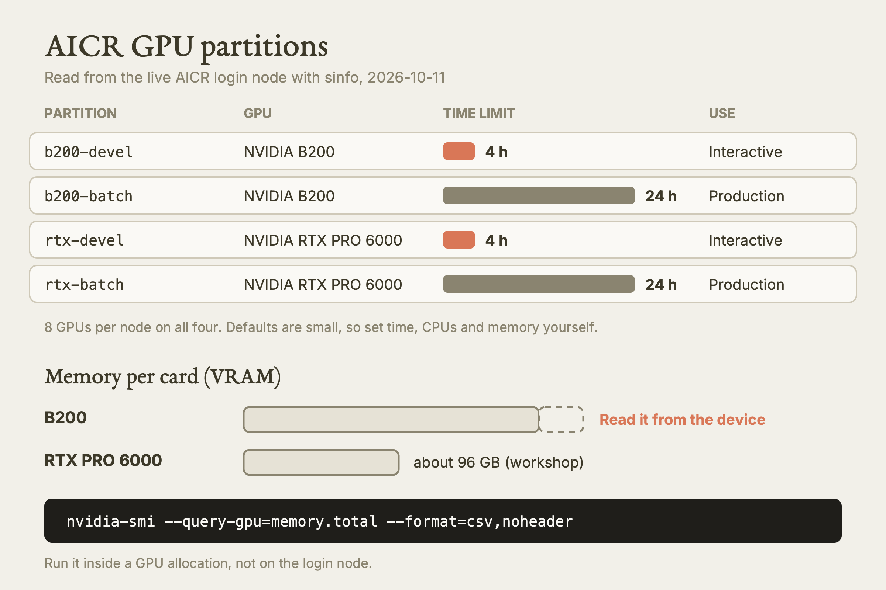
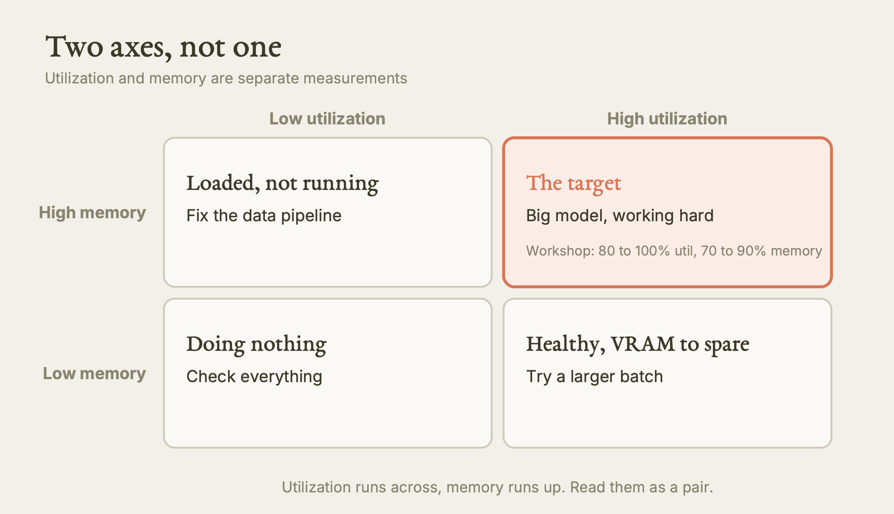
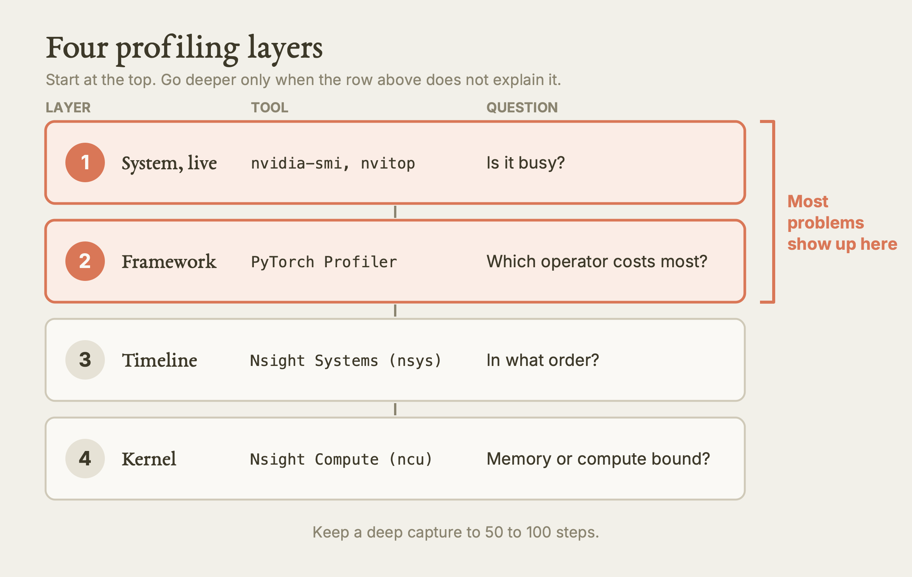
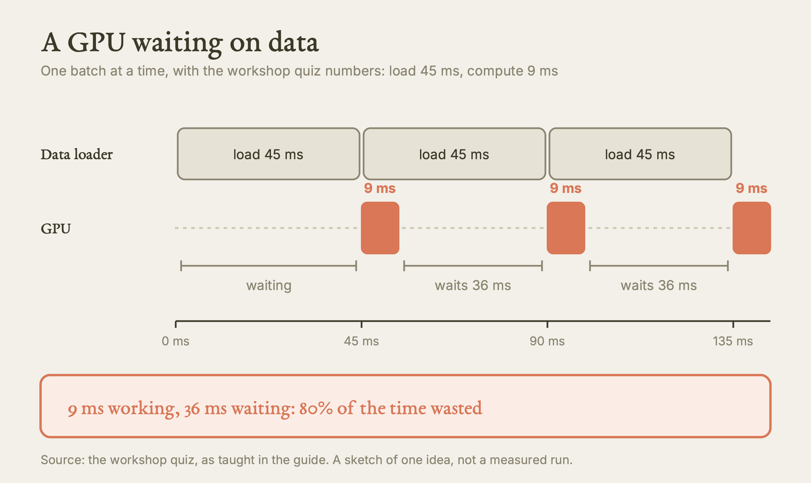
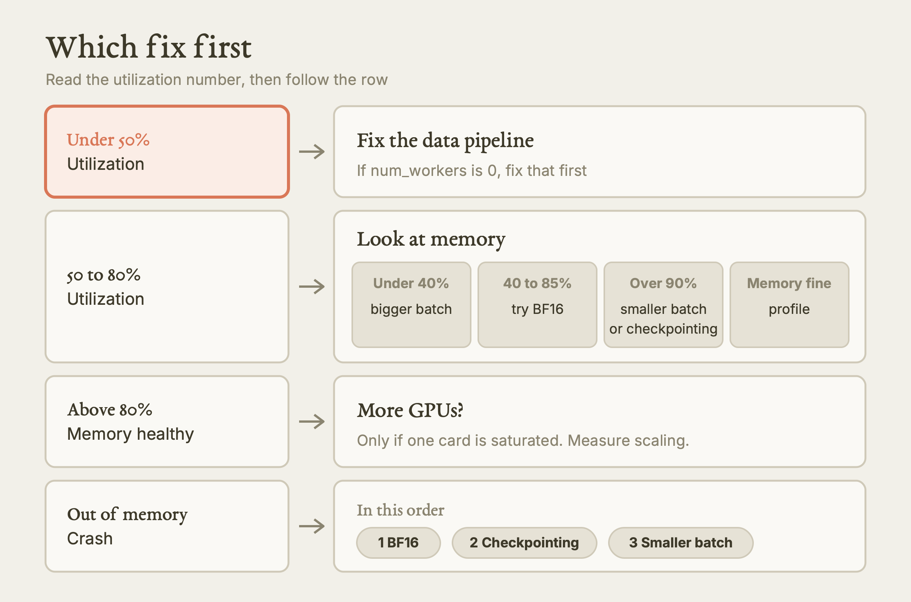

# Optimizing GPU Usage on AICR

This guide teaches you to check that a GPU job really used the GPU, to find out why it did not, and to fix the usual causes one at a time.

**Watch the film:** [Optimizing GPU Usage on AICR](https://youtu.be/8oinGvzgzgc), Video 2 of the series "Research Computing on Explorer and AICR" (unlisted link).

**Based on:** Northeastern University Research Computing's training lesson *AI Compute Resource (AICR) Training - Optimizing GPU usage on AICR*, presented by Arsalan Akhter: <https://github.com/northeastern-rc-training/AICR-Optimizing-GPU-Usage>. **This is our own rewrite, not a copy.** The structure follows our film; the wording, examples and exercises are ours; we added what we learned using it (real output, corrections, gaps). The original remains the authority; it is © its authors (the repository carries no license).

---

**What this is.** A written lesson for researchers who run GPU jobs on AICR, the shared GPU cluster that Northeastern uses with partner universities. It covers how to confirm you got the GPU, how to read what it is doing, how to profile, how to fix a starved GPU, how to read memory against utilization, when a second GPU helps, and a loop that ties these together. It is about AICR only. Explorer is a different cluster with different rules, and we say so where it matters.

**Why it matters.** A job that finishes has not necessarily used the GPU. Many jobs leave a very expensive card waiting for data. On AICR an idle GPU is also against the rules: a background process cancels jobs that hold a GPU without running work. And the cluster is shared, so every wasted hour is an hour someone else could not have. Measuring takes minutes. Guessing costs days of queue time.

**What we found.** We followed the original against the live AICR login node and against our own earlier AICR job logs. We corrected or flagged: the sample batch script creates its log folder too late; the original's `source activate` line is the pattern that killed one of our real jobs; the GPU verify script exits with success even when CUDA is missing; B200 memory is quoted as 192 GB in the workshop and 180 GB in the system documentation; the utilization targets change from section to section; `nvitop`, `nsys` and `ncu` are not on the login node's PATH; and one cost claim and a few speedups have no source or no measurement. We also include one real `jobstats` report from a finished job, which the original only simulates.

**What is NOT verified.** We ran only read-only commands on the login node plus one `jobstats` read on a finished job. We did not request a GPU, run any workshop script, run a profiler, or test BF16, checkpointing, DDP or scaling on AICR. Every claim about those is from the original and is labeled as such. AICR's own documentation is dated May to July 2026 and AICR describes itself as in early access, so limits can change: confirm with `sinfo` and with your institution's research computing team.

---

## Opening idea: measure first, change second

One rule runs through the whole lesson. Before you change anything about a GPU job, measure it. Then change one thing. Then measure again.

The rest of this guide is a set of instruments, each answering one question:

| Question | Instrument | Section |
|---|---|---|
| Did I get the GPU I asked for? | a verify script, `nvidia-smi` | Act I |
| Is it busy right now? | `nvidia-smi`, `nvitop` | Act II |
| Where does the time go? | PyTorch Profiler, Nsight Systems | Act III |
| Is the GPU waiting for data? | two timings | Act IV |
| Is memory the limit, or utilization? | the two-axes table | Act V |
| Would more GPUs help? | the 80 percent rule, scaling efficiency | Act VI |
| How did the finished job do? | `jobstats` | Act VII |

## Key terms

Six terms are used throughout. The glossary at the end repeats them in one place.

- **GPU utilization:** the share of the last second in which the GPU was running any work at all.
- **VRAM:** the GPU's own memory, where your model and your batch live.
- **DataLoader:** the PyTorch part that reads and batches your data and hands it to the GPU.
- **Profiler:** a tool that tells you where time went.
- **BF16:** a 16-bit number format that keeps the range of 32-bit floats.
- **DDP:** distributed data parallel, one copy of the model per GPU.

---

## Act I: Do you even have the GPU?

Start by proving the job is on the hardware you asked for. Three quiet failures cause most surprises:

1. The CUDA module is not loaded. PyTorch then runs on the CPU and raises no error.
2. A typo in the GPU request puts you on a different kind of node.
3. A `CUDA_VISIBLE_DEVICES` value left over from an earlier shell hides the card you were given.

### The four GPU partitions

Read from the live AICR login node (`sinfo`, 2026-10-11):

| Partition | GPU | GPUs per node | Time limit | Use |
|---|---|---|---|---|
| `b200-devel` | NVIDIA B200 | 8 | 4 h | interactive work and profiling |
| `b200-batch` | NVIDIA B200 | 8 | 24 h | tuned production jobs |
| `rtx-devel` | NVIDIA RTX PRO 6000 | 8 | 4 h | interactive work, lighter workloads |
| `rtx-batch` | NVIDIA RTX PRO 6000 | 8 | 24 h | tuned production jobs |

The same `sinfo` also listed `b200-fullnode`, `preemptable` and a `cpu` partition. No page we have read explains the first two, so do not request them without asking your institution's support. Defaults are small (our rule file records 15 minutes on devel and 1 hour on batch), so set time, CPUs and memory yourself every time.

Memory per card: the workshop says 192 GB for the B200 and 96 GB for the RTX PRO 6000. AICR's system page says 180 GB for the B200. Do not hard-code either. Ask the device:

```bash
nvidia-smi --query-gpu=memory.total --format=csv,noheader
```

Run that inside a GPU allocation, not on the login node.



*The four GPU partitions and the memory you should read from the device. Our diagram, drawn for this guide. [SVG](images/partitions-and-vram.svg)*

### A minimal batch script

The request first, then the work. This is our own version of the pattern the workshop teaches:

```bash
#!/bin/bash
#SBATCH --job-name=<jobname>
#SBATCH --account=<slurm-account>
#SBATCH --partition=b200-batch        # or rtx-batch
#SBATCH --nodes=1
#SBATCH --ntasks=1
#SBATCH --cpus-per-task=8             # DataLoader workers + 1
#SBATCH --gres=gpu:1                  # one GPU
#SBATCH --mem=32G                     # CPU memory, not GPU memory
#SBATCH --time=04:00:00               # measured runtime plus about 20 percent
#SBATCH --output=/work/<institution>/<project>/logs/%x-%j.out
#SBATCH --error=/work/<institution>/<project>/logs/%x-%j.err

module purge
module load cuda/13.1
module load miniforge3/25.3.0-3
export PATH=$HOME/.conda/envs/<env>/bin:$PATH
which python

python train.py
```

Create the log folder before you run `sbatch`, from your own shell. Slurm opens the output file before your script starts, so a `mkdir -p` inside the script is too late. The original puts `mkdir -p logs` inside the script. We moved it out (see the corrections section).

Two lines deserve attention:

- `--mem=32G` is CPU memory. The GPU's memory comes with the GPU and is not part of this request.
- `--cpus-per-task=8` is not a formality. Your DataLoader workers run on those cores. The workshop's rule is workers equal CPUs per task minus one, so eight cores means seven workers and the main process.

Two real details from the live cluster: `module load cuda/13.1` resolved to `cuda/13.1.1` on AICR when we checked, and `miniforge3/25.3.0-3` exists. AICR uses Lmod and has no `python` module; Explorer is a different system.

### Verify the allocation at the top of every job

Never trust that you got what you asked for. The workshop's verify script takes under five seconds and checks five things:

1. Can CUDA be reached at all?
2. How many GPUs, which model, how much memory?
3. What does `CUDA_VISIBLE_DEVICES` say?
4. Does `nvidia-smi` agree?
5. Does a small tensor survive a trip from CPU to GPU and back?

`torch.cuda.is_available()` only says PyTorch can see a GPU. The round trip proves it can use one. It catches a driver mismatch, a card already saturated, or a hardware fault before your job is twenty minutes in.

One trap: the workshop's verify script exits with success when CUDA is missing. A batch script that just runs it will carry on and use the CPU. Add your own hard stop:

```bash
python -c "import torch, sys; sys.exit(0 if torch.cuda.is_available() else 1)" || { echo "no GPU"; exit 1; }
```

### CUDA_VISIBLE_DEVICES

Slurm sets this to tell your program which GPUs are yours.

| You see | Meaning |
|---|---|
| `0` | one GPU allocated |
| `0,1` | two GPUs allocated |
| not set | commonly seen in a plain `srun` shell; the workshop calls it normal there |

Do not set or override it in your script unless you deliberately want a subset. The "not set is normal" statement sits oddly beside an `srun` that did request a GPU, and the workshop does not reconcile the two. Treat `nvidia-smi` as the final word on what you can see.

### The idle-GPU rule

AICR runs a background process that cancels jobs which hold a GPU without running anything. The sources give no threshold, no grace period, no warning and no appeal path, so you cannot plan around any of them. The safe habits:

- Do not request a GPU and then write code or chase Python errors on it. Do that on a CPU node or on your own computer.
- Run the verify step first, so an environment problem shows up in seconds.
- Profile in short devel sessions. Keep batch for jobs that are already tuned.

---

## Act II: Seeing your GPU live

The quickest instrument is already on every compute node. `nvidia-smi` prints one snapshot. A human can run `watch -n 1 nvidia-smi` in a second terminal to see it refresh every second. (An agent must not: a command that never exits will hang the session. Use one-shot forms.)

Two numbers matter. Using the workshop's illustrative example (a sample, not a capture from a real run):

- **GPU-Util 84%** means kernels were running for 84 percent of the last second. That is healthy. Below 50 percent, something needs checking.
- **24576 MiB of 196608 MiB** is about 12 percent of the card. That leaves a lot of room for a bigger batch.

### A quick test

Utilization 12 percent, memory 91 percent. What is wrong? The model is loaded and the card is nearly full, yet it barely computes. Nothing on the CPU side is feeding it. That is data starvation, covered in Act IV.

### Two axes, not one

Utilization and memory are separate measurements. Picture a grid, utilization across and memory up:

| | Low utilization | High utilization |
|---|---|---|
| **High memory** | model loaded, not running: fix the data pipeline | the target: big model working hard (workshop: 80 to 100 percent utilization, 70 to 90 percent memory) |
| **Low memory** | the GPU is doing nothing: check everything | good throughput with VRAM to spare: try a larger batch |



*Utilization and memory read as a pair. Our diagram, drawn for this guide. [SVG](images/two-axes-grid.svg)*

### nvitop

`nvitop` is a live dashboard with per-process GPU use, a memory trend, power and temperature. On a shared node it answers one useful question: is it my Python process on the GPU, or something left behind? The workshop installs it with `pip install nvitop`. On the AICR login node we found no `nvitop` on the PATH, so install it into your own environment if you want it, and treat it as a human tool.

---

## Act III: The profiling toolchain

`nvidia-smi` tells you there is a problem. A profiler tells you where.

| Layer | Tool | Question it answers |
|---|---|---|
| System, live | `nvidia-smi`, `nvitop` | Is the GPU busy? How full is the memory? |
| Framework | PyTorch Profiler | Which operator or layer uses the most GPU time? |
| Timeline | Nsight Systems (`nsys`) | In what order did every CPU thread, kernel and memory copy happen? |
| Kernel | Nsight Compute (`ncu`) | Is one kernel limited by memory or by compute? |

Most problems show up on the first two rows. Use the deeper rows only when those do not explain it.



*Four profiling layers, shallowest first. Our diagram, drawn for this guide. [SVG](images/profiling-ladder.svg)*

### The habit that matters most: profile in devel, produce in batch

1. Open an interactive session on a devel partition.
2. Run the verify step.
3. Run your code for 50 to 100 steps.
4. Profile, fix the bottleneck, profile again until utilization is above 70 percent.
5. Only then send the tuned script to a batch partition, unattended.
6. When it ends, read `jobstats`.

Why `srun` for the first part and `sbatch` for the last: `srun` gives you a live terminal on a compute node, where you can stop and restart without queuing again. `sbatch` is for runs that are already good.

An interactive request, as the workshop gives it (add your account string if your institution requires one; we did not run this one):

```bash
srun -p b200-devel -N 1 -n 1 -c 8 --mem=32G --gres=gpu:1 --time=01:00:00 --pty bash
```

### PyTorch Profiler

It needs no extra install. Record CPU and CUDA activity, and profile a short window only: 10 to 20 steps is enough.

```python
import torch
from torch.profiler import profile, ProfilerActivity

with profile(activities=[ProfilerActivity.CPU, ProfilerActivity.CUDA],
             record_shapes=True,
             on_trace_ready=torch.profiler.tensorboard_trace_handler("./prof")) as prof:
    for i, (xb, yb) in enumerate(loader):
        if i >= 20:
            break
        loss = loss_fn(model(xb.cuda()), yb.cuda())
        loss.backward()
        opt.step()
        opt.zero_grad()
        prof.step()

print(prof.key_averages().table(sort_by="cuda_time_total", row_limit=15))
```

Sort by total CUDA time. The top row is where to look first.

Read the table in this order:

1. Gaps between kernels on the timeline: the GPU is idle and the CPU is too slow.
2. Large `aten::copy_` entries: data is shuttling between CPU and GPU.
3. CPU total far above CUDA total: the work is not really on the GPU.
4. DataLoader functions at the top of the CPU table: the data pipeline again.

The columns that matter: `CUDA total` is your main target, `CPU total` is wall time on the CPU side, and `Self CPU` excludes child calls, which helps isolate the true culprit.

The workshop's sources disagree on window size (10, 20, 20 to 50 steps). Pick one and use it every time so your before and after numbers compare.

### Nsight Systems

When order matters (CPU threads, kernels, copies, GPU to GPU communication), use `nsys`:

```bash
nsys profile --trace=cuda,nvtx,osrt,cudnn,cublas \
  --output=/scratch/<aicr-username>/profile_$(date +%s) \
  python train.py --max-steps 50
```

Then copy the `.nsys-rep` file to your own computer, from your computer, and open it in the Nsight GUI. Keep the capture to 50 to 100 steps or use `--duration`. A full-run trace is gigabytes. We found `nsys` and `ncu` missing from the login node's PATH, and we do not know whether a module provides them on AICR. Check with `module spider` before planning around them.

---

## Act IV: The number one bottleneck, data starvation

Most low-utilization training jobs are not a model problem. The data pipeline cannot keep up. A B200 finishes a batch far faster than older cards, so a loader that barely kept up elsewhere will starve it here.

Picture a fast factory. The machine finishes a batch in 8 milliseconds. The truck that brings the next batch takes 50. The machine waits. Nothing is wrong with the machine.

### The two-timing test

Time the loader alone, then time compute alone on synthetic data, and compare.

```python
import time, torch

n = 50
t = time.perf_counter()
for i, _ in zip(range(n), loader):
    pass
load_ms = (time.perf_counter() - t) / n * 1000

fake = torch.randn(256, 3, 224, 224, device="cuda")
for _ in range(5):                      # warm up first
    model(fake).sum().backward()
torch.cuda.synchronize()
t = time.perf_counter()
for _ in range(n):
    model(fake).sum().backward()
    torch.cuda.synchronize()
comp_ms = (time.perf_counter() - t) / n * 1000

print(f"load {load_ms:.1f} ms, compute {comp_ms:.1f} ms")
```

If load time is larger than compute time, you are data bound. No model change will help until that is fixed. Check the arithmetic with the workshop's quiz: load 45 ms, compute 9 ms. The GPU works 9 ms and waits 36 ms, so 80 percent of its time is wasted.



*A starved GPU: busy 9 ms, idle 36 ms, over and over. Our diagram, drawn for this guide. [SVG](images/idle-gaps-timeline.svg)*

Warm up before timing and call `torch.cuda.synchronize()` around each timer. GPU calls return before the work finishes, and the first iterations include one-off setup. The workshop's own precision-comparison script does not warm up between its two runs, so its reported speedup is partly start-up cost (from reading its code; we did not run it).

### The four DataLoader settings

A DataLoader reads samples, batches them, shuffles, and does that on separate CPU worker processes so the next batch is ready when the GPU finishes the current one. Four settings control how hard it works:

| Setting | What it does | Starting value |
|---|---|---|
| `num_workers` | CPU processes loading in parallel | CPUs per task minus 1; never 0 |
| `pin_memory` | page-locked memory for fast copy to the GPU | `True` on GPU nodes |
| `persistent_workers` | do not respawn workers each epoch | `True` whenever workers are above 0 |
| `prefetch_factor` | batches each worker loads ahead | 2; raise it if the loader is still slow |

The biggest single win in the workshop is one line: `num_workers` from the PyTorch default of 0 to 4 or more. The workshop says that alone often moves a job from about 20 percent utilization to 60 to 80 percent. That is its claim, not our measurement.

Storage matters for loading too. The original has a whole section on where to keep data, but it is switched off in the source file (an HTML comment, with its rows also removed from the checklist and the reference table). We do not teach it as established. Our rule file keeps the cautious parts: do not train from millions of tiny files, and test whether node-local `$TMPDIR` exists before using it.

---

## Act V: Memory versus utilization

Two percentages on one screen, two different problems.

| Metric | Measures | Low means | High is bad when |
|---|---|---|---|
| Utilization | share of the last second the GPU ran kernels | idle: data or synchronization | rarely; sustained 100 percent is fine |
| Memory | share of VRAM allocated | room for a bigger batch | you near the limit and risk out of memory |

Read them as a pair:

| You see | Likely cause | First move |
|---|---|---|
| low util, low memory | GPU doing nothing | verify CUDA, check the data |
| low util, high memory | loaded but not running | fix the data pipeline |
| high util, low memory | healthy, VRAM unused | increase batch size |
| high util, high memory | healthy, working hard | leave it |
| out-of-memory crash | batch too large | mixed precision first |

A related rule of ours: a B200 under about 40 percent utilization usually means the workload is too small. Raise batch size, resolution or model width and switch to BF16 before deciding the GPU is slow.

### Batch size

Batch size moves both axes. Doubling it roughly doubles throughput while the GPU is not saturated and memory allows it. If memory sits at 15 to 20 percent of a 192 GB card, there may be room for four to eight times the batch. To find the ceiling, double or bisect the batch size, run one forward and backward pass, and catch `torch.cuda.OutOfMemoryError`:

```python
def fits(bs):
    try:
        model(torch.randn(bs, 3, 224, 224, device="cuda")).sum().backward()
        return True
    except torch.cuda.OutOfMemoryError:
        return False
    finally:
        model.zero_grad(set_to_none=True)
        torch.cuda.empty_cache()
```

Then run production at 70 to 85 percent of the largest size that fits, to leave room for memory growth in the backward pass.

### Mixed precision: BF16 first

By default PyTorch uses 32-bit floats. Both AICR GPU families are Blackwell cards with Tensor Cores built for lower precision. The change is a wrapper around the forward pass and the loss:

```python
with torch.autocast(device_type="cuda", dtype=torch.bfloat16):
    loss = loss_fn(model(x), y)
loss.backward()
```

What the workshop says BF16 buys: roughly half the activation memory, 2 to 4 times faster matrix operations, and no loss scaler. Those are the workshop's claims; we measured none of them.

Why BF16 rather than FP16: a 16-bit number splits its bits between exponent (range) and mantissa (precision).

| Format | Bytes | Exponent / mantissa bits | Note |
|---|---|---|---|
| FP32 | 4 | 8 / 23 | the baseline; use for debugging comparisons |
| BF16 | 2 | 8 / 7 | same range as FP32, so gradients do not underflow; the default on AICR |
| FP16 | 2 | 5 / 10 | more precision, tiny range; underflows and needs a scaler; avoid |
| FP8 | 1 | 4 / 3 | biggest saving, but needs scaling and calibration; large models on B200 only, and the workshop suggests contacting Research Computing first |

Every step down trades numerical quality for speed and memory. "Mixed" is the safety net: master weights, the loss, softmax and normalization reductions stay in 32-bit, and `autocast` handles that. So memory savings are partial (optimizer state does not shrink) and the speedup is largest on matrix multiplies, not on elementwise work.

### Gradient checkpointing

If memory is still too tight, checkpointing stores fewer activations in the forward pass and recomputes them during backpropagation. The workshop quotes about 60 to 70 percent less activation memory for about 30 percent more compute (a claim, not measured by us). In Hugging Face it is `model.gradient_checkpointing_enable()`. In custom modules wrap the expensive layers with `torch.utils.checkpoint.checkpoint(..., use_reentrant=False)`. Consider it when your batch is forced below 8, or when fine-tuning a very large model on one card.

Order when memory runs out: BF16, then checkpointing, then a smaller batch. Do not pay the extra compute of checkpointing until BF16 has been tried.

---

## Act VI: When, and when not, to add GPUs

More GPUs amplify the efficiency you already have. They do not create any. Four starved GPUs waste four times as much, and on AICR they take capacity from other universities.

| Situation | More GPUs useful? | Why |
|---|---|---|
| one GPU already above 80 percent utilization | yes | you are compute bound; share the work |
| one GPU below 60 percent | no | fix the bottleneck first |
| model does not fit on one card | yes | needed for memory |
| the job is I/O bound | no | cards compete for the same files, so it gets worse |

With 192 GB per B200 (or 96 GB per RTX card), a job that once needed several older cards may now fit on one or two, especially after BF16. Check single-GPU numbers before asking for more.

### What DDP does

Each GPU holds a full copy of the model and takes a different mini-batch. After the backward pass they all-reduce: they average the gradients into one, and each applies the same update. Inside one node that exchange is fast; across nodes it is slower. Stay on one node. Our rule file records that only a single-node recipe exists in the sources and that multi-node jobs should not be written from them.

### Check that your code is really multi-GPU

A plain script given four GPUs still uses one. Before asking for several, confirm that `torch.distributed` is available and initialized, and that `torch.cuda.device_count()` matches your request.

The workshop's four-GPU request is one task per GPU and `torchrun`:

```bash
#SBATCH --partition=b200-batch
#SBATCH --nodes=1
#SBATCH --ntasks-per-node=4
#SBATCH --gres=gpu:4
#SBATCH --cpus-per-task=8

torchrun --nproc_per_node=4 train_ddp.py
```

AICR's own four-GPU template differs: `--gpus-per-node=4`, `--cpus-per-task=32`, `--mem=128G`, no `--ntasks-per-node`, and one `torchrun --nproc_per_node=4` call. Either way the `torchrun` count equals the GPU count, `torchrun` is started once from the batch script, and you do not wrap it in `srun` with several tasks (inferred, as that would start too many processes). We did not run either form.

### Measure the scaling

Efficiency is throughput divided by (number of GPUs times your single-GPU throughput). Above 80 percent, the extra cards are paying. 70 to 80 is acceptable. Below 70, communication or input is the real limit, and more GPUs will not help; go back to one card.

---

## Act VII: The repeatable workflow

The sections above were bottlenecks in order of how often they occur. As a loop:

| Step | Action |
|---|---|
| 1. Baseline | 50 steps; record samples per second and GPU utilization |
| 2. Profile | a 20-step trace |
| 3. Diagnose | data, memory, compute or communication |
| 4. Fix one thing | only one, or you will not know what helped |
| 5. Re-profile | did the bottleneck move? |
| 6. Record | the gain against the baseline |
| 7. Repeat | until utilization passes 80 percent or returns diminish |

### The decision guide

- Utilization under 50 percent: the data pipeline. If `num_workers` is 0, fix that first.
- 50 to 80 percent: look at memory. Under 40 percent, raise the batch size. 40 to 85, try BF16. Over 90, smaller batch or checkpointing. If memory is fine, profile.
- Above 80 percent with healthy memory: consider more GPUs only if one card is genuinely saturated, and measure scaling.
- Out of memory: BF16, then checkpointing, then a smaller batch, in that order.



*Which fix to try first. Our diagram, drawn for this guide. [SVG](images/decision-order.svg)*

### Jobstats: your report card

AICR has `jobstats`, a post-job report from Princeton Research Computing. It exists on AICR only, not on Explorer; we found it at `/usr/bin/jobstats`.

```bash
jobstats <jobid>
```

Here is a real read of one of our finished jobs (one RTX PRO 6000, 8 cores, 64 GB, 8-hour limit; recorded 2026-10-06). Only the numbers that matter are kept:

```
  State: COMPLETED     QOS/Partition: normal/rtx-batch
  Run Time: 00:55:09   Time Limit: 08:00:00
  CPU utilization   13%
  CPU memory usage  25%
  GPU utilization   80%
  GPU memory usage  17%    (15.9 GB of 95.6 GB)
  * This job only needed 11% of the requested time which was 08:00:00.
```

How to read it:

- GPU utilization 80 percent: healthy.
- GPU memory 17 percent: room for a bigger batch.
- CPU utilization 13 percent: we asked for 8 cores and used about one. Ask for fewer, or use them.
- 11 percent of the time limit used: ask for less time. Request about the measured runtime plus 20 percent, taken from `sacct`'s Elapsed. A smaller request gets scheduled sooner for everyone.

The workshop's `07_jobstats_guide.py` is a simulated report, not a call to `jobstats`. Its prose and its code also use different thresholds for CPU efficiency. Trust the real tool and the numbers on this page. The habit: after every batch job, run `jobstats`; if GPU use is under 60 percent, fix that before the next run.

### Pre-submission checklist

Ideally run it in a devel session first:

- [ ] The verify step passes and fails the job on a missing GPU.
- [ ] `nvidia-smi` during a 50-step test shows utilization above 70 percent.
- [ ] `num_workers` is not 0 and `pin_memory` is on.
- [ ] The batch uses at least 60 percent of VRAM.
- [ ] BF16 autocast is on.
- [ ] The script names the right partition, your account, and a time based on a real measurement.
- [ ] `--cpus-per-task` is at least 4 and equals workers plus 1.
- [ ] The log folder exists before you run `sbatch`.
- [ ] You profiled 20 steps and read the CUDA column.
- [ ] You will end any devel session when finished. The limit is 4 concurrent devel jobs per user, and an idle one blocks your own next request.

---

## Act VIII: Beyond PyTorch training

The same ideas apply across domains:

- **Deep learning:** every act applies. In Hugging Face, `TrainingArguments` takes the fixes as flags: `bf16=True`, `gradient_checkpointing=True` if needed, `dataloader_num_workers=8`, `dataloader_pin_memory=True`.
- **Molecular dynamics:** verify the GPU type before a long run; multi-GPU tends to scale well inside one node. `nvidia-smi` is the main monitor.
- **LLM inference:** the workshop suggests RTX PRO 6000 cards for smaller models and B200s for the 70-billion-parameter class.
- **Custom CUDA or Triton kernels:** everything applies, plus Nsight Compute for per-kernel detail.

Help: rchelp@northeastern.edu, plus the office hours and consultations on the Research Computing site.

---

## Terms

| Term | In our words |
|---|---|
| GPU utilization | The share of the last second in which the GPU ran any work. High is good; it says nothing about how much memory is used. |
| VRAM | The GPU's own memory. It holds the model, the batch and the intermediate values. Separate from the `--mem` you request. |
| DataLoader | The PyTorch component that reads, batches and delivers data, using CPU worker processes in parallel. |
| Profiler | A tool that records where time went, by operator, by kernel, or on a timeline. |
| BF16 | A 16-bit float with the same exponent range as 32-bit, so it trains stably without loss scaling. |
| DDP | Distributed data parallel. Every GPU holds the whole model, takes its own batch, and averages gradients with the others. |
| Data bound | Waiting on input rather than computing. |
| Scaling efficiency | How close N GPUs come to N times one GPU's throughput. |

## Try it

Read-only first.

1. **Look at the four GPU partitions. Tested by us (2026-10-11).** On the AICR login node run `sinfo -o "%P %l %D %G"`. You should see `b200-devel`, `b200-batch`, `rtx-devel` and `rtx-batch`, devel at 4 hours and batch at 1 day, with 8 GPUs per node. You will also see partitions the workshop does not mention. Do not request those.
2. **Find which tools exist. Tested by us (2026-10-11).** On the AICR login node run `command -v jobstats nvidia-smi nvitop nsys ncu`. Our result: `jobstats` and `nvidia-smi` found, the other three not found. If yours differs, trust yours. Do not expect a GPU on the login node.
3. **Check the modules. Tested by us (2026-10-11).** Run `module avail cuda` and `module avail miniforge3`. You should see `cuda/13.1.1` and `miniforge3/25.3.0-3` under the AICR modulefiles. Explorer's module system is different, so this check is for AICR.
4. **Read a jobstats report. Tested by us (one job, read-only; SESSION record 2026-10-06).** Find the id of one finished job of yours with `sacct -u <aicr-username> -X`, run `jobstats <jobid>`, and write down GPU utilization, GPU memory, CPU utilization and the "needed N percent of the requested time" note. Decide the one change that would help most.
5. **Prove the GPU in a devel session. From the source, not run by us.** In an interactive `rtx-devel` or `b200-devel` session, run a short Python check that prints `torch.cuda.is_available()`, `torch.cuda.device_count()` and the device name, does a tensor round trip, and exits non-zero on failure. You should see your GPU named and the count you requested. Leave the session when done.
6. **Run the two-timing test. From the source, not run by us.** In that devel session, time 50 batches through your loader, then 50 steps on synthetic GPU data. Report whether you are data bound, then change only `num_workers` and run both timings again.

## What we tested, and what we only read

| Item | Status |
|---|---|
| Four GPU partitions, time limits, GPUs per node, extra partitions | Tested by us, read-only `sinfo` on the login node, 2026-10-11 |
| `jobstats`, `nvidia-smi` present; `nvitop`, `nsys`, `ncu` absent from login PATH | Tested by us, 2026-10-11 |
| `cuda/13.1.1` and `miniforge3/25.3.0-3` modules; no `python` module on AICR | Tested by us, 2026-10-11 |
| A real `jobstats` report for a finished job | Tested by us, one read, 2026-10-06 |
| Verify script, profiler, loader benchmark, batch search | Read only. Not run on a GPU |
| BF16 speedups, memory savings, checkpointing cost | The workshop's claims. Not measured by us |
| DDP request, `torchrun`, scaling efficiency | Read only. Not run |
| Idle-GPU cancellation details | Only in the workshop and the AICR introduction; no threshold documented |
| Storage advice | Not taught, because the source switches it off |

## Where the original is wrong, outdated, or silent

- **The log folder is created too late.** The sample script runs `mkdir -p logs` after Slurm has already opened the output files. Make the folder before `sbatch`, and use an absolute path in `--output`.
- **`source activate` in a batch script.** The workshop and its templates use it. One of our real AICR jobs (rtx-batch, 8 hours requested) died on it, though earlier jobs with the same pattern finished. The cause is unverified. We use `export PATH=$HOME/.conda/envs/<env>/bin:$PATH`, which works either way, and print `which python` in the log. Do the same in any `ssh ... '<command>'` one-liner.
- **The verify script does not fail the job.** It exits with success when CUDA is missing (from reading its code). Add a hard stop.
- **B200 memory.** 192 GB in the workshop and in its sample output; 180 GB in AICR's system page. Read it from the device.
- **Utilization targets move.** Depending on the section: 50 (investigate), 60 (fix before the next run), 70 (devel gate and jobstats target), 80 (stop optimizing, justify more GPUs). We read them as layers: under 50 red, 50 to 70 amber, over 70 acceptable, over 80 required before adding GPUs. That layering is ours (inferred), not the workshop's. Memory targets also vary (60 to 90, 70 to 90 percent).
- **Profile window.** 10, 20, 20 to 50 and 50 steps all appear. Choose one and keep it.
- **Tools that are not on the login PATH.** The workshop treats `nvitop` as installed and shows `nsys` with no availability note. We found `nvitop`, `nsys` and `ncu` missing from the login PATH. Whether a module supplies them is unconfirmed.
- **Environment setup on a GPU node.** The original says to run its `setup_env.sh` in a devel session. Our own scripts ran environment setup on the login node. Installing packages while holding a GPU sits badly with the idle-GPU rule (inferred). Ask your support team which they prefer.
- **No `--account`.** The original's script omits it. Every one of our completed AICR jobs set it. Ask for your account string.
- **Unsourced claim, dropped.** "An idle B200 is roughly 2.5 times more expensive to waste than an idle A100" has no basis given. We did not repeat it.
- **Datable references, dropped.** Mentions of other workshops (including a vLLM session that is not in the repository) are not in this guide.
- **Storage is silent.** The source comments out its storage section, then the other materials still teach parts of it. We left it out rather than repeat advice the authors switched off.
- **Jobstats is simulated in the repo.** The `07` script fakes a report. A real one looks like the sample above.
- **`CUDA_VISIBLE_DEVICES` "not set is normal".** True in the workshop's example shell, but unexplained next to a GPU request.
- **Agents and live tools.** `watch`, `nvitop` and any never-ending command are human tools. An agent should use a bounded one-shot form.

## Your turn

Paste this into Claude:

> Here is my PyTorch training loop and my Slurm script: [paste both]. I run it on one GPU. Walk me through the optimization loop: what to measure for a 50-step baseline, how to profile 20 steps, and which of these to try first and why: DataLoader num_workers and pin_memory, a larger batch, BF16 autocast, gradient checkpointing, or a second GPU. Give me the exact code changes for your first pick only. Then check two things yourself. Did it ask you to measure before it changed anything? And did it change exactly one thing?

## Sources

- Original lesson (Northeastern University Research Computing, presented by Arsalan Akhter): <https://github.com/northeastern-rc-training/AICR-Optimizing-GPU-Usage>
- Northeastern Research Computing documentation: <https://rc-docs.northeastern.edu/en/latest/index.html> and help: <https://rc.northeastern.edu/getting-help/>
- AICR Open OnDemand: <https://ood.aicr.ai/>
- AICR documentation pages (partitions, jobs, storage), as saved and summarized in our evidence digests
- Our film: <https://youtu.be/8oinGvzgzgc> (unlisted link)
- Our agent rules: `skills/hpc/HPC.md` and `skills/aicr/AICR.md` in this repository
- Real outputs: `films/REAL-OUTPUTS.md` (2026-10-11) and the film's `SESSION.md` (the jobstats read)
