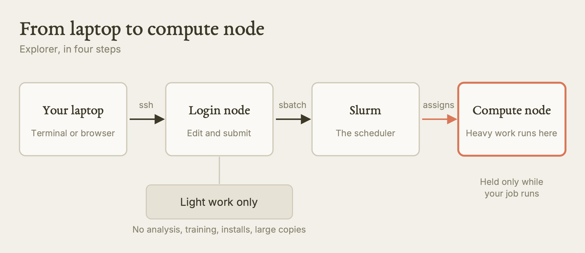
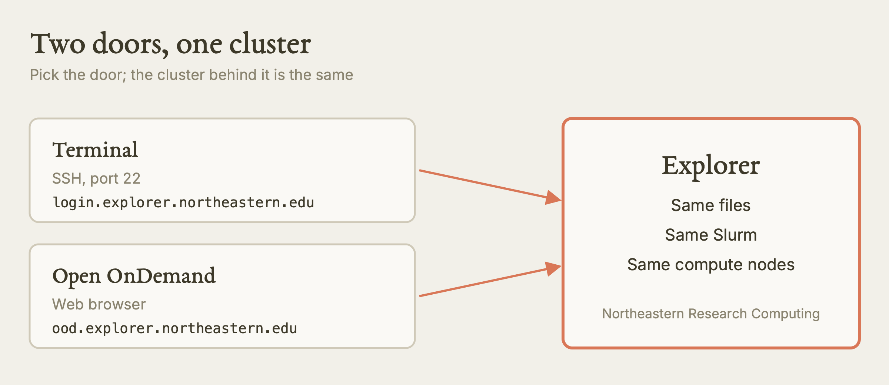
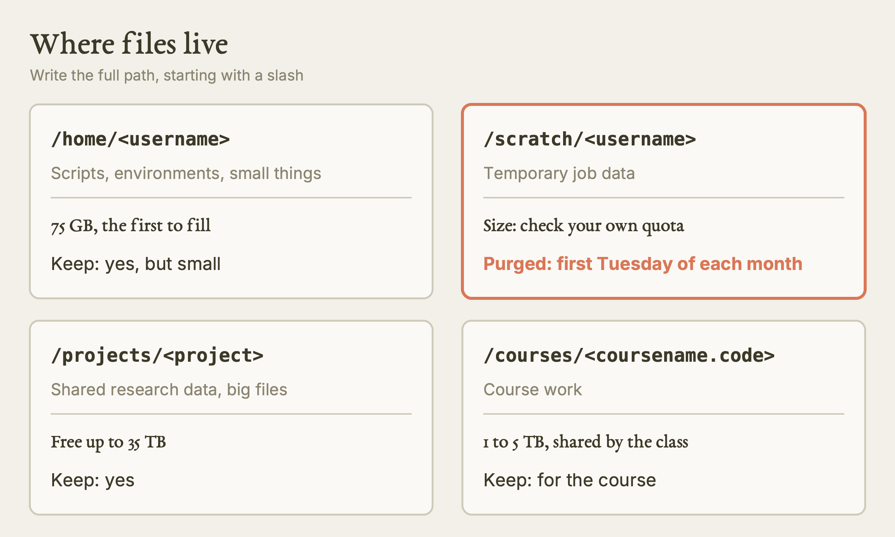
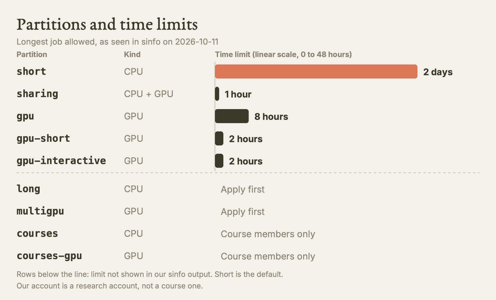
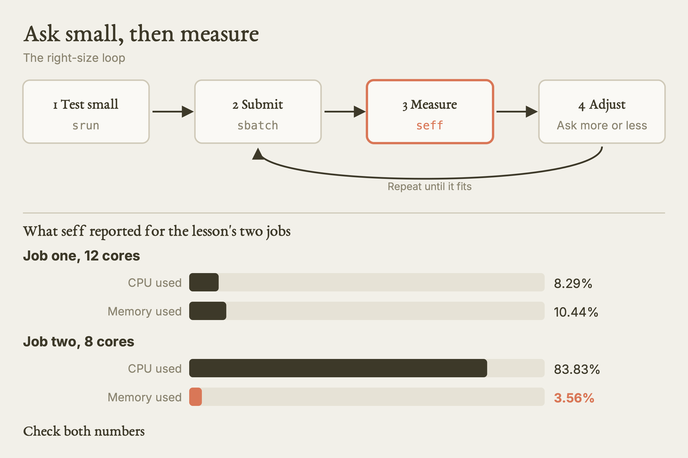

# Intro to Explorer and OOD

This guide teaches a researcher who is new to clusters how Northeastern's Explorer cluster is organised, how to get an account and log in, where files live, how to move data in, how to run and check a job, how to size it, and how software is loaded.

**Watch the film:** https://youtu.be/LIjhb1dokME (unlisted link). Video 3 in the series "Research Computing on Explorer and AICR".

**Based on:** Northeastern University Research Computing's training lesson *Introduction to Explorer and the OOD*, presented by Serena Caplins: https://github.com/northeastern-rc-training/Intro-to-Explorer-OOD-2026. **This is our own rewrite, not a copy.** The structure follows our film; the wording, examples and exercises are ours; we added what we learned using it (real output, corrections, gaps). The original remains the authority; it is © its authors (the repository carries no license).

---

**What this is.** A written walk through the first things you need on Explorer: what a cluster is, how to get in, the four storage areas, how to copy files across, how to run work with `srun` and `sbatch`, how to watch it, how to check what it really used, and how to load software. It covers two front doors: a terminal (SSH) and Open OnDemand (OOD), the web interface at `ood.explorer.northeastern.edu`.

**Why it matters.** Most early trouble on a cluster has one of four causes. People run heavy work on the login node. They leave data on scratch, which is wiped monthly. They ask for far more than they use, so they wait longer than they should. Or they copy a command from a slide that has a typo in it. Each is cheap to avoid once you know it.

**What we found.** We checked the lesson against the live cluster and our own login records on 2026-10-11. The login worked with a password and with an SSH key, and we saw no Duo prompt on SSH (one account, one network). The login name that worked was the UserID shown on the access form, not the email prefix. The partitions and time limits we saw with `sinfo` matched the lesson's table, and the GPU list was much wider than the one card type the lesson names. Explorer has a `python/3.13.5` module and classic Tcl Modules 5.3.0. The lesson's short form of `srun` has a typo, and its sample batch script sets no time or memory. The scratch quota is stated two ways by Research Computing's own pages.

**What is NOT verified.** We ran only read-only commands on a login node. We did not request a compute node, submit a job, copy a file with `scp`, use Open OnDemand, or read any `seff` report of our own. Everything about those is from the source and is marked so. We did not test a different network, off-campus access, Windows, or Linux.

---

## Act I · What A Cluster Is

A cluster is many computers wired together so they can work on problems too big for one desk. You do not run your code on "Explorer" as if it were one big machine. You ask it for a slice of a few machines.

There are two kinds of machine you meet:

| Machine | What it is for | What you must not do there |
|---|---|---|
| Login node | Landing spot. Edit files, look around, submit jobs, read logs. | Run analysis, training, installs, large copies. |
| Compute node | Does the heavy work. You get one, or part of one, on request. | Nothing special; you hold it only while your job runs. |

A scheduler called **Slurm** takes everyone's requests for compute nodes and decides who runs where and when. You talk to it with commands such as `srun`, `sbatch` and `squeue`.



*The path of a job: you land on a login node, Slurm decides, a compute node does the work. Our diagram, drawn for this guide. [SVG](images/cluster-path.svg)*

Facts about Explorer, from the source (not checked by us except where noted):

| Item | Value |
|---|---|
| Run by | Northeastern Research Computing |
| Replaced | the older Discovery cluster |
| Size | about 45,000 CPU cores and more than 525 GPUs |
| Cost | free to Northeastern faculty and students |
| Location | Massachusetts Green High Performance Computing Center, Holyoke, MA |
| Link to campus | 10 Gbps Ethernet |
| Shared storage | 6 PB on a fast file system |
| Between nodes | 10 GbE, or InfiniBand at 100 or 200 Gbps |

We did see that the login node we reached ran Rocky Linux 9.7 and was named `explorer-02` on one call and `explorer-01` on another. So "the login node" is more than one machine, and the name you land on can differ between visits.

## Act II · Getting An Account

A Northeastern login alone does not let you in. Every research user must belong to a storage space owned by a sponsor (a PI or staff member). Storage is free up to 35 TB. So "request access" really means "get added to your sponsor's group".

There are three cases:

| You are | What happens |
|---|---|
| In a lab with a storage space | The PI (or a delegate the PI chose) adds you, or you file the access form and name the sponsor. |
| In a lab with no storage space | The PI requests a storage space first, then adds people. |
| A student in a course | Your instructor applies through the classroom access form. Only the instructor can fill it in. |

**Route A, your sponsor adds you.** There are two ways. With a terminal, the PI or a delegate runs the `project` command on a cluster node. Without one, Research Computing announced an Open OnDemand app on 2026-08-25 called **Managing /projects**; it is under **Files** on the OnDemand dashboard. You give your sponsor your Northeastern username. Changes can take up to 2 hours to spread, and you may need a fresh login before the new group shows.

**Route B, you file the form.** The form is at https://bit.ly/NURC-AccessRequest and needs your university sign-in. Its first screen is pre-filled from your record (name, email, UserID, department) and asks one question: are you requesting a new account, or do you already have access and need to update your sponsor? The wording after that screen we did not capture. How the request is approved, and how long it takes, we do not know. Ask Research Computing at rchelp@northeastern.edu before you promise anyone a date.

**Check that it worked.** After your first login, run `whoami` (your login name) and `groups`. The `groups` line should list your sponsor's project group. If you can log in but the group is missing, your sponsor has not added you yet.

## Act III · Logging In

There are two ways in, and both reach the same cluster. Research Computing's advice is to get comfortable with the terminal. We agree, and the terminal is also the only route an AI agent can use.



*Two doors in, one cluster behind them. Our diagram, drawn for this guide. [SVG](images/two-doors.svg)*

### The terminal

On a Mac, open Terminal. On Windows, install an SSH client such as MobaXterm or PuTTY and point it at the same host on port 22. The command is:

```bash
ssh <username>@login.explorer.northeastern.edu
```

**What worked for us, honestly (2026-10-11, one faculty account, one network):**

1. The first connection asked whether to trust the host. We answered `yes`.
2. It then asked for the Northeastern password. Nothing appears as you type; the cursor does not move. That is normal.
3. It landed us on a login node with a welcome banner. **We saw no Duo prompt on SSH**, with a password or later with a key. Do not take that as a rule for everyone.
4. The login name that worked was the **UserID shown on the access form**, not the first part of the email address. The lesson's own example looks like an email prefix, so formats clearly vary. Try the form's UserID first, then the email prefix. If you changed your password minutes ago, wait a while.

**Key login (what we did after).** A key means you type your password once, not every time. We made an ed25519 key with a passphrase, installed it with `ssh-copy-id`, and unlocked it once into the agent. We also added a short alias block to `~/.ssh/config`. Without the block, `ssh explorer` failed with "Could not resolve hostname explorer", which is exactly what you see if you skip that step. With it in place, this worked with no prompt at all:

```bash
ssh -o BatchMode=yes explorer 'whoami; hostname; pwd'
```

`BatchMode=yes` makes ssh fail at once rather than wait at a password prompt. That matters for scripts and agents. We tested the unlock commands on a Mac only. Research Computing's own Mac page suggests an empty passphrase and an RSA key. We would not: a passphrase protects the key if the laptop is lost.

Never give a password, passphrase or key to anyone, including an AI tool. The researcher unlocks the key in their own terminal.

### Open OnDemand

Open https://ood.explorer.northeastern.edu in a browser. The source says you sign in with your Northeastern username and password and confirm with Duo, then land on the dashboard. **We did not test OnDemand**, so we cannot say what the sign-in looked like for us.

## Act IV · Where Files Live

You have three areas by default, and course members have a fourth:

| Path | Use | Size, from the source | Keep it? |
|---|---|---|---|
| `/home/<username>` | scripts, environments, small things | 75 GB; the first to fill | yes, but small |
| `/scratch/<username>` | temporary job data | 50 TB in the slides (our sources disagree; see the corrections section) | **no: purged on the first Tuesday of each month** |
| `/projects/<project>` | long-term and shared research data, big files, folders of many small files | free up to 35 TB | yes |
| `/courses/<coursename.code>` | course work | 1 to 5 TB, shared by the whole class | for the course |

Course members may not have a `/projects` area.



*The four storage areas, and why scratch is the one to watch. Our diagram, drawn for this guide. [SVG](images/storage-map.svg)*

Three habits:

1. **Write the full path, starting with `/`.** A path like `data/run1` means something different depending on where you stand. `/projects/<project>/data/run1` means one place everywhere.
2. **Watch home.** When home fills you will see "quota exceeded". A full home also stops OnDemand sessions from starting, because OnDemand runs from it.
3. **Never keep the only copy of anything on scratch.** The purge takes all files on that date, not just old ones.

Two commands for looking, both safe:

```bash
ls /projects/<project>/data        # list what is in a folder
cat /home/<username>/notes.txt     # print a short file
```

With an absolute path you can read any file you have permission for, from anywhere on the cluster.

## Act V · Moving Data

Do not move big files through the login node. The lesson uses a separate transfer host for copying from your own computer.

**From your own computer with `scp`.** Run this on your laptop, not on the cluster. First make a small test file, then copy it to your home folder:

```bash
echo "test from my laptop" > hello.txt
scp hello.txt <username>@xfer.discovery.neu.edu:/home/<username>
```

Then log in and run `ls` in your home folder to see it arrive. To land it in a project folder, change the destination to `/projects/<project>/...`. The transfer host still carries the old Discovery name; that is the name in the current docs. **We did not test `scp`.** Key login was only tested against the login host.

If you have many small files, bundle them first with `tar` (or `zip`). One large file moves far faster than ten thousand small ones.

**From the browser with the Files app.** In OnDemand, open **Files**, then **Home Directory**. It starts in your home folder; the **Change directory** button takes you to scratch or projects. **Upload** opens a window where you browse or drag files in. The same app downloads files, edits them, and makes folders.

| Size | Use |
|---|---|
| up to 10 GB per transfer | the Files app |
| more than 10 GB | `scp` |
| very large datasets | Globus |

## Act VI · Running Jobs

Everything so far used the login node and the transfer host. Real computing goes to a compute node. Research Computing says it plainly: no scientific software, no large transfers and no heavy computation on login nodes, because their traffic slows everyone down. Work found there is terminated.

### Interactive: `srun`

`srun` gives you a live shell on a compute node. Run it from a login node.

```bash
srun --pty bash
```

With no flags you get the defaults (from the source): 4 hours, 1 node, 1 task, 2 GB of memory and 2 CPUs on the `short` partition. To ask for more, name it:

```bash
srun --time=6:00:00 --mem=50GB --ntasks=16 --partition=short --pty bash
```

The short forms are `-t`, `-n` and `-p`. Note that memory has no one-letter form in this line:

```bash
srun -t 6:00:00 --mem=50GB -n 16 -p short --pty bash
```

(The lesson prints `--m 50GB --n 16` here. That is a typo; see the corrections section.)

### Partitions

A partition is a named group of nodes with its own limits, usually by time, node count, or CPU versus GPU. Here is the list from the lesson, next to what we saw from `sinfo` on 2026-10-11:

| Partition | Kind | Access | Time limit we saw in `sinfo` |
|---|---|---|---|
| `short` (default) | CPU | everyone | 2 days |
| `sharing` | CPU and GPU | everyone | 1 hour |
| `gpu` | GPU | everyone | 8 hours |
| `gpu-short` | GPU | everyone | 2 hours |
| `gpu-interactive` | GPU | everyone | 2 hours |
| `long` | CPU | apply first | not shown in our output |
| `multigpu` | GPU | apply first | not shown in our output |
| `courses`, `courses-gpu` | CPU, GPU | only if you are in a course | not shown in our output |

We do not know why the last three rows were absent from our output. Our account is a research account, not a course one. Ask Research Computing before assuming a partition exists for you. For `long` and `multigpu`, Research Computing wants to see that you have already optimised your code; apply at https://bit.ly/NURC-PartitionAccess.

Which to choose:

| Your situation | Partition |
|---|---|
| In a course and you have `/courses` | `courses` for CPU, `courses-gpu` for GPU |
| CPU work, not in a course | `short` |
| Quick interactive GPU session | `gpu-interactive` or `gpu-short` |
| GPU batch job | `gpu` |



*Partitions and the longest job each allows, as seen on 2026-10-11. Our diagram, drawn for this guide. [SVG](images/partitions.svg)*

### Asking for a GPU

A GPU is a processor built to do thousands of small calculations at once. It is what deep learning and a lot of modern science run on. You need a GPU partition **and** a `--gres` line:

```bash
srun --partition=gpu-interactive --gres=gpu:v100-sxm2:1 --ntasks=1 --mem=4GB --time=01:00:00 --nodes=1 --pty /bin/bash
```

Name the card (`v100-sxm2` here) and you get that card. Write `--gres=gpu:1` and you get whichever is free first. That is fine for a quick test. For repeated runs, name the type or at least write down which card you got, because speed and memory differ.

The lesson names only the V100. Our `sinfo` on 2026-10-11 listed these card types on the `gpu` partition: `v100-sxm2`, `v100-pcie`, `a100`, `h200` and `t4`. Check yours with `sinfo -p gpu -o "%G"`, and see https://rc.northeastern.edu/compute/ for the table.

### In the browser: an interactive app

In OnDemand, an interactive job is a form. For RStudio you choose the version, partition, hours, CPUs and memory, then press **Launch**. The card goes from Queued to Starting to Running. **Your time starts counting when it is Running**, not when you queued. The card shows the host node, a Cancel button, the time left and a session ID. Cancel it when you finish, so someone else can have the node.

### Unattended: `sbatch`

Most real work runs as a batch job: set up, submitted, and left alone. Test your commands first in an `srun` session or a small batch job. When you know they run and roughly what they need, write a script. Our own example, with the time and memory set (the lesson's sample leaves them out):

```bash
#!/bin/bash
#SBATCH --job-name=first-test
#SBATCH --partition=short
#SBATCH --nodes=1
#SBATCH --ntasks=1
#SBATCH --cpus-per-task=2
#SBATCH --mem=4GB
#SBATCH --time=00:10:00
#SBATCH --output=%x-%j.out

module load anaconda3/2024.06
source activate /projects/<project>/envs/<env>

echo "job $SLURM_JOB_ID on $(hostname)"
python --version
```

Save it as `first-test.sh`, then submit:

```bash
sbatch first-test.sh
```

Slurm replies `Submitted batch job <jobid>`. When the job runs, its output goes to a file named from `--output`. (If you leave `--output` out, the default is `slurm-<jobid>.out`.) Read it with `cat` for a short file, or `less` for a long one; press `q` to quit `less`.

If you do not know how much to ask for, ask for a little and increase when a job dies for memory, CPU or time. A job that asks for more waits longer to start.

The lesson's script also sets `--mail-user` to the presenter's own address. Use yours, or leave the mail lines out.

## Act VII · Checking On A Job

From the terminal:

```bash
squeue -u <username>              # your jobs
squeue -p short | wc -l           # how many lines are in the short queue (busy-ness)
squeue -u <username> --start      # estimated start times for waiting jobs
```

The columns are job ID, partition, name, user, state (`R` is running, `PD` pending), time, node count and node list. The lesson's example printed 518 for the short queue. The count probably includes the header line (inferred).

In OnDemand: **Jobs**, then **Active Jobs**, lists them. **My Interactive Sessions** shows each session with its host node and, in parentheses, a seven-digit Slurm job ID. Give that ID to Research Computing if something goes wrong. Click the **Session ID** link to open the files OnDemand made for the job. `output.log` is the one to read when a session misbehaves, and the one the team asks for in a ticket.

**Tested by us (2026-10-11):** `squeue -u <username>` on the login node returned just the header, because we had no jobs. `squeue` was present at `/usr/bin/squeue`. We did not run `--start`.

## Act VIII · Right-Sizing

The habit that separates a careful user from a wasteful one: ask for close to the minimum, then measure. Every extra core or gigabyte you request is a longer wait for you and fewer resources for others.

After a job **finishes**, run `seff` with its ID:

```bash
seff <jobid>
```

It prints how much of the CPU time and memory you asked for was really used. The lesson shows two reports:

| | Job one | Job two |
|---|---|---|
| Cores | 12 | 8 |
| CPU efficiency | 8.29% | 83.83% |
| Memory used | 5.22 GB of 50 GB (10.44%) | 569 MB of 15.62 GB (3.56%) |
| Wall time | 17 min | 26 min |
| Verdict | asked for far too much | good on CPU, still too much memory |

The lesson calls job two a much better fit. Look at its memory line: it used under 4% of what it requested. A good fit on one number is not a good fit on both.



*Ask small, measure with seff, adjust, repeat. Our diagram, drawn for this guide. [SVG](images/right-size-loop.svg)*

`seff` is present on Explorer at `/usr/bin/seff` (tested). We did not run it on a job. Two other helpers are present: `historical-seff` (past jobs) and `gpu-logs` (GPU use). Both need a compute-node session to run, so we did not run them.

## Act IX · Software

Software on Explorer comes as **modules**. A module makes one program available while loaded, so different projects can use different versions. Load only what you need, since some modules conflict.

```bash
module avail                      # list what exists
module load anaconda3/2024.06     # load one: copy the name and case exactly
```

Do not put `module load` in your `~/.bashrc`. It interferes with OnDemand and hides what your job used. Put the loads inside the job script instead.

**Tested by us:** Explorer uses classic Tcl **Modules 5.3.0**, not Lmod. On 2026-10-11 `module avail` showed, among others: `anaconda3/2024.06`, `miniconda3/24.11.1` and `miniconda3/25.9.1`, `python/3.13.5`, several `cuda` versions (12.1.1 up to 13.2.0), `OpenMPI/4.1.6` and `cmake`. `apptainer` was installed at the system level (version 1.4.5-3.el9). `conda` was **not** on the login PATH until a conda module is loaded.

Beyond modules, three routes. Conda environments hold many kinds of scientific software, not only Python. Containers are supported through Apptainer. And you can build from source. Research Computing has guides for all three at https://rc-docs.northeastern.edu/en/latest/.

**Getting help.** Email rchelp@northeastern.edu, join office hours on Zoom, or book a consultation: https://rc.northeastern.edu/getting-help/. For a ticket about a job, include your username, the job ID, the node, the exact command, the full error text, and for OnDemand the session's `output.log`.

---

## Terms

| Term | Our definition |
|---|---|
| HPC cluster | Many computers wired together to work on one problem. |
| Login node | The machine you land on. Light work only. |
| Compute node | A machine that does heavy work, handed to you on request. |
| Slurm | The scheduler that takes requests for compute nodes and decides who runs where. |
| Partition | A named group of nodes with its own time and size limits. |
| Open OnDemand (OOD) | A website that gives you the cluster in a browser. |

## Try it

1. **Check your login (read-only).** Log in, then run `whoami; hostname; pwd; groups`. You should see your login name, a node such as `explorer-01`, your home path, and a group list that includes your project group. **Tested by us (2026-10-11):** `whoami`, `hostname` and `pwd` returned the login name, `explorer-01` and the home path.
2. **Look at the queue (read-only).** Run `squeue -u <username>`. With no jobs you should see only the header row. **Tested by us (2026-10-11).**
3. **See the partitions (read-only).** Run `sinfo -s`, then `sinfo -p gpu -o "%G"`. You should see `short` marked with `*` as the default, and a list of GPU types. **Tested by us (2026-10-11).**
4. **List the software (read-only).** Run `module avail python`, then `module avail anaconda3`. You should see the version names to copy exactly. **Tested by us (2026-10-11):** `python/3.13.5` and `anaconda3/2024.06` appeared.
5. **Run your first interactive job.** From a login node, run `srun --time=00:10:00 --pty bash`, type `hostname`, then `exit`. The name should be a compute node, not a login node. **From the source, not run by us.**
6. **Submit and measure.** Save the batch script from Act VI, submit it with `sbatch`, read the output file, then run `seff <jobid>` once it finishes. Note both efficiency figures. **From the source, not run by us.**

## What we tested, and what we only read

| Item | Status |
|---|---|
| Password login to the login node (host-key question, then password, no Duo seen) | Tested by us, 2026-10-11 |
| Key login with `BatchMode=yes`, including an emptied agent | Tested by us, 2026-10-11 |
| `whoami`, `hostname`, `pwd`, `squeue -u` | Tested by us, 2026-10-11 |
| `sinfo` partitions, time limits, GPU card types | Tested by us, 2026-10-11 |
| `module avail`, Modules 5.3.0, apptainer version | Tested by us, 2026-10-11 |
| Presence of `sbatch`, `srun`, `seff`, `check-quota`, `project`, `gpu-logs` | Tested by us (present only) |
| Access form first screen | Seen by us, 2026-10-11; the rest not captured |
| `srun`, `sbatch`, `seff` on a real job, defaults, GPU requests | Only read |
| `scp` to the transfer host, Files app, Globus | Only read |
| Open OnDemand sign-in, RStudio form, session cards, `output.log` | Only read |
| Storage sizes and the purge | Only read |

## Where the original is wrong, outdated, or silent

- **Short-form `srun` typo.** The lesson's short line uses `--m 50GB --n 16`. Those are not the flags meant. Use `--mem=50GB` and `-n 16`.
- **The sample batch script sets no `--time` and no `--mem`.** It leans on defaults, which hides what it asked for and makes `seff` harder to act on. Set both every time. It also uses the presenter's email for `--mail-user`.
- **Wrong project path in the `scp` example.** One destination is `/projects/rc/<name>`. The real layout is `/projects/<project>`.
- **Scratch size is disputed.** The lesson says 50 TB. Research Computing's scratch policy page, read the same day, says 20 TB and 20 million files. We could not tell which is newer. Check your own quota rather than quoting either. The file-count limit only appears on the policy page.
- **Purge date has no stated warning.** The first Tuesday of each month is also the maintenance day, when no jobs run. No page we read promises advance notice.
- **GPU list is narrow.** The lesson names only the V100. The live cluster showed five card types, including A100 and H200. The old card types may not run current builds of some tools.
- **Duo.** The lesson says OnDemand needs Duo. That is likely still true, but SSH did not ask for it for us. Neither fact should be generalised.
- **Modules.** The lesson loads `anaconda3/2024.06`; that exists. But Explorer also has `miniconda3` and a `python/3.13.5` module, and uses Tcl Modules, not Lmod. Run `module avail` to see what is there today.
- **`seff` job two.** Described as "a much better fit", though only 3.56% of its memory was used.
- **Silent on agents.** Nothing in the lesson or the policy pages we read says whether automated agent access is allowed. Ask rchelp@northeastern.edu before any unattended use.
- **Dated material.** Our sources are 2026 training slides. The transfer host name and some limits may change.

## Your turn

Paste this into Claude:

> I'm new to a Slurm cluster. Here's what I want to run: [describe your program and data in two sentences]. Tell me which of my files belong in home, scratch and projects; write me an srun command to test it interactively with modest resources; then write the sbatch script for the real run, and tell me which commands I use to check on the job and to read its efficiency afterwards.

Then check two things yourself. Does every path it wrote start with a slash? And did it tell you to test with `srun` before you submit with `sbatch`?

## Sources

- Original lesson: https://github.com/northeastern-rc-training/Intro-to-Explorer-OOD-2026 (Northeastern University Research Computing; presenter Serena Caplins)
- Research Computing documentation: https://rc-docs.northeastern.edu/en/latest/ (connecting, managing projects, transferring data, home quota, scratch purge, conda, containers)
- Research Computing site: https://rc.northeastern.edu/ (partitions, compute hardware, getting help, policies)
- Our film: https://youtu.be/LIjhb1dokME
- Our agent rules: `skills/hpc/HPC.md` (Explorer) and `skills/aicr/AICR.md` (AICR) in this repository
- Our records: `Logging-into-Explorer-with-Claude/SESSION.md`, `Requesting-Access-to-Explorer/README.md`, `films/REAL-OUTPUTS.md`
