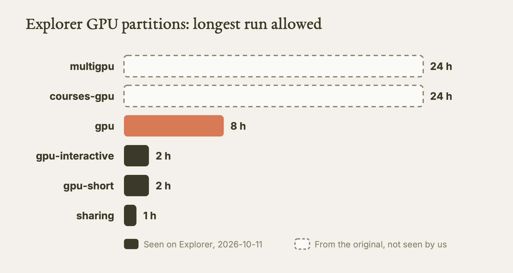
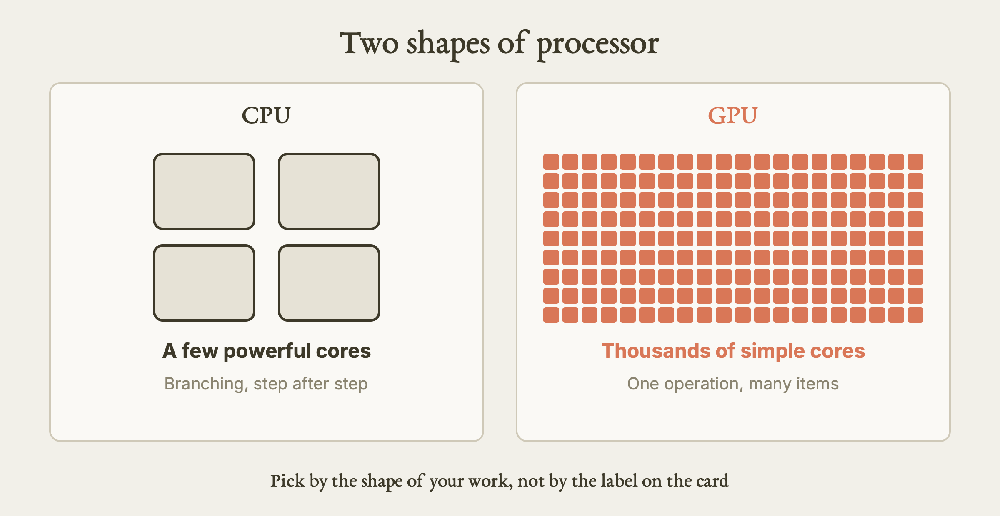
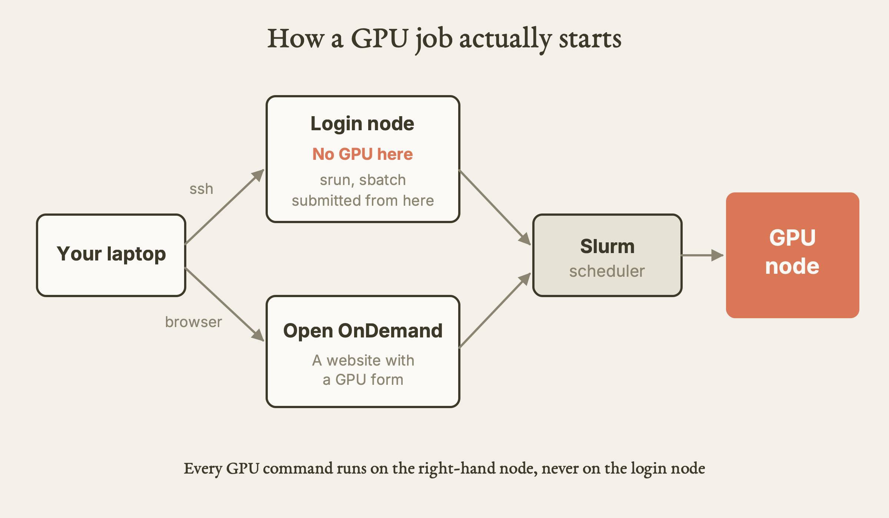
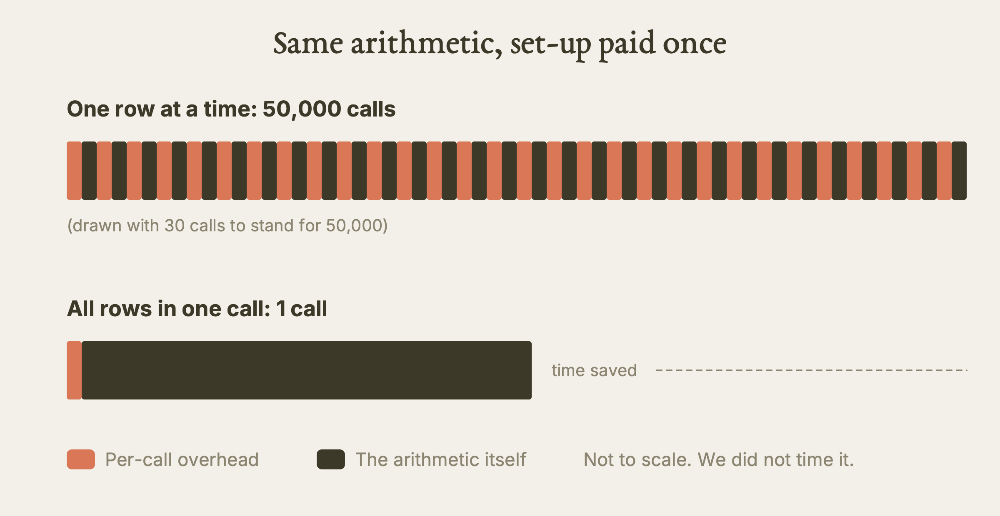
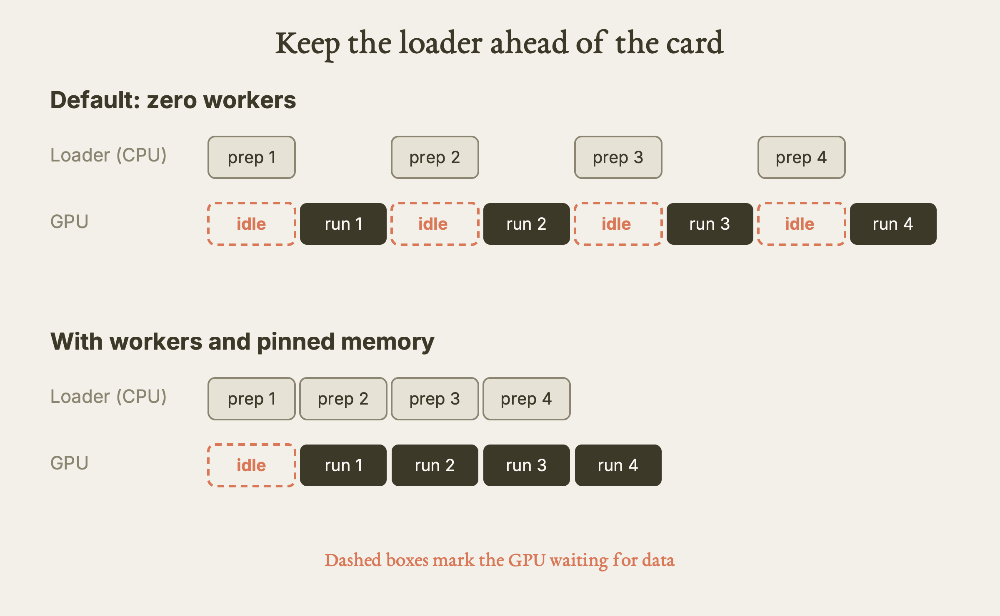

# Intro to GPUs on Explorer

This guide teaches you what a GPU is for, which GPUs Northeastern's Explorer cluster has, the three ways to get one for a job, how to see whether it is working, and two code habits that keep it busy.

**Watch the film:** [Intro to GPUs on Explorer](https://youtu.be/vqe1ILbAuRc), Video 4 of the series "Research Computing on Explorer and AICR" (unlisted link).

**Based on:** Northeastern University Research Computing's training lesson *Introduction to GPUs on Explorer*, presented by Arsalan Akhter: https://github.com/northeastern-rc-training/Intro-to-GPUs-2026. **This is our own rewrite, not a copy.** The structure follows our film; the wording, examples and exercises are ours; we added what we learned using it (real output, corrections, gaps). The original remains the authority; it is © its authors (the repository carries no license).

---

**What this is.** A written lesson for a researcher who has never asked a cluster for a GPU. It covers Explorer only. It follows the order of our film: where the GPUs are, what a GPU is, three ways to get one, what the first working session looks like, how to watch a job, and the habits that stop a GPU from sitting idle.

**Why it matters.** A GPU is scarce and shared. The usual mistakes are quiet ones: asking for a card the code never uses, reading a node label as "GPU free", or running a script that never touched the GPU and calling it a success. Each one costs queue time for you and for everyone behind you.

**What we found.** We checked the lesson's facts against read-only output from an Explorer login node on 2026-10-11. The partition time limits for `gpu`, `gpu-short`, `gpu-interactive` and `sharing` match. The card list for the `gpu` partition matches, with one card family showing a `down*` state. We also found problems in the original's walkthrough: the setup script cannot leave your shell activated, the first check script proves almost nothing, two paths in the batch example only work from the wrong folder, the log folder is never created, and the suggested editor password is a bad idea. Section "Where the original is wrong, outdated, or silent" lists all of them. We also learned that Explorer does have a `python/3.13.5` module and a set of `cuda` modules, which some of the training material says it lacks.

**What is NOT verified.** We never ran a job. We did not open Open OnDemand, request a compute node, run `gpu-logs`, or run any of the demo scripts. Everything about those steps comes from the original, our film, or our rule file, and is labelled as such below. The `gpu-logs` numbers in this guide are the original's recorded example, not ours.

---

## The idea

A GPU is not a faster CPU. It is a different shape of processor: thousands of small, simple processing units that all work at the same moment. That shape wins when your problem is a huge pile of identical little operations. It loses when your problem is a chain of steps where each one depends on the last.

So the question to ask first is not "how do I get a GPU?" It is "is my work the kind of work a GPU is good at?" The film and this guide assume the answer is yes, and show how to ask the cluster for one without wasting it.

The three things to carry out of this guide:

1. Know which partition and which card you need, and check what is free before you submit.
2. Never believe a job used the GPU until something measured it.
3. Feed the card: send data in big batches, and prepare the next batch while the current one runs.

## I. The GPU Partitions

A **partition** is a named group of cluster nodes with its own rules, mainly a maximum run time. Explorer groups its GPU nodes into several. The original names six. This table gives their stated limits and what we could confirm.

| Partition | Intended use (from the original) | Max time (original) | Seen in our `sinfo -s`, 2026-10-11 |
|---|---|---|---|
| `gpu` | General GPU work, batch jobs | 8 hours | Yes, `8:00:00` |
| `gpu-interactive` | Development and testing in Open OnDemand | 2 hours | Yes, `2:00:00` |
| `gpu-short` | Quick tests; jobs here are prioritised | 2 hours | Yes, `2:00:00` |
| `sharing` | GPUs that Northeastern PIs lend to the community | 1 hour | Yes, `1:00:00` |
| `multigpu` | Jobs that need several GPUs; access is by request | 24 hours | Not listed for our account |
| `courses-gpu` | Course work; instructors request access | 24 hours | Not listed for our account |



*Longest run allowed per GPU partition; dashed bars are from the original and were not visible to our account. Our diagram, drawn for this guide. [SVG](images/gpu-partitions.svg)*

We did not see `multigpu` or `courses-gpu` in our listing. We think (inferred) that `sinfo` hides partitions your account cannot use, but we did not test that. Do not write a script for either one until you know you have access. The access page for `multigpu` is linked in Sources.

Two things the original does not say clearly:

- **`sharing` is borrowed hardware.** Use it for short tests, not for your real run.
- **Open OnDemand sessions are meant for `gpu-interactive`.** The original's demo uses `sharing` for the browser session, which caps at one hour. For a longer editing session, `gpu-interactive` is the partition the table describes (inferred from the table, not tested).

### Which cards are in a partition

Ask the scheduler, do not guess. The original's command:

```bash
sinfo -p gpu -o "%G"
```

The `%G` column is the **GRES** list: "generic resources", Slurm's word for the extra hardware you request, here GPUs. Each line is a card type and how many sit in one node. The text in brackets, such as `(S:0-1)`, describes which CPU sockets the cards attach to; you can ignore it at first.

On 2026-10-11 we captured the same information in a slightly different layout. The `gpu` partition held these card types:

| Card name in `--gres` | Cards per node | Node state we saw |
|---|---|---|
| `v100-sxm2` | 4 (some nodes show 3) | complete, drained, mixed, allocated, idle |
| `v100-pcie` | 2 | mixed; one node `down*` |
| `t4` | 4 | idle |
| `a100` | 3 or 4 | mixed |
| `h200` | 8 | mixed |

The partition had 25 nodes in total. Those states are a snapshot and will have changed by the time you read this. The point is the shape: five card families, in different node sizes, in one partition.

### Which cards are free right now

Before you submit, look at what is free. The original gives two commands:

```bash
sinfo -p gpu -O "NodeList,Gres:30,GresUsed:30"
sinfo -n <nodename> --Format="Gres:30,GresUsed:30"
```

The first lists every node with the cards it has and the cards in use. The second checks one node you picked. Compare the two columns: cards total against cards used.

**The trap.** A node labelled `MIXED` does not mean it has free GPUs. That label describes the node's CPUs: some are busy, some are not. Only the "used" GPU column tells you whether a card is free. In our `sinfo -s` summary the numbers `21/2/2/25` are nodes allocated, idle, other and total; they are also about the node, not about its cards.

The original also mentions a **GPU Monitor** app inside Open OnDemand that colours each GPU node as idle, mixed or allocated and shows how many GPU jobs are waiting per card type. Our film shows it from the original's screenshot. We did not open it.

## II. What A GPU Is

A **core** is one unit that executes instructions on its own. A CPU usually has a modest number of powerful cores, built to handle branching and unpredictable work quickly. A **GPU** has thousands of cores, each far simpler, built to do the same operation on many pieces of data at once.



*A few powerful cores against thousands of simple ones. Our diagram, drawn for this guide. [SVG](images/cores-few-vs-many.svg)*

Our own picture: imagine one expert accountant and a hall of five thousand clerks with rubber stamps. Ask for one tricky tax ruling and the accountant wins. Ask for the same stamp on five thousand forms and the hall wins. A GPU is the hall. (The film retells two pictures from the original; this one is ours.)

Work that fits the hall:

- Training and running machine-learning models, which are mostly large matrix arithmetic.
- Simulations that map onto big arrays of numbers.
- Data analysis and visualisation on large arrays.

Work that does not fit: anything where each step needs the result of the one before, anything with lots of branching, and anything small. If your job is small, a faster card does not help. A flat, low usage line on a GPU usually means the work is too small to keep it busy.

## III. Three Ways In

There are three ways to get a GPU on Explorer:

| Way | What it is | Good for |
|---|---|---|
| Open OnDemand | A website. A GPU session is a form you fill in. | Developing in a browser editor |
| Interactive session | `srun` from a terminal gives you a live shell on a GPU node. | Trying things, short runs, debugging |
| Batch job | A script you submit with `sbatch`; it runs when a card is free. | Longer, tuned runs you do not want to watch |

The original's rule of thumb, repeated in its sibling lessons, is to develop interactively and use `sbatch` once the code works and runs long. If a job finishes in under about 30 minutes inside an `srun` session, you do not need `sbatch` for it.



*Every route to a GPU ends on a compute node placed by the scheduler. Our diagram, drawn for this guide. [SVG](images/path-to-gpu-node.svg)*

### Common setup: log in and fetch the example code

All three ways use the same example files. From your own computer:

```bash
ssh <username>@login.explorer.northeastern.edu
cd /scratch/$USER
git clone https://github.com/northeastern-rc-training/Intro-to-GPUs-2026.git
```

The original uses the SSH form of the clone address (`git@github.com:...`), which needs a GitHub key set up on Explorer. The HTTPS form above avoids that (inferred; we did not clone it). Whatever the form, do not type a password or key into an AI assistant while doing this.

Remember that `/scratch` is temporary space that is purged on a schedule. It is fine for a training exercise. Keep anything you cannot afford to lose somewhere else (see `skills/hpc/HPC.md`, Section 7).

**Never run GPU work on the login node.** It has no GPU. We confirmed that `nvidia-smi` is not installed on the Explorer login node we reached on 2026-10-11. You always need a compute node, through one of the three ways above.

## IV. In The Browser

This is the first way: Open OnDemand. We did not run any of it; this section follows the original.

1. Go to `https://ood.explorer.northeastern.edu` and sign in. That sign-in is yours to do by hand.
2. Under Standard Apps, choose **VS Code Server**.
3. The form asks for an editor password, a partition and a number of GPUs. The original chooses `sharing` and `1` GPU and leaves the rest alone. Pick a real password, not a trivial one.
4. Launch. When the session is ready, connect, open the folder you cloned, and open a terminal from the View menu.
5. Run the original's setup script, then **activate the environment yourself** (see the next box).
6. Check that Python comes from the new environment: `which python` should print a path inside the environment folder.
7. Run the smallest test, `python gpu_simple.py`.

What the setup script does, in our words: it uses the system `python3` to create a virtual environment named `gpu_env` in the current folder, upgrades `pip`, and installs `torch`, `torchvision` and `torchaudio` from `requirements.txt`. If the environment already exists, it only activates it.

> **Fix to the original.** Running `./setup_python_env.sh` starts a child shell. Any activation it does ends when the script exits, so your own shell is not activated afterwards. After it finishes, run `source gpu_env/bin/activate` yourself, then check `which python`.

What `gpu_simple.py` does: it prints the value of the environment variable `CUDA_VISIBLE_DEVICES`, then says "GPU successfully allocated by scheduler" if that variable exists, and "No GPU visible" if not. It never touches CUDA or PyTorch.

> **Fix to the original.** That makes it a weak test. A variable can exist while no card is usable, and (per our digest) the variable may be unset in some valid interactive sessions. Treat `gpu_simple.py` as a hint, not proof. Use the PyTorch check in the next section.

## V. Interactive And Batch

### Interactive: `srun`

`srun` runs a command on a compute node; with `--pty bash` it gives you a live shell there. The original's command:

```bash
srun --partition=sharing --gres=gpu:1 --pty bash
```

That asks for one GPU on the `sharing` partition. When the prompt comes back, you are on a compute node. Activate the environment from inside the repository folder, then run the fuller check.

The original's `example1/gpu_test_torch.py` does four things: prints the PyTorch version, prints whether CUDA is available, prints the name of GPU number 0, and creates a three-number tensor on the GPU and prints which device holds it. If there is no GPU, the name line stops the script with an error (inferred from how PyTorch behaves), so this check fails loudly. That is what you want.

A better check, written by us, adds one thing: it moves a tensor to the card and back, and prints the answer.

```python
import torch
print(torch.__version__, torch.cuda.is_available())
x = torch.arange(5.0).cuda()
print(torch.cuda.get_device_name(0), (x * 2).cpu())
```

If this prints a card name and `tensor([0., 2., 4., 6., 8.])`, the card did real work. The original also suggests opening the script in an editor and adding an `nvidia-smi` line to see the card's own report. Type `exit` when you are done so the session ends and the card goes back to the pool.

### Batch: `sbatch`

A batch script is a text file that starts with `#SBATCH` lines. They are Slurm's instructions to the scheduler; the rest is the commands that will run. The original's `example1/submit_job.sh` asks for:

| Line | Meaning |
|---|---|
| `--job-name=gpu_job` | A label |
| `--partition=gpu` | The general GPU partition |
| `--gres=gpu:1` | One GPU of any type |
| `--cpus-per-task=4` | Four CPU cores |
| `--mem=16G` | 16 GB of CPU memory (not GPU memory) |
| `--time=01:00:00` | One hour |
| `--output=logs/%x_%j.out`, `--error=logs/%x_%j.err` | Log files named by job name and job ID |

Then it activates the environment and runs the check. Submit it with `sbatch` and it runs when a card is free; the output lands in the `logs` folder.

Our film shows the script as given. In practice, several things need fixing before it works from the folder the walkthrough uses; they are in the corrections section. The minimum:

```bash
mkdir -p logs                      # before sbatch, not inside the script
sbatch example1/submit_job.sh      # only after fixing the two paths in it
squeue -u $USER                    # watch your job; do not loop on this
```

The repository also contains a shorter script at its top level, `submit_my_job.sh`. It names a card type (`gpu:v100-sxm2:1`), asks for five minutes, and points at the right path for the check script. The walkthrough never mentions it, but it is the better model for a test job.

A smoke-test batch script of our own, which you can adapt (replace `<type>` with a card name from `sinfo`):

```bash
#!/bin/bash
#SBATCH --job-name=gpu_check
#SBATCH --partition=gpu-short
#SBATCH --gres=gpu:<type>:1
#SBATCH --cpus-per-task=4
#SBATCH --mem=16G
#SBATCH --time=00:10:00
#SBATCH --output=logs/%x_%j.out
echo "job $SLURM_JOB_ID on $SLURMD_NODENAME, GPUs: $CUDA_VISIBLE_DEVICES"
source gpu_env/bin/activate
python check_gpu.py
nvidia-smi
```

Naming the card type matters. A bare `--gres=gpu:1` can land you on a different card from the one you expected.

## VI. Watching The GPU

Two tools, one during a job and one after.

**During.** Put `nvidia-smi` in your script so its report lands in the log. It shows the card name, how much of the card's memory is in use, and a utilisation figure. (If you are sitting in an interactive session, a second terminal running `watch -n 1 nvidia-smi` gives a live view. Do not leave a watch running unattended through an automated tool.)

**After.** `gpu-logs <jobid>` prints a minute-by-minute record of GPU memory and utilisation for a finished job. It exists on Explorer (we confirmed the command is installed on the login node; we did not run it, because it needs a compute node). The original shows one real example, which we reproduce in outline only:

| Time in the record | GPU memory | GPU utilisation |
|---|---|---|
| First five minutes | 0% | 0% |
| Next stretch | 22.56%, then 77.98% | 0% |
| End of the record | 81.1% | 56% |

The lesson from this table: memory filled first, utilisation stayed at zero for a long time, and only at the end did it reach 56%. For most of the job, the card was holding data and doing nothing. Our reading (inferred) is that the model and data were being loaded and prepared while the card waited.

The original does not explain the "Activity" column in the same output, which still says `inactive` while utilisation shows 56%. We do not know what that column means. Do not rely on it.

**Reading the two numbers.** Memory is how much of the card's memory is allocated. Utilisation is how busy it was. They are independent:

| Memory | Utilisation | What it usually means |
|---|---|---|
| Low | Low | The card sits empty; look at your data pipeline |
| High | Low | Model loaded but not fed; the most common problem |
| Low | High | Healthy; you can try a bigger batch |
| High | High | Good |

After any job, also run `seff <jobid>`. It shows how many CPU cores you actually used and how much memory, so your next request can be smaller.

## VII. Using It Well

Two habits cover most of the waste. Both are about feeding the card.

### Habit 1: batch your data

Every call to the GPU has a fixed cost. If you send one row at a time, you pay it once per row. The original's example does this 50,000 times with a small neural-network layer; the fix sends all 50,000 rows in one call. The arithmetic is the same, so the answer is the same; the overhead is paid once.



*One row per call pays the set-up cost every time; one big call pays it once. Our diagram, drawn for this guide. [SVG](images/batching.svg)*

Here is our own version of the comparison, with the timing details done properly:

```python
import time, torch
dev = "cuda"
model = torch.nn.Linear(2048, 2048).to(dev)
rows = torch.randn(50000, 2048, device=dev)   # data made once, on the card

def timed(fn):
    fn(); torch.cuda.synchronize()            # warm-up, then clear the queue
    t = time.time(); fn(); torch.cuda.synchronize()
    return time.time() - t

with torch.no_grad():
    one_by_one = timed(lambda: [model(rows[i:i+1]) for i in range(50000)])
    all_at_once = timed(lambda: model(rows))
print(one_by_one, all_at_once)
```

We did not run this. We expect the second number to be much smaller, but we make no promise about how much, and the size depends on the card. The second call also needs memory for 50,000 rows; at 2048 values of 4 bytes each, that is about 410 MB for the input alone.

### Habit 2: keep the loader ahead of the card

When training, a **DataLoader** prepares batches on the CPU. With the default of zero workers, the same process prepares a batch, then waits while the GPU uses it, then prepares the next. The card idles during preparation. The fix has three parts:

| Setting | What it does |
|---|---|
| `num_workers=N` | N extra processes prepare batches in parallel |
| `pin_memory=True` | Puts batches in a memory area that copies to the card faster |
| `.to("cuda", non_blocking=True)` | Lets the copy overlap with other work |



*With zero workers the card waits for every batch; with workers it does not. Our diagram, drawn for this guide. [SVG](images/loader-vs-gpu.svg)*

How many workers? Our rule file says set `num_workers` to your `--cpus-per-task` minus one, and ask for at least 4 CPUs. The original's example uses 2 workers, and a comment in its own script says 4; the numbers do not agree with each other, so treat both as examples. If you add workers, make sure your job asked for the cores to run them.

## VIII. Habits

The original ends with four habits. We keep all four and add what we learned.

1. **Choose the right partition.** `gpu-short` for quick tests (prioritised), `gpu` with `sbatch` for long runs, `sharing` for brief tests only.
2. **Ask for only what you need, and learn it from a finished job** with `seff <jobid>`.
3. **Use libraries built for GPUs** (the CUDA and cuDNN libraries, usually through PyTorch) rather than writing your own GPU code.
4. **Profile before you optimise.** Measure first, then change one thing, then measure again.

Add three of ours, all from our rule file:

5. **Verify the GPU did the work.** A job that finishes without error may have run on the CPU. Check the device name and move a tensor, as above.
6. **Ask for one GPU first.** More cards only help code written to use them, and only once one card is busy. A plain single-GPU script given four cards uses one and wastes three.
7. **End interactive sessions when you finish.** Our rule file says Explorer cancels GPU jobs that sit idle: an email after about 15 minutes of low use, cancellation after about an hour. That comes from public pages we read, not a test, and the exact threshold is not published.

Stuck? Email rchelp@northeastern.edu, go to office hours, or book a consultation with the Research Computing team. Do not guess limits or policies; ask.

---

## Terms

- **Core:** one processing unit that runs instructions on its own.
- **GPU:** a chip with thousands of small cores for parallel work.
- **Partition:** a named group of cluster nodes with its own limits, such as a maximum run time.
- **GRES:** generic resources, Slurm's name for extra hardware such as GPUs. It is what you request with `--gres`.
- **`srun`:** the command that runs something on a compute node; with `--pty bash` it gives you a live shell there.
- **`sbatch`:** the command that submits a script to run later without you.

## Try it

1. **See the partitions and their limits. Tested by us (2026-10-11).** On the login node, run `sinfo -s`. You should see `gpu` at `8:00:00`, `gpu-short` and `gpu-interactive` at `2:00:00`, and `sharing` at `1:00:00`. Read the `A/I/O/T` column as nodes, not cards.
2. **List the cards in the `gpu` partition. Tested by us (2026-10-11), in a similar layout.** Run `sinfo -p gpu -o "%G"` (the exact flag is from the source; we captured the same GRES data with a different format string). You should see lines like `gpu:h200:8` and `gpu:t4:4`. Count how many card families there are.
3. **Prove the login node has no GPU. Tested by us (2026-10-11).** Run `command -v nvidia-smi || echo missing`. On the login node we reached it printed that the command is missing. This is why every GPU command needs a compute node.
4. **Find the monitoring commands. Tested by us (2026-10-11).** Run `command -v seff gpu-logs`. Both exist on the login node. Do not run `gpu-logs` here; it needs a job ID and a compute node.
5. **Run the two-line GPU check in a live session. From the source, not run by us.** After `srun --partition=sharing --gres=gpu:1 --pty bash`, activate your environment and run the tensor check from section V. You should see a card name and `tensor([0., 2., 4., 6., 8.])`. Then type `exit`.
6. **Time batching properly. From the source, not run by us.** In the same session, run our timing snippet from section VII. You should see the one-row-at-a-time number far above the single-call number. Write both down; do not trust one run.

## What we tested, and what we only read

| Item | Status |
|---|---|
| Partition names and max times for `gpu`, `gpu-short`, `gpu-interactive`, `sharing` | Tested, read-only `sinfo`, 2026-10-11 |
| GPU card types in the `gpu` partition | Tested, read-only `sinfo`, 2026-10-11 |
| `nvidia-smi` absent on the login node; `seff` and `gpu-logs` present | Tested, 2026-10-11 |
| Modules `python/3.13.5`, several `cuda/*` on Explorer | Tested (module listing), 2026-10-11 |
| `multigpu`, `courses-gpu` limits | Read only; not visible to our account |
| Open OnDemand form and GPU Monitor app | Read only |
| `srun` session, `sbatch` job, all repo scripts | Read only; never run |
| `gpu-logs` output | The original's example; not ours |
| Batching and DataLoader speed-ups | Read only; no timing by us |

## Where the original is wrong, outdated, or silent

These come from reading the repository's scripts and from our real output. We say what we would do instead.

| Issue | What we would do |
|---|---|
| The setup script is run as `./setup_python_env.sh` "to activate the environment". A script run that way cannot activate your shell. | Run it, then `source gpu_env/bin/activate`, then check `which python`. |
| The setup script installs PyTorch, a large download, and the walkthrough runs it from a normal terminal. | Run installs only inside a compute-node session, never the login node (our rule file, Section 1). |
| `gpu_simple.py` only tests whether an environment variable exists. | Use a check that asks PyTorch for the card and moves a tensor. |
| The interactive step changes into `/scratch/$USER`, but the clone lives one folder deeper, so `./setup_python_env.sh` and `example1/...` are not found there. | `cd` into the cloned folder first. |
| `example1/submit_job.sh` runs `python gpu_test_torch.py`, but the file is in `example1/`, and it activates `gpu_env` by a relative path. The walkthrough submits it from the repo root. | Use `python example1/gpu_test_torch.py`, or submit from inside `example1/` with the environment path corrected. The top-level `submit_my_job.sh` has the right path. |
| The same script writes logs to `logs/`, which nothing creates. | `mkdir -p logs` before `sbatch`. Slurm opens the output file before the script body runs, so a `mkdir` inside the script is too late (inferred from Slurm behaviour). |
| It uses a bare `--gres=gpu:1`. | Name the card type when it matters, as `submit_my_job.sh` does. |
| It asks for one hour for a script that prints a few lines. | A short `--time` (five minutes) for a smoke test, so it schedules sooner. |
| The OOD step suggests the editor password `123`. | Use a real password. |
| The clone uses an SSH address that needs a GitHub key on the cluster. | Use the HTTPS address if the repository is public (we did not test). |
| The batching and loader examples time more than the thing they claim to. In the first, the "naive" loop also builds random data on the CPU and copies it every time; neither version warms up or syncs before starting the clock. | Warm up, synchronise before and after timing, and build the data once, as in section VII. |
| The loader example says 2 workers while the repo's comment says 4, and the CIFAR scripts time only 40 batches. | Treat as illustrative; set workers from your CPU request. |
| Some Explorer training material says the cluster has no `python` module. | On 2026-10-11 Explorer listed `python/3.13.5` and `cuda/12.1.1`, `12.3.0`, `12.8.0`, `13.2.0`. A venv with the PyTorch wheels still works without CUDA modules (documented, not run by us). Run `module avail` to see today's list; the cluster uses classic Environment Modules 5.3.0. |
| The card list in some sibling material mentions only V100 and A100. | `sinfo` shows `v100-sxm2`, `v100-pcie`, `t4`, `a100` and `h200`. The H200 is never discussed. |
| `multigpu` and `courses-gpu` limits are given as fact. | Only what the original says; we could not see these partitions. Confirm access first. |
| `gpu-logs` "Activity" column is unexplained. | Do not rely on it. |
| Silent about idle-GPU cancellation, about `--mem` being CPU memory and not GPU memory, and about what to do when `CUDA_VISIBLE_DEVICES` is unset. | See sections VI and VIII and our rule file. |

## Your turn

Paste this into Claude: Here is a PyTorch loop I run on a GPU: [paste it]. First, tell me whether it processes samples one at a time or in batches, and rewrite it to batch if it doesn't. Second, write the DataLoader line with workers and pinned memory. Third, write me the Slurm srun command for a one-hour test on one GPU and the sbatch script for the real run. Then check two things yourself. Did it keep the arithmetic identical when it batched? And did it ask for only one GPU?

## Sources

- Original lesson and code: https://github.com/northeastern-rc-training/Intro-to-GPUs-2026 (presenter Arsalan Akhter; Northeastern University Research Computing).
- Northeastern Research Computing documentation: https://rc-docs.northeastern.edu/en/latest/index.html
- Multigpu partition access: https://rc-docs.northeastern.edu/en/latest/gpus/multigpu-partition-access.html
- Research Computing help and office hours: https://rc.northeastern.edu/getting-help/ and rchelp@northeastern.edu
- Our film: https://youtu.be/vqe1ILbAuRc (Video 4, "Research Computing on Explorer and AICR", unlisted link)
- Our agent rules: `skills/hpc/HPC.md` (Explorer) and `skills/aicr/AICR.md` (the AICR cluster, not covered here)
- Our read-only captures: `films/REAL-OUTPUTS.md`, 2026-10-11
