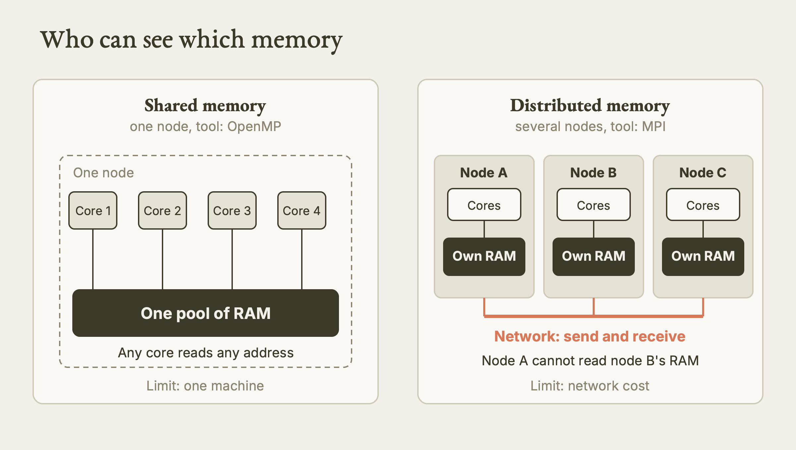
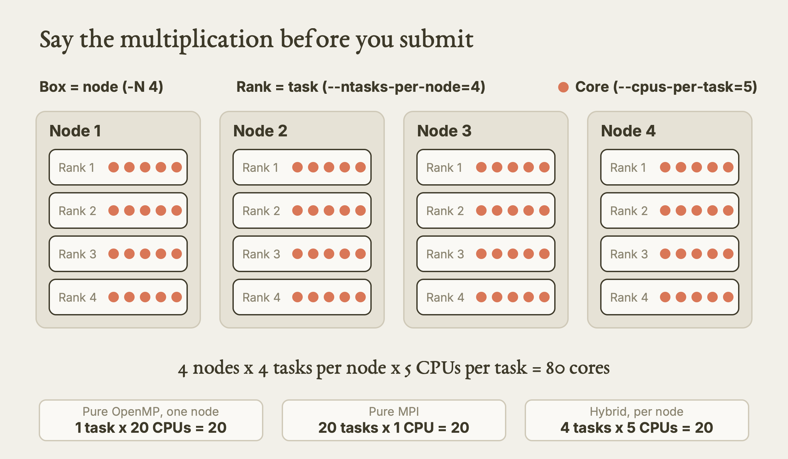
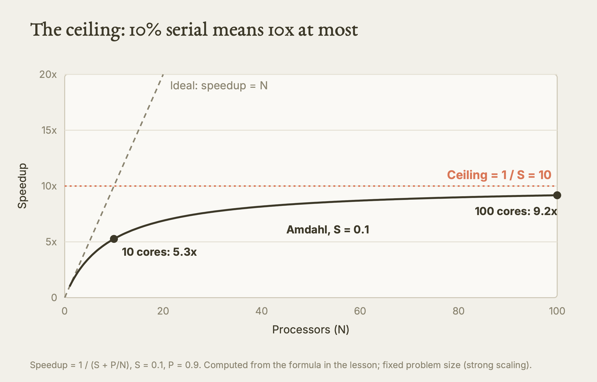
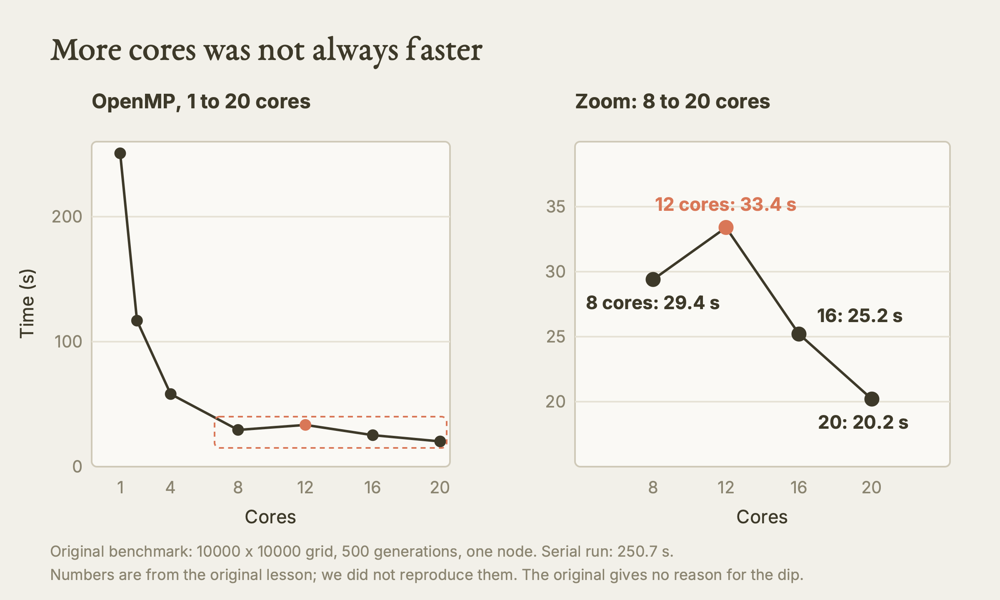
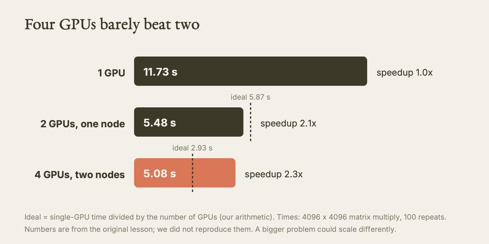

# Intro to Parallel Computing

This lesson teaches you how work gets split across cores, nodes and GPUs, why doubling the hardware rarely doubles the speed, and how to turn a choice of method into the right Slurm request.

**Watch the film:** https://youtu.be/IEIEL4jZhjQ (Video 5 of "Research Computing on Explorer and AICR"; unlisted link).

**Based on:** Northeastern University Research Computing's training lesson *Introduction to Parallel Computing*, presented by Ghanghoon "Will" Paik: https://github.com/northeastern-rc-training/Intro-to-HPC-Scaling-Parallel-Computing-2026. **This is our own rewrite, not a copy.** The structure follows our film; the wording, examples and exercises are ours; we added what we learned using it (real output, corrections, gaps). The original remains the authority; it is © its authors (the repository carries no license). Its sample code (C++, CUDA, PyTorch) is in that repository; we describe it here in our own words and do not copy it.

---

**What this is.** A written lesson on parallel computing for researchers who are not computing experts. It covers the four kinds of parallel machine, shared versus distributed memory, the two scaling laws, a real benchmark on a CPU cluster, how a GPU program runs, how PyTorch uses one or many GPUs, and the parallel tools in Python, R and MATLAB. Each choice ends in a Slurm request you can read and check.

**Why it matters.** "More cores" is the most common wrong answer to a slow job. The serial part of your code and the cost of processors talking to each other set a limit that hardware cannot beat. A request that asks for 20 cores when the code can use 1 wastes your allocation and your queue time, and nothing warns you. Knowing the limit first lets you ask for the right amount, or decide that parallel is not the answer.

**What we found.** We ran read-only checks on the Explorer and AICR login nodes on 2026-10-11 and read the original against our own rule files. Three things differ from the original. The original's benchmark shows 12 OpenMP threads slower than 8, which contradicts its own remark that single-node scaling "should be efficient"; we say so and show the arithmetic. Its hybrid MPI job names a program (`life_mpi_omp`) that is not in its code repository, and it shows no compiler or MPI module line; we list what the two clusters actually offer. Its PyTorch job scripts use the `miniconda3` module and a bare `--gres=gpu:1`, which our Explorer rules supersede. We also added a "is parallel even the answer" check that the original does not contain.

**What is NOT verified.** We submitted no job and requested no compute node. The benchmark numbers, every Slurm header below and every code behaviour are from the original or from documentation, not reproduced by us. We did not build or run any of the sample programs. What we did test is limited to login-node facts: which commands, modules and partitions exist (see the table near the end).

---

## Act I. Why go parallel

Simulations, data processing and model training all hit the same wall sooner or later: one core is not fast enough. Parallel computing splits the work over several processing units so it finishes sooner.

Take three loads of laundry, each needing wash, dry and fold. Count time in steps.

| Plan | What happens | Steps for 3 loads |
|---|---|---|
| Serial | One load at a time, start to finish | 9 |
| Pipelined (task parallelism) | While load 1 dries, load 2 washes | 5 |
| Data parallel | Three washers and three dryers, all loads at once | 3 |

The first column of ideas matters later. Pipelining keeps each machine busy by overlapping different stages. Data parallelism applies the same stages to different pieces of data at the same time. Almost everything in this lesson is data parallelism: cut a large problem into small ones and solve them together.

## Act II. Four kinds of parallel machine

Computer scientists sort machines by two questions: is there one instruction stream or many, and is there one data stream or many? The four answers have four-letter names.

| Name | Instructions | Data | Where you meet it |
|---|---|---|---|
| SISD | One | One | An ordinary single core |
| SIMD | One | Many | A GPU, or vector instructions: one operation over many values |
| MISD | Many | One | Rare; some fault-tolerant hardware |
| MIMD | Many | Many | A cluster of nodes, each working on its own data |

Two of these matter for research work. SIMD is what a GPU does. MIMD is what you get when you spread tasks over several nodes.

## Act III. Shared and distributed memory

How processors reach memory decides which tool you use.

| | Shared memory | Distributed memory |
|---|---|---|
| Where | The cores of one node | Several nodes |
| Memory | One pool of RAM; any core can read any address | Each node has its own RAM; node A cannot read node B's |
| Moving data | Automatic, you do not copy it | You send and receive it over the network yourself |
| Standard tool | OpenMP | MPI (Open MPI, Intel MPI, MPICH) |
| Limit | The cores and RAM of one machine | Network cost |

Shared memory is easier to program. Distributed memory is what lets you grow past one machine. Many real codes are hybrid: MPI between nodes and OpenMP threads inside each node.



*Shared memory versus distributed memory, side by side. Our diagram, drawn for this guide. [SVG](images/shared-vs-distributed-memory.svg)*


### The two Slurm numbers

Slurm has two options that people confuse. They describe different things, and they multiply.

| Option | What it sets | Typical use |
|---|---|---|
| `--ntasks` or `--ntasks-per-node` | How many separate processes (MPI ranks) | Work spread over nodes |
| `--cpus-per-task` | How many cores each process may use | Threads inside one process (OpenMP) |

Total cores = nodes x tasks per node x CPUs per task. Say that sum out loud before you submit.

| Style | `--ntasks` | `--cpus-per-task` | Cores |
|---|---|---|---|
| Pure OpenMP (one node) | 1 | 20 | 20 |
| Pure MPI | 20 | 1 | 20 |
| Hybrid, per node | 4 | 5 | 20 |

A worked case: 4 nodes, 4 tasks per node, 5 CPUs per task is 4 x 4 x 5 = 80 cores.



*Nodes times tasks times CPUs per task, for the hybrid request. Our diagram, drawn for this guide. [SVG](images/nodes-ranks-cores.svg)*


Two rules follow, and neither is stated this way in the original (the first is inferred from how the options are defined).

1. Do not request cores the code cannot use. A single-threaded program with `--cpus-per-task=20` leaves 19 cores idle. A program that is not written for MPI should never get more than one node or more than one task. Slurm hands you the resources and nothing in your code touches them.
2. Take worker counts from the allocation, not from a number you typed. For OpenMP use `export OMP_NUM_THREADS=$SLURM_CPUS_PER_TASK`.

## Act IV. The speed limit

Not all work can be split. Reading input, writing the final result, and any step that needs the previous step's answer stay serial.

**Amdahl's law.** Let S be the serial fraction, P = 1 - S the parallel fraction, and N the number of processors.

```
Speedup = 1 / (S + P/N)
```

If S = 0.1, the speedup can never pass 10, no matter how large N gets. Check it: as N grows, P/N goes to zero and the formula approaches 1/0.1 = 10.

Amdahl's law fixes the problem size and asks how much faster the same job gets. That is **strong scaling**. The curve always flattens.



*Amdahl speedup for S = 0.1, computed from the formula above. Our diagram, drawn for this guide. [SVG](images/amdahl-ceiling.svg)*


**Gustafson's law** asks a different question: what if the problem grows with the number of cores?

```
Speedup = S + P x N
```

Given 100 cores, you will not finish a 10-minute job in 6 seconds. You will solve a problem about 100 times larger in roughly the same 10 minutes. That is **weak scaling**, and it is how much real HPC work is done. Both laws are correct; they answer different questions.

Before requesting cores, ask yourself which you want: the same job faster, or a bigger job in the same time? Size the request to that answer.

One more rule: plan for parallelism before you write the code. Turning a finished serial program into a parallel one is usually painful and inefficient.

## Act V. A real case: the Game of Life

Conway's Game of Life is a grid in which each cell's next state depends on its eight neighbours. Inside a single time step every cell can be computed independently of every other cell. That makes it a clean test case for parallel methods.

### Serial baseline

One core walks the grid row by row. This is the reference time.

### OpenMP: shared memory

With OpenMP you add one line above the loop, a compiler directive. The directive `#pragma omp parallel for collapse(2)` tells the compiler to treat the two nested loops as one pool of iterations and divide it among threads. The compiler creates and manages the threads.

The matching Slurm request, as the original shows it:

```bash
#SBATCH -p short
#SBATCH -N 1
#SBATCH --ntasks=1
#SBATCH --cpus-per-task=20

export OMP_NUM_THREADS=$SLURM_CPUS_PER_TASK
./my_openmp_program <arguments>
```

One node, one process, twenty cores, and the thread count read from what Slurm granted.

### MPI plus OpenMP: distributed memory

When the grid will not fit in one node's memory, or you need more cores than one node has, you split the grid across nodes. This is **domain decomposition**: cut the grid into horizontal strips, one strip per MPI rank.

A cell on a strip's edge needs its neighbour's row, which lives on another rank. So before every time step, neighbouring ranks swap their boundary rows using `MPI_Send` and `MPI_Recv`. The borrowed rows are called the **halo** or ghost zone. That swap is communication, and communication costs time.

The hybrid request from the original:

```bash
#SBATCH -p long
#SBATCH -N 4
#SBATCH --ntasks-per-node=4
#SBATCH --cpus-per-task=5

export OMP_NUM_THREADS=$SLURM_CPUS_PER_TASK
mpirun -np $SLURM_NTASKS ./my_hybrid_program <arguments>
```

That is 80 cores. Note the `-p long` partition: on Explorer, do not write scripts for `long` until you have confirmed you have access.

### The benchmark

The original timed a 10000 x 10000 grid for 500 generations. The grid size is fixed, so this measures strong scaling. Efficiency in the last column is speedup divided by cores, our arithmetic.

| Setup | Cores | Time (s) | Speedup | Efficiency (ours) |
|---|---|---|---|---|
| Serial | 1 | 250.7 | 1.0x | 100% |
| OpenMP | 2 | 116.8 | 2.2x | about 107% |
| OpenMP | 4 | 58.1 | 4.3x | about 108% |
| OpenMP | 8 | 29.4 | 8.5x | about 107% |
| OpenMP | 12 | 33.4 | 7.5x | about 63% |
| OpenMP | 16 | 25.2 | 10.0x | about 62% |
| OpenMP | 20 | 20.2 | 12.4x | about 62% |
| MPI + OpenMP | 40 (2 nodes) | 10.0 | 25.1x | about 63% |
| MPI + OpenMP | 60 (3 nodes) | 6.8 | 36.9x | about 61% |
| MPI + OpenMP | 80 (4 nodes) | 5.7 | 44.0x | about 55% |



*The original benchmark times for 1 to 20 OpenMP cores, with the 12-core dip highlighted. Our diagram, drawn for this guide. [SVG](images/openmp-12-slower-than-8.svg)*


What to take from it:

- Going from 2 to 8 cores is close to ideal. (Efficiency above 100% for a few rows is a hint that the baseline or timing has noise or a cache effect. The original does not explain it.)
- **12 cores were slower than 8.** More is not always faster. The original gives no reason. The practical lesson is the same either way: try two or three core counts on a short slice before you fix the real request.
- Across nodes, communication cost appears and the curve falls under the ideal line.
- Two printed speedups are rounded generously: 250.7 / 116.8 is 2.15 and 250.7 / 25.2 is 9.95.

## Act VI. GPU computing

A CPU is built for low latency: tens of complex cores, good at sequential logic and branches. A GPU is built for throughput: thousands of simple cores doing the same operation on a large array.

| | CPU | GPU |
|---|---|---|
| Aim | Low latency | High throughput |
| Cores | Tens, complex | Thousands, simple |
| Best at | Sequential logic, branching | One operation over big arrays |

A GPU is therefore the right tool only when the work is the same operation over a lot of data. Sequential, branchy or tiny work belongs on a CPU.

### The four steps of a GPU program

Every CUDA program, whether you write it or a library does, follows the same shape. The host is the CPU; the device is the GPU.

1. Allocate memory on the device.
2. Copy the input data from host to device.
3. Launch a kernel: a function that thousands of threads run at once, each on different data.
4. Copy the results from device to host.

In the original's matrix-multiply example, each thread works out its own row and column from its block and thread indices and computes exactly one element of the result. A 1024 x 1024 result means 1,048,576 threads, in parallel.

You will probably never write CUDA. PyTorch, CuPy and RAPIDS call tuned kernels for you. We recommend that a non-expert never hand-write a kernel. Knowing the four steps still helps you understand why moving data between CPU and GPU is a cost.

## Act VII. Scaling machine learning with PyTorch

### One GPU

Create your tensors on the device and call the operation. PyTorch launches the CUDA kernels. In the original's example two 4096 x 4096 matrices are filled with random numbers on the device and multiplied.

The original's request is:

```bash
#SBATCH -N 1
#SBATCH --gres=gpu:1
#SBATCH --partition=gpu

module load miniconda3
source activate pytorch_env
python single_gpu.py
```

For Explorer, our rules differ in three ways. Name the GPU type (a bare `gpu:1` can land on a different card with different memory). Set `--cpus-per-task`, `--mem` (this is CPU RAM, not GPU memory), `--time` and `--partition` explicitly rather than relying on defaults. And do not assume the `miniconda3` route: the Explorer GPU optimisation material uses a virtual environment instead (see "Where the original is wrong"). On AICR the partition fixes the GPU type and you use different environment commands; see the AICR rules file.

### Several GPUs on one node

To use more than one GPU in one process, split one large operation. The original partitions matrix A by rows, gives each GPU its row block and a full copy of B, launches a multiply on each device, then waits for every device to finish. Kernel launches are asynchronous, so the program must synchronise each device before it reads results or stops the clock. The request asks for two GPUs on the `multigpu` partition. On Explorer, do not write scripts for `multigpu` until you have confirmed access.

A trap: if you request `--gres=gpu:2` but run a plain single-GPU script, only the first GPU does anything. The other sits idle. Check that the code is written for more than one device first.

### Several nodes: Distributed Data Parallel

For training across nodes PyTorch uses Distributed Data Parallel (DDP). Four terms:

| Term | Meaning |
|---|---|
| Backend | The communication library. `nccl` is NVIDIA's, the GPU counterpart to MPI |
| World size | Total number of GPUs across all nodes |
| Rank | A GPU's unique ID across the whole job |
| Local rank | A GPU's index inside its own node |

The original's communication test works like this. Every process sets its device from its local rank, joins the process group with the `nccl` backend, and creates a tensor holding 1. Then an `all_reduce` with sum adds the values from all GPUs and shares the answer with everyone. If the result equals the world size, every GPU is talking to every other.

Note that DDP keeps a full copy of the model on every GPU. It speeds up training; it does not help a model that is too big for one GPU's memory.

The original shows the concepts and a benchmark, but no multi-node launch script. We do not have one either, so we do not give one.

### GPU benchmark

A 4096 x 4096 matrix multiply, 100 times:

| Setup | GPUs | Time (s) | Speedup |
|---|---|---|---|
| Single GPU | 1 | 11.73 | 1.0x |
| Multi-GPU, one node | 2 | 5.48 | 2.1x |
| Multi-node | 4 (2 nodes) | 5.08 | 2.3x |

Two GPUs on one node is near linear. Going to four GPUs over two nodes barely helps: at this size each GPU gets a small piece, and synchronising across the network costs more than the maths it saves. The ratio of computation to communication decides how far a job can scale. A bigger problem could behave differently.



*The original GPU benchmark times against the ideal. Our diagram, drawn for this guide. [SVG](images/gpu-benchmark-bars.svg)*


Our rule on top of this: do not ask for more than one GPU until a single-GPU run keeps that GPU busy. Multi-GPU multiplies whatever efficiency you already have. A job at 20% single-GPU use becomes a four-GPU job at 20% use, with four times the allocation. If the job is slow because of data loading, more GPUs make it worse because they compete for the same filesystem.

## Act VIII. Parallel tools in Python, R and MATLAB

You do not need C, C++ or CUDA to go parallel.

**Python.** `mpi4py` gives you MPI. Every process asks for its rank and the world size, works on its own chunk, and a `reduce` gathers a result on rank 0. Launch with `mpirun`. In a Slurm job we use `mpirun -np $SLURM_NTASKS python my_script.py`, not a typed number, so ranks match the tasks you requested (inferred from the compiled-code launch line). Other tools worth knowing: `multiprocessing` and `concurrent.futures` for one node, Dask for out-of-core and distributed data, and Ray.

**R.** The `parallel` package ships with base R: make a cluster, apply a function over a list with `parLapply`, stop the cluster. The `foreach` and `doParallel` packages give you `%dopar%` loops for embarrassingly parallel work. Both examples are single-node.

**MATLAB.** `parpool` creates a pool of workers and `parfor` replaces a `for` loop; MATLAB distributes the iterations. For MATLAB Parallel Server on the cluster, follow Research Computing's MATLAB guide rather than improvising.

**One warning on worker counts (inferred).** The original's examples type a number such as 4, or use `detectCores() - 1`. Neither is tied to what Slurm gave you. Set pool sizes from `$SLURM_CPUS_PER_TASK`. On a shared node, "all cores" reports the whole machine, not your share (general knowledge, not in the source; check on your own cluster).

### Choosing the tool

| Language | Tool | Memory model | Use for |
|---|---|---|---|
| C, C++, Fortran | OpenMP | Shared | Loop-level work on one node |
| C, C++, Fortran | MPI | Distributed | Multi-node simulations |
| Python | mpi4py | Distributed | Multi-node Python |
| Python | multiprocessing | Shared | Single-node task parallelism |
| Python | PyTorch DDP | Distributed | Deep-learning training |
| Python | Dask or Ray | Both | Large data, ML pipelines |
| R | parallel or foreach | Shared | Independent R tasks |
| MATLAB | parfor with parpool | Shared | Loop-heavy MATLAB |

## Act IX. What to keep, and three Slurm recipes

Four lessons:

1. Profile first. Find the bottleneck before you parallelise.
2. Choose the level: shared memory on one node, MPI across nodes, GPUs for data-parallel maths.
3. Communication cost is real. More nodes is not always faster.
4. Plan for parallelism from the start.

Our additions, to run before you ask for anything:

| Step | Question |
|---|---|
| 1 | Where is it really running? For a finished job, `seff <jobid>` shows how many cores it used. |
| 2 | Is it pre-built software (GROMACS, NAMD, AMBER, Hugging Face) or your own code? Pre-built packages have their own flags; use them, do not rewrite. |
| 3 | What is the baseline? Record wall time (and for GPUs, utilisation) before changing anything. |
| 4 | Is the work many independent runs? Then a job array is the easiest parallelism (the Slurm syntax `#SBATCH --array=0-99%10` caps how many run at once). The original has no arrays, and we have not tested one. |
| 5 | Is the code threaded, MPI, or GPU? Match the request to that. |

The three recipes from the original, with our comments:

```bash
# OpenMP: one node, one task, 20 cores
#SBATCH -N 1
#SBATCH --ntasks=1
#SBATCH --cpus-per-task=20
export OMP_NUM_THREADS=$SLURM_CPUS_PER_TASK
./my_openmp_program

# MPI + OpenMP: 4 nodes x 4 ranks x 5 threads = 80 cores
#SBATCH -N 4
#SBATCH --ntasks-per-node=4
#SBATCH --cpus-per-task=5
export OMP_NUM_THREADS=$SLURM_CPUS_PER_TASK
mpirun -np $SLURM_NTASKS ./my_mpi_program

# GPU: one node, two GPUs
#SBATCH -N 1
#SBATCH --gres=gpu:2
python my_training.py
```

These are teaching headers, not complete scripts. A real script also needs `--partition`, `--time` (about 20% above the expected runtime, never above the partition limit), `--mem`, `--job-name` and `--output`/`--error`. Create the log directory before you submit. Never run the program on a login node.

Questions go to rchelp@northeastern.edu.

---

## Terms

- **Core:** one processing unit that runs instructions on its own.
- **Node:** one computer in the cluster, with its own memory.
- **Thread:** a stream of work inside one process, sharing that process's memory.
- **Process:** a running program with its own memory.
- **MPI:** the message passing interface, the standard way processes on different nodes send each other data.
- **Speedup:** serial time divided by parallel time.

## Try it

1. **Do the sum (no cluster needed).** Pick a program of yours. Estimate the serial fraction S: what share of the time goes to reading input, writing output and steps that must wait. Compute 1/S. Write down the ceiling before you ask for any cores. *From the source, not run by us.* You should end with one number and a sentence saying whether it is worth parallelising.
2. **Look at the two clusters' parallel tools (read-only, login node).** On Explorer run `module avail OpenMPI` and `module avail cuda`; on AICR run `module avail openmpi` and `module avail cuda`. Do not run any program. *Tested by us (2026-10-11).* On Explorer you should see `OpenMPI/4.1.6` and several `cuda/` versions; `module avail gcc` returned nothing. On AICR you should see `openmpi/4.1.8-gcc-12.5.0-cuda-13.1.1`, `cuda/13.1.1` and `CUDA/13.3.0`.
3. **Check the partitions and GPU types before choosing one.** Run `sinfo -s` on either cluster. Match the partition's time limit to your expected runtime. *Tested by us (2026-10-11).* Explorer showed `short` (2 days), `gpu` (8 hours) and `gpu-short` (2 hours), among others. AICR showed `cpu`, `rtx-batch`, `b200-batch`, `rtx-devel`, `b200-devel` and others with limits of 4 hours (devel) or 1 day.
4. **Read the multiplication back.** For each of the three recipes in Act IX, write nodes x tasks x CPUs and check it against the comment. *From the source, not run by us.* You should get 20, 80 and (for the GPU recipe) 2 GPUs.
5. **Measure two core counts on a short slice.** In a short test job (ask your supervisor or support about the right partition), run the same fixed-size work with 4 cores and 8 cores, then 12. Compare wall times. *From the source, not run by us; needs a compute node.* If a larger count is slower, use the smaller one.
6. **Ask Claude to classify your job.** Use the "Your turn" prompt below. Judge its answer yourself.

## What we tested, and what we only read

| Item | Status |
|---|---|
| Open MPI and CUDA modules exist (Explorer `OpenMPI/4.1.6`, `cuda/*`; AICR `openmpi/4.1.8-...`, `cuda/13.1.1`) | Tested by us on the login nodes, 2026-10-11 |
| `module avail gcc` on Explorer | Tested: returned nothing |
| Explorer uses classic Tcl Modules 5.3.0; has `python/3.13.5` | Tested |
| AICR uses Lmod and has no `python` module | Tested |
| Partition names and time limits | Tested (`sinfo`), 2026-10-11 |
| `seff` exists on both clusters | Tested (command present) |
| Game of Life timings, GPU timings, all Slurm headers | Read only; not reproduced |
| Compiling or running any sample code | Not done |
| Job arrays, multi-node DDP, `torchrun` | Not tested; not in the original |

## Where the original is wrong, outdated, or silent

- **The benchmark note is not borne out.** It says OpenMP scaling inside a node should be relatively efficient. Its own table shows 12 cores slower than 8 (33.4 s against 29.4 s) and roughly 62% efficiency from 12 cores on. We would test several core counts on a short slice, not assume a bigger number helps.
- **A missing program.** The hybrid job runs `life_mpi_omp`, but the repository holds only a serial and an OpenMP version (a Makefile builds those two). The MPI code is not provided. We would not claim to reproduce the 40, 60 and 80-core rows from the repository.
- **No module lines.** Nothing shows how to load a compiler or MPI. On Explorer the module list we saw has `OpenMPI/4.1.6` and no `gcc` match. On AICR it is `openmpi/4.1.8-gcc-12.5.0-cuda-13.1.1`. We have not used either to build the code.
- **Environment setup for GPU jobs.** The original uses `module load miniconda3` and `source activate pytorch_env`. Explorer has `miniconda3` modules, but the Explorer GPU optimisation material says there is no needed Python module and uses a virtual environment; that material also asks you to name the GPU type. AICR has no `python` module and uses Lmod with a different environment route. We follow the rules files and mark the conflict rather than pick a winner here.
- **Bare `--gres=gpu:1`.** It does not choose a card. We name the type on Explorer.
- **Hard-coded worker counts** (4, or `detectCores() - 1`) are not tied to the allocation.
- **Silent on:** job arrays, how to estimate memory and runtime for a new job, what to do when work outlasts a partition limit, `long`/`multigpu` access, multi-node DDP launch, and parallelism for models too big for one GPU. We have not filled these gaps with untested recipes.
- **Rounding.** Two speedups in the table are generous (2.15 printed as 2.2; 9.95 as 10.0). Minor.

## Your turn

Paste this into Claude:

> Here is a serial program I want to run faster on a cluster: [describe it and paste the main loop]. First, mark which parts are inherently serial and estimate my Amdahl ceiling. Then tell me which level fits: threads on one node, MPI across nodes, or a GPU, and why. Finally, write the Slurm header for that choice with --ntasks and --cpus-per-task explained.

Then check two things yourself. Did it name the serial part before it promised a speedup? And do its tasks times CPUs per task equal the cores you would actually get?

## Sources

- Original lesson and code: https://github.com/northeastern-rc-training/Intro-to-HPC-Scaling-Parallel-Computing-2026 (Northeastern University Research Computing; presenter Ghanghoon "Will" Paik).
- Research Computing MPI guide: https://rc-docs.northeastern.edu/en/latest/software/systemwide/mpi.html
- Research Computing MATLAB guide (Parallel Server): https://rc-docs.northeastern.edu/en/latest/software/systemwide/matlab.html#using-matlab-parallel-server
- Research Computing documentation: https://rc-docs.northeastern.edu/en/latest/index.html ; help: rchelp@northeastern.edu
- Our film: https://youtu.be/IEIEL4jZhjQ
- Our agent rules: `skills/hpc/HPC.md` (Section 4, "Is parallel even the answer") and `skills/aicr/AICR.md`.
