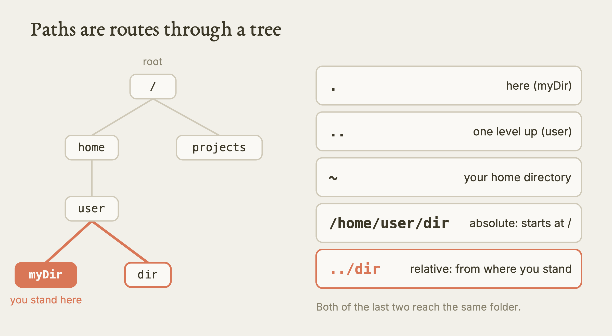
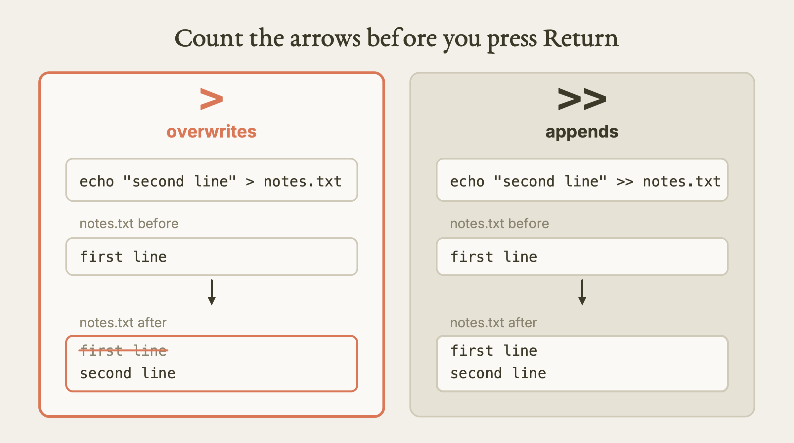
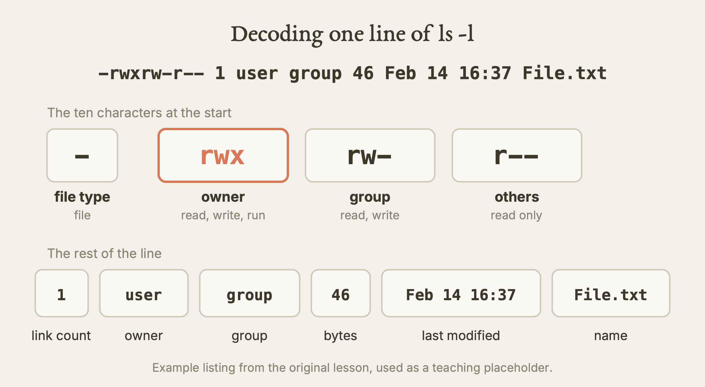
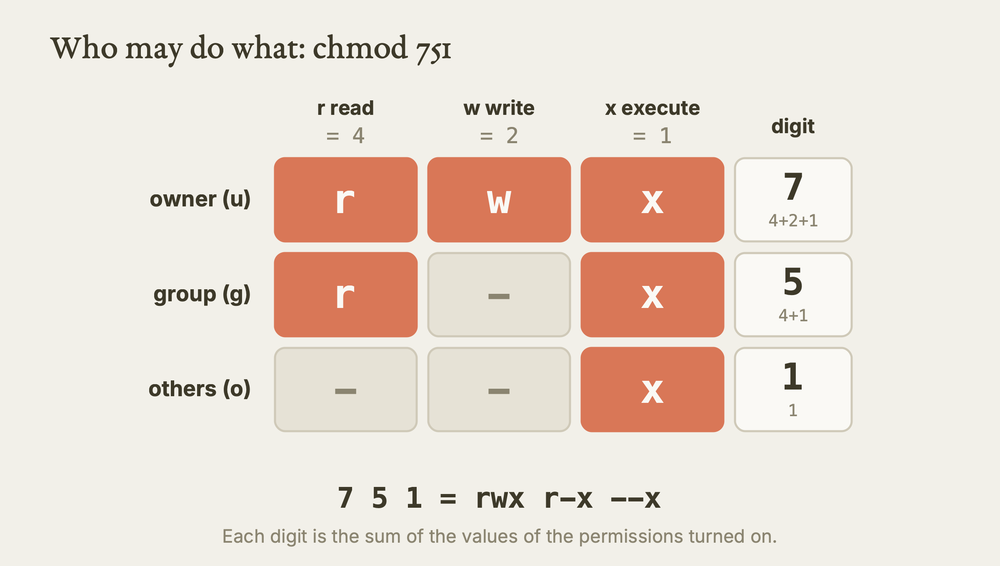
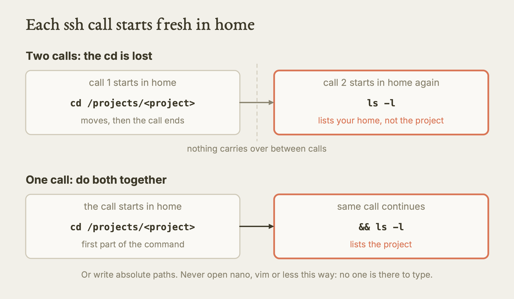

# Intro to Linux

This lesson teaches the small set of Linux terminal commands that every cluster user needs: finding your way around, making and removing files, reading them, setting who may touch them, editing, and the habits that stop you from deleting your own work.

**Watch the film:** https://youtu.be/Q70HTMmL6oQ (Video 6 of "Research Computing on Explorer and AICR"; unlisted link).

**Based on:** Northeastern University Research Computing's training lesson *Introduction to Linux*, presented by Ghanghoon "Will" Paik: https://github.com/northeastern-rc-training/Intro-to-Linux-2026. **This is our own rewrite, not a copy.** The structure follows our film; the wording, examples and exercises are ours; we added what we learned using it (real output, corrections, gaps). The original remains the authority; it is © its authors (the repository carries no license).

---

**What this is.** A written guide to the Linux command line, aimed at a researcher who has never used one. Both clusters in this series, Explorer and AICR, run Rocky Linux, so everything here applies on both. You type commands, the cluster runs them, and you read the result.

**Why it matters.** On a cluster the keyboard is the main way in. A handful of commands cover most days. A handful of mistakes cause most disasters: deleting something that cannot come back, overwriting a file with a single character, or opening your data to everyone. Learning the commands and the dangers together is cheaper than learning the dangers one loss at a time.

**What we found.** We kept the original's command set and added four things. First, real facts from the clusters: on 2026-10-11 Explorer reported Rocky Linux 9.7 and AICR reported Rocky Linux 9.6. Second, a clear rule for shared project space: do not use `chmod` to share data under `/projects` on Explorer, because that tool is the supported route. Third, how a non-interactive `ssh` call behaves (it starts in your home directory and remembers nothing), which matters if you let an agent run commands for you. Fourth, a list of things the original does not cover: quoting, overwrite protection, wildcards and `rm -rf`.

**What is NOT verified.** We ran only a few read-only commands on the clusters (the operating system, the working directory, and a queue listing). Most commands below, including everything that creates, copies, moves, removes, links or changes permissions, we took from the original and standard Linux behaviour and did not run on a cluster. Each exercise says which kind it is.

---

## Act I: What Linux is, and what the prompt tells you

**Linux** is a family of operating systems built around the Linux **kernel**, the core part that talks to the hardware. Linus Torvalds started the kernel in 1991. It follows the design of Unix, a much older system that also shaped macOS. Linux runs Android phones, laptops, and almost every HPC cluster.

Two reasons it dominates clusters:

| Reason | What it means for you |
|---|---|
| Free and open source | Anyone can contribute, and a very large toolbox costs nothing. |
| Secure and robust | Servers and clusters run it for long stretches without trouble. |

Linux has graphical desktops, but under them is the **command line**. You reach it with a **terminal**, a window where you type and the system types back. Your keyboard is the main input.

The terminal prints a **prompt** before every command. A typical one looks like this:

```
[user@host myDir]$
```

| Part | Meaning |
|---|---|
| `user` | Who you are logged in as. |
| `host` | Which machine you are on. |
| `myDir` | The folder you are standing in. |
| `$` | You are a normal user. |
| `#` | You are **root**, the administrator (you will not be on a cluster). |

Read the prompt before you run anything. It answers "who am I, where am I, what may I do".

A normal user cannot change the system itself. If you try to install a system package with `sudo`, you get a refusal that mentions the sudoers file. That is expected. On a cluster you never use `sudo`. To get software you use the cluster's own routes: modules, conda, containers, or building from source in your own space. (That is the safe reading in our agent rules; software routes are a topic for another lesson.)

**Which cluster?** Both Explorer and AICR show the same kind of prompt and run Rocky Linux. We checked the version on 2026-10-11:

| Cluster | Operating system we saw |
|---|---|
| Explorer (login node) | Rocky Linux 9.7 |
| AICR (login node) | Rocky Linux 9.6 |

## Act II: Moving around the file system

The file system is made of **files** and **directories** (folders), arranged in a tree. Many terminals colour them. The usual convention:

| Colour | Usually means |
|---|---|
| Blue | Directory |
| Green | Executable (a program you can run) |
| Red | Compressed archive |
| Plain | Ordinary file |

Other colours exist. Do not rely on colour alone; use `ls -l` (below) when it matters.

### Paths

A **path** is the address of a file. There are two kinds.

| Kind | Starts with | Example |
|---|---|---|
| Absolute | `/` (the root of the tree) | `/home/user/dir` |
| Relative | anything else; measured from where you stand | `../dir` |

Two shorthand symbols:

- `.` means "here".
- `..` means "one level up".

A third symbol, `~` (tilde), means your home directory.



*Paths are routes through the tree: the same folder reached by an absolute and a relative path. Our diagram, drawn for this guide. [SVG](images/tree-and-paths.svg)*


### Three commands to find your way

`pwd` prints your working directory, that is, where you are.

```bash
pwd
```

`ls` lists what is in the current directory. Flags change its output. A **flag** is a dash and a letter after the command name.

| Command | What you get |
|---|---|
| `ls` | Names only. |
| `ls -l` | Long listing: permissions, owner, group, size, date, name. |
| `ls -a` | Everything, including hidden files. Hidden names start with a dot. |
| `ls -la` | Both at once. Flags can be combined. |

Hidden files such as `.bashrc` hold settings. You will not see them in a plain `ls`. A broken `.bashrc` can cause strange failures at login, so know that `ls -a` reveals it.

`cd` changes directory.

```bash
cd project1      # go into a folder below you
cd ..            # go up one level
cd               # go home, from anywhere
cd ~             # also home
```

After each `cd`, look at the prompt: it shows the folder you now stand in. Use `pwd` whenever you are unsure.

## Act III: Making, copying, moving and removing

### Make things

| Goal | Command |
|---|---|
| Empty file | `touch notes.txt` |
| Directory | `mkdir results` |
| File with text, replacing anything inside | `echo "first line" > notes.txt` |
| Add a line to the end | `echo "second line" >> notes.txt` |
| Show the file | `cat notes.txt` |

The two arrows are the most dangerous single characters on this page. `>` **overwrites**: whatever the file held is gone. `>>` **appends**: the old content stays. If you meant to add and you typed one arrow, you lost the file. Check which one you typed before you press Return.



*One arrow overwrites, two arrows append. Our diagram, drawn for this guide. [SVG](images/redirect-arrows.svg)*


### Copy and move

```bash
cp notes.txt notes_backup.txt     # copy a file; the original stays
cp -R results results_backup      # copy a directory and everything in it
mv notes_backup.txt results/      # move a file into a directory
mv notes.txt summary.txt          # rename: move to a new name in the same place
```

`cp` needs `-R` (recursive) for a directory. `mv` moves or renames and needs no flag for either. Standard Linux also offers `cp -i` and `mv -i`, which ask before replacing an existing file. The original does not mention them; we recommend them when you are copying into a folder that may already hold files with the same names (inferred from standard Linux, not run by us).

### Remove, with care

```bash
rm notes.txt          # remove a file
rm -r results_backup  # remove a directory and everything in it
```

There is **no trash can and no undo**. A removed file is gone. Habits that help:

1. Run `ls` on the exact same path first, so you see what will go.
2. Read the command twice before Return.
3. Never remove anything in shared or project space unless the owner has said yes.
4. Be extra wary of `rm -rf`, wildcards (`*`), variables and `..` in the path. The original does not cover these; they are standard Linux risks, and one empty variable or a stray space can widen a delete far beyond what you meant (inferred).
5. Practise first on a throw-away test file.

### Symbolic links (shortcuts)

A **symbolic link**, or symlink, is a shortcut to another file or directory. It takes almost no space. The form is:

```bash
ln -s <target> <link_name>
```

Read it as "point to the target, call it the link name". Example: `ln -s /projects/<project>/data ./my_data` lets you `cd my_data` instead of typing the long path.

In `ls -l` a link starts with `l` and shows an arrow:

```
lrwxrwxrwx 1 user group 18 Feb 12 15:21 my_data -> /projects/data/intro_to_linux
```

If you move or delete the original, the link still exists but points at nothing. It is **broken**. Links also make it harder to tell where your data really lives, so keep a note of what each one points to.

## Act IV: Reading a file

| Tool | Use it for | Notes |
|---|---|---|
| `cat file` | Short files | Prints everything at once. A long file floods the screen. |
| `less file` | Long files | A scrollable viewer. |

Keys inside `less`:

| Key | Action |
|---|---|
| Up / Down arrow | One line |
| Page Up / Page Down | One page |
| Home / End | Top / bottom |
| `q` | Quit |

Escape does **not** close `less`. Press `q`.

## Act V: Who may do what (permissions and ownership)

Every file or directory has three audiences and three permissions.

| Audience | Letter |
|---|---|
| The user who owns it | `u` |
| The group that owns it | `g` |
| Others (everyone else) | `o` |
| All three together | `a` |

| Permission | Letter | Number | On a file | On a directory |
|---|---|---|---|---|
| Read | `r` | 4 | View contents | List what is inside |
| Write | `w` | 2 | Change it | Add or remove files |
| Execute | `x` | 1 | Run it as a program | Enter it with `cd` |
| None | `-` | 0 | | |

### Decoding a long listing line

```
-rwxrw-r-- 1 user group 46 Feb 14 16:37 File.txt
```

Take it field by field:

| Field | Value here | Meaning |
|---|---|---|
| 1 | first character `-` | Type: `-` file, `d` directory, `l` link. |
| 2 | next nine `rwxrw-r--` | Three groups of three: owner, group, others. |
| 3 | `1` | Link count. |
| 4 | `user` | Owner. |
| 5 | `group` | Group. |
| 6 | `46` | Size in bytes. |
| 7 | `Feb 14 16:37` | Last modified. |
| 8 | `File.txt` | Name. |

Reading the nine characters: owner `rwx` can read, write and run. Group `rw-` can read and write, not run. Others `r--` can only read.



*Every field of one ls -l line, named. Our diagram, drawn for this guide. [SVG](images/ls-line-decoded.svg)*


### Changing permissions with `chmod`

By symbol: who, then plus or minus, then which permission.

```bash
chmod g+x File.txt        # give the group execute
chmod u-x File.txt        # take execute from the owner
chmod ug+w,o-r File.txt   # several changes, separated by commas
```

By number: three digits, for owner, group, others. Each digit is the sum of the numbers above.

```bash
chmod 751 File.txt
# 7 = 4+2+1  owner: read, write, execute
# 5 = 4+1    group: read, execute
# 1 = 1      others: execute only
```



*chmod 751 as a grid: each digit is the sum of the values switched on. Our diagram, drawn for this guide. [SVG](images/permissions-grid.svg)*


### Changing ownership with `chown`

```bash
chown <user>:<group> File.txt
chown -R <user>:<group> some_directory    # -R covers the whole directory
```

### Warnings the original does not give

- Do not run `chmod 777`. It opens a file to everyone. Do not run `chmod -R` or `chown -R` broadly either: they rewrite a whole tree in one go (inferred; standard risk).
- Read `ls -l` first. Understand the current state before you change it.
- **On Explorer, sharing under `/projects` is not done with `chmod o+...`.** Our Explorer rules say to use the `project` tool, which adds people as members or guests. That tool needs a compute node and was not run by us. Ask Research Computing if unsure.

## Act VI: Editors

Two editors work inside the terminal.

**nano** is the simple one.

```bash
nano myFile.txt
```

Its shortcuts are printed along the bottom of the screen. The caret `^` stands for the Control key, so `^X` means Ctrl+X.

**vim** (also called `vi`) is more powerful and has two modes.

```bash
vim myFile.txt
```

| Mode | What you can do |
|---|---|
| Normal (the one you start in) | Move and give commands. You cannot type text into the file. |
| Insert | Type text. |

| Do this | Result |
|---|---|
| `i` | Enter insert mode. |
| Escape | Back to normal mode. |
| `:wq` then Return | Save and quit. |
| Escape, then `:q!` and Return | Quit without saving. Use this when you are stuck. |

If you are new, prefer nano.

## Act VII: Three tips, and where to get help

| Tip | What it does |
|---|---|
| Tab | Completes a long file or command name. Type the start, press Tab. It also prevents typos in paths. |
| Ctrl+C | Stops a running program, or discards a half-typed command. |
| `clear` | Wipes the screen. It does not undo anything. |

Help: email rchelp@northeastern.edu, go to Research Computing office hours (on Zoom; days and times are at https://rc.northeastern.edu/getting-help/), or book a consultation. The documentation is at https://rc-docs.northeastern.edu/en/latest/index.html.

### One more habit, if an agent runs commands for you

When a tool or an agent runs `ssh explorer '<command>'` without a person at the keyboard (a non-interactive call), each call starts fresh in your home directory and keeps nothing between calls. In our session on 2026-10-11 such a call printed `/home/<username>` for `pwd`. So:

- Use absolute paths, or do the `cd` and the command in the same call: `cd /projects/<project> && ls -l`.
- Never start an interactive program (nano, vim, less, a bare `python`) through such a call. It will hang, because no one is there to type.
- Single-quote the remote command so that variables such as `$USER` are expanded on the cluster, not on your laptop.



*A non-interactive ssh call starts in home and remembers nothing. Our diagram, drawn for this guide. [SVG](images/ssh-call-state.svg)*


## Terms

| Term | Meaning |
|---|---|
| Kernel | The core of an operating system; it talks to the hardware. |
| Shell | The program that reads what you type and runs it. |
| Directory | A folder. |
| Path | The address of a file, written from the root `/` (absolute) or from where you stand (relative). |
| Root | The administrator account that may do anything. |
| Flag | A dash and a letter after a command that changes what it does. |

## Try it

Do these on a scratch folder in your own home directory, never on shared or project space.

1. **Where am I? (Tested by us, 2026-10-11.)** Run `pwd` and `cat /etc/os-release` after logging in, or from your laptop `ssh explorer 'pwd; cat /etc/os-release'`. You should see your home directory (`/home/<username>`) and "Rocky Linux" with a 9.x version. This is read-only.
2. **Read your listing. (From the source, not run by us.)** Run `ls -la` in your home directory. Find one hidden file and one directory. For one line, name the type, owner, group and others permissions in words.
3. **Build a small tree. (From the source, not run by us.)** Make a folder `practice`, `cd` into it, create `notes.txt` with one line, append a second line with `>>`, and `cat` it. What do you expect to see? Two lines. Then use `>` by mistake on purpose and watch the first line vanish, so you learn the cost on a throw-away file.
4. **Copy, rename, link. (From the source, not run by us.)** Inside `practice`, copy `notes.txt` into a new subfolder with `cp`, rename the copy with `mv`, and make a symlink to the subfolder with `ln -s`. Check the arrow in `ls -l`. Then rename the subfolder with `mv` and see what `ls -l` shows for the now-broken link.
5. **Permissions. (From the source, not run by us.)** In `practice`, give your group read access to `notes.txt` and remove all access for others, using the symbolic form. Check with `ls -l`. Then do the same again with the number form and confirm that both agree.
6. **Clean up safely. (From the source, not run by us.)** Run `ls` on `practice`, read the output, then remove it with `rm -r practice`. Only do this on the folder you just made.

## What we tested, and what we only read

| Item | Status |
|---|---|
| Operating system of the Explorer and AICR login nodes (Rocky Linux 9.7 and 9.6) | Tested by us, 2026-10-11 (read-only) |
| `pwd` after a non-interactive `ssh` call starts in the home directory | Tested by us, 2026-10-11 |
| `ls`, `ls -l`, `ls -a`, `cd` and every file-creating, copying, moving, removing, linking, permission and ownership command | Read in the original, not run by us |
| `less`, `cat`, nano, vim, Tab, Ctrl+C, `clear` | Read in the original, not run by us |
| The `project` tool for sharing on Explorer | Read, not run (needs a compute node) |
| Anything on a different network or account | Not tested |

## Where the original is wrong, outdated, or silent

- **Silent on quoting.** It does not say to quote paths with spaces or variables. An unquoted space splits one path into two arguments. Quote them. (The one place spaces are forbidden is the `project` user list, which takes `u1,u2,u3` with no spaces.)
- **Silent on `rm -rf`, wildcards and variables.** It warns that removal cannot be undone, which is right, but gives no guidance on wide deletes. We list-first, confirm-first, and never delete in shared space without the owner's yes. This is our own advice, not the source's.
- **Silent on overwrite protection.** `cp -i` and `mv -i` are standard but not mentioned.
- **Silent on `chmod 777` and recursive changes.** The syntax is given; the danger is not. On Explorer `/projects`, group access is set by the `project` tool rather than by `chmod`.
- **Silent on the shared nature of the system.** Everything you create here is on a cluster that other people use; the original does not say which commands are safe to try on a login node. Stick to light commands there. Do not run computation on a login node.
- **Generic prompts.** The examples use `user@host`, which is fine for teaching but does not show the real cluster names. Our real output is in the table above.
- **The example listing and link path** are teaching placeholders. Do not paste `/projects/data/intro_to_linux` into your own commands; the real layout is `/projects/<project>`.
- **Non-interactive use.** The original assumes a person is typing. See the note at the end of Act VII for how a scripted `ssh` call behaves differently.

## Your turn

Paste this into Claude: I'm new to the Linux terminal on a cluster. Give me a ten-command practice session: make a project folder in my home directory with two subfolders, create a notes file with one line, append a second line, copy it into a subfolder, rename the copy, make the file readable by my group but not by others, and show me the long listing after each step so I can see what changed. Explain each command in one sentence. Then check two things yourself. Did every path it wrote start with a slash or a tilde? And did it warn you before the first r m?

## Sources

- Original lesson (the authority): https://github.com/northeastern-rc-training/Intro-to-Linux-2026 (Northeastern University Research Computing; presenter Ghanghoon "Will" Paik).
- Research Computing documentation: https://rc-docs.northeastern.edu/en/latest/index.html
- Getting help and office hours: https://rc.northeastern.edu/getting-help/
- Our film: https://youtu.be/Q70HTMmL6oQ (unlisted link).
- Our agent rules: `skills/hpc/HPC.md` (Section 11, Linux habits that prevent disasters) and `skills/aicr/AICR.md`.
- Our real captured output: `films/REAL-OUTPUTS.md` and the Explorer login session record.
