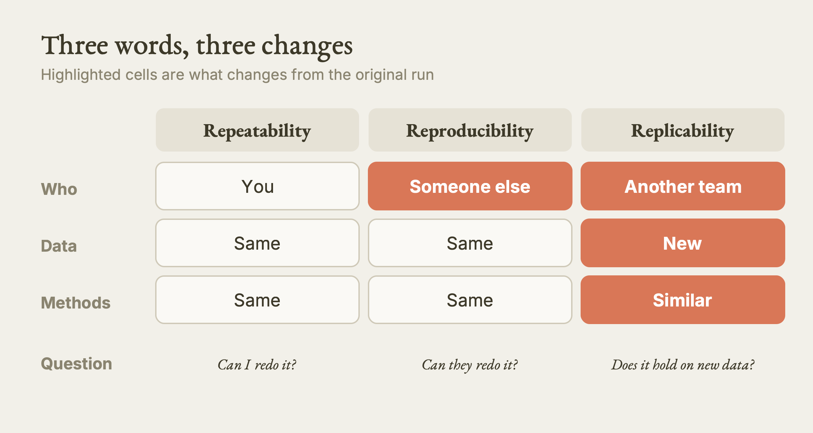
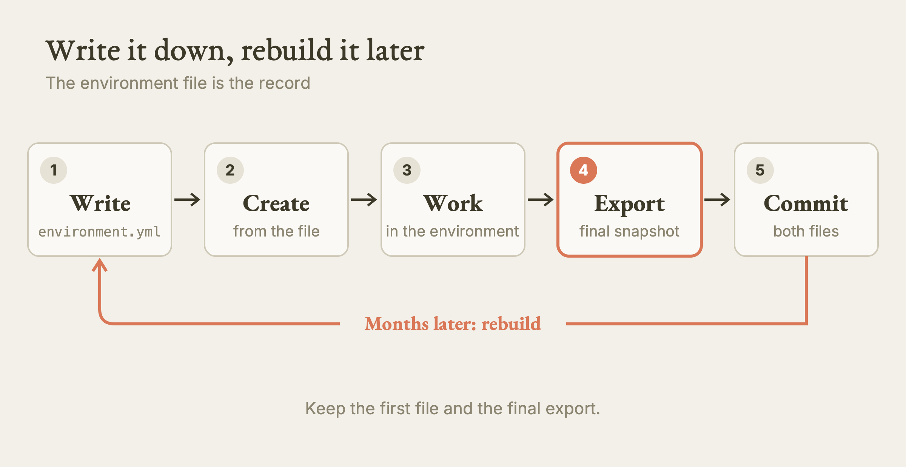
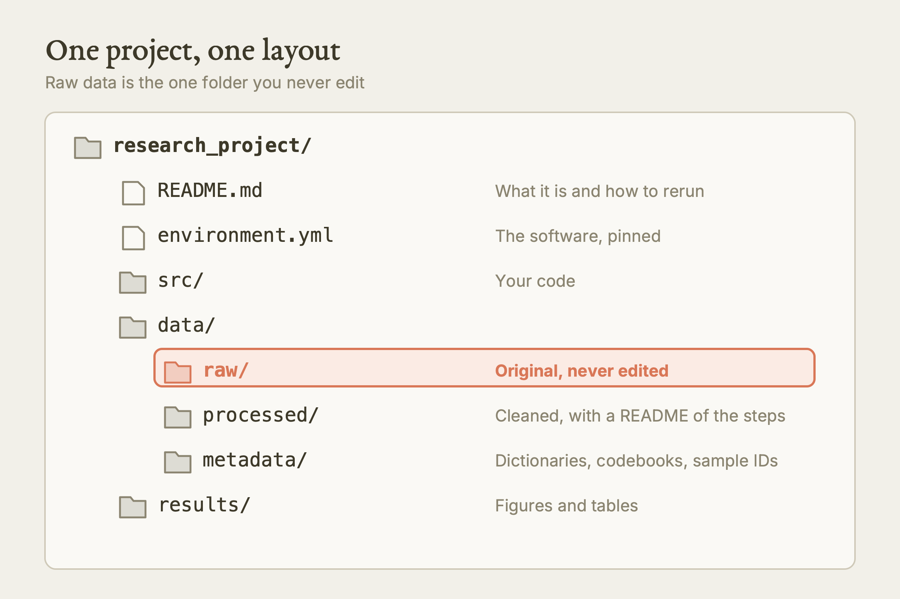
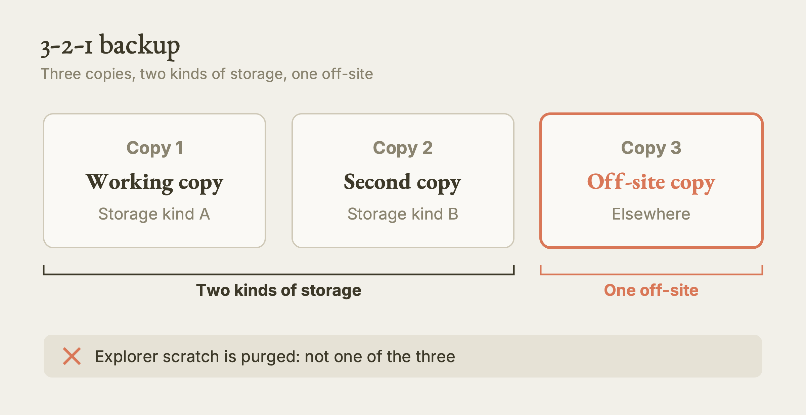
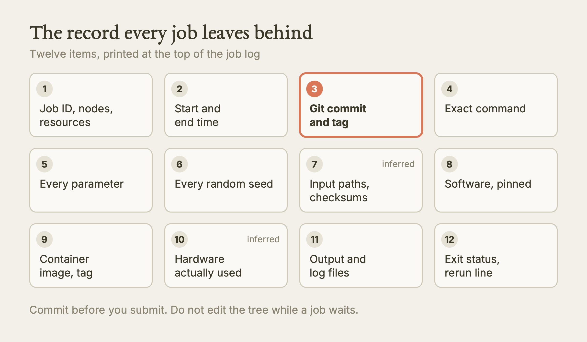

# Scientific Reproducibility

This guide teaches you how to make your computational work redoable, by you in six months or by anyone else, using a record of your software, a pinned conda environment, a clean data layout and a README.

**Watch the film:** https://youtu.be/68LPUyZrRYs (Video 7 of "Research Computing on Explorer and AICR"; unlisted link).

**Based on:** Northeastern University Research Computing's training lesson *Scientific Reproducibility: Best Practices and Implementation* (the "Intro to Scientific Reproducibility 2026" repository): https://github.com/northeastern-rc-training/Intro-to-Scientific-Reproducibility-2026. **This is our own rewrite, not a copy.** The structure follows our film; the wording, examples and exercises are ours; we added what we learned using it (real output, corrections, gaps). The original remains the authority; it is © its authors (the repository carries no license).

---

**What this is.** A written lesson on making research code and data redoable. It covers the three words people confuse (reproducibility, replicability, repeatability), a project checklist, how to record the software a job used, how to build conda environments that rebuild later, how to lay out and document data, and how to write a README. The ideas are general. The commands in the software and conda sections are written for Explorer, Northeastern's general cluster.

**Why it matters.** Sooner or later you will have to redo an analysis: a reviewer asks for one more plot, a collaborator wants your numbers, or you want to rerun last year's job. If the software, data and steps were not written down at the time, that redo costs days. The first person reproducibility helps is you.

**What we found.** We read the lesson against our own cluster notes and checked what we could on the login nodes of both clusters. Several commands in the original fail or mislead as written: `mkdir -P`, unquoted `>` and `<` in a conda spec, a `channel_priority` command with no value, `conda list -e` labelled as pip output, an exercise that omits `-f`, and example channel lists that keep `defaults`. We also found that neither cluster has `conda` on the login PATH until you load a module, and that AICR is a different setup from Explorer (Lmod, a `miniforge3` module, no `python` module). We added a twelve-line record every job should leave behind.

**What is NOT verified.** We ran only read-only commands on the two login nodes (module lists, command presence). We did not create a conda environment, request a compute node, submit a job, or run the original's exercise. Every conda behaviour below is from the original or from general conda knowledge, and is labelled when inferred.

---

## Opening: the idea

Reproducibility is not a favour to other scientists. It is a favour to the version of you who opens this project in six months. Everything in this guide is a way of writing down, at the time, what you did, so that a later run can match it.

Two terms you need first:

| Term | Meaning |
|---|---|
| Version control | Software (usually Git) that records every change to your files so you can go back. |
| Environment | One named, isolated set of software, kept apart from every other set. |

## I. Three Words

People use these words interchangeably. Keep them apart.

| Word | Who | Data | Methods | The question it answers |
|---|---|---|---|---|
| Repeatability | You | Same | Same | Can I get the same answer when I rerun this myself later? |
| Reproducibility | Someone else | Same | Same | Can another person take my data and code and get my result? |
| Replicability | Another team | New | Similar | Does the finding hold up on fresh data? |



*Repeatability, reproducibility and replicability differ in what changes. Our diagram, drawn for this guide. [SVG](images/three-words.svg)*

This guide is mostly about the first two. Replicability depends on the science, not on your folder layout, but a well-documented method makes it far easier for others to try.

## II. Why It Matters

**The numbers.** In a 2016 Nature survey of researchers, a majority in every field listed said they had failed to reproduce someone else's result. The original shows the figure; we do not reproduce its exact values here, so read the bars from the source if you need them. Three other studies, as cited by the original:

| Field | Finding | Citation given |
|---|---|---|
| Psychology | 36 to 47 of 100 studies replicated | Open Science Collaboration, 2015 |
| Biomedicine | 11 percent of 53 landmark cancer studies replicated | Begley and Ellis, 2012 |
| Economics | 49 percent of papers had enough data and code to attempt reproduction | Chang and Li, 2015 |

We did not re-verify these studies against their primary papers; we report them as the original cites them.

**Where the harm lands.** Clinical decisions resting on a result nobody can reproduce, and policy built on models nobody can rerun. Closer to home: every project eventually needs something redone, and a reproducible workflow makes that fast.

**Five common barriers.**

1. Methods are not documented.
2. Data and code are not shared.
3. Software versions are not recorded.
4. Results depend on the hardware they ran on.
5. File paths in the code are absolute, so the code only works on one machine.

Each section below attacks one or more of these.

## III. The Checklist

Use this at three moments in a project.

| Phase | Do this |
|---|---|
| Setup | Start a Git repository. Pick a folder layout and keep to it. Create an environment file. Write a README. |
| During the work | Comment your code. Use relative paths. Set random seeds. Write down every transformation you apply to data. Commit often. |
| Finishing | Ask someone else to run it from your instructions. Ship the environment file. Share data and code where you are allowed to. Write down the limitations. |

A **random seed** is the number that makes a random process repeat exactly. If your analysis shuffles, samples or initialises randomly, set the seed in the code and note it down. Without it, two runs of identical code can legitimately differ.

### FAIR data

FAIR is a four-part standard for shared data, published in *Scientific Data* in 2016:

| Letter | Means | In practice |
|---|---|---|
| Findable | Others can locate it | Persistent identifier, descriptive metadata |
| Accessible | Others can retrieve it | Stored in an open repository |
| Interoperable | Other tools can read it | Standard file formats |
| Reusable | Others know what they may do with it | A clear license and documentation |

### Version control, in one paragraph

Git records each change, lets you return to any earlier version, lets several people work without overwriting each other, keeps the whole history, and lets you try ideas on a branch without breaking the working code. The original gives it a separate lesson; we use it here only as a habit: commit from the first day.

## IV. Record Your Software

Anything you run on a cluster came from somewhere. Write down which version, and when.

On **Explorer**, software installed by the Research Computing team is loaded with `module load name/version`. Put the loads, with versions, at the top of the job script. The script then doubles as a record. A sketch (the module names and versions are examples from the original; check what exists with `module avail`):

```bash
#!/bin/bash
#SBATCH --partition=short
#SBATCH --time=05:00:00
#SBATCH --ntasks=32

module load julia/1.10.4
module load bwa/0.7.18

cd /projects/<project>/rawdata
bwa mem ref.fa reads.fq > aln.sam
```

If you edit a script that produced a published result, copy it first and edit the copy, or let Git hold the versions.

### Keep modules out of `~/.bashrc`

`~/.bashrc` is a hidden file in your home directory that runs in every shell and program you open on the cluster. Aliases and colours belong there. Module loads do not, for two reasons:

- The job script stops being self-contained. Months later you cannot tell whether a program came from the script or from your shell.
- Modules loaded for every session can conflict with the dependencies of whatever you load next.

Our cluster rules tolerate plumbing lines there (a `PATH` line, `module use`) but not `module load`, `conda init` or an activation. Ask before editing it, and repeat anything a batch job needs inside the job script itself.

The Research Computing team publishes the scripts it used to build many modules at https://github.com/northeastern-rc-software-modules, so you can see exactly how a module was made.

### What the two clusters actually have

We checked read-only on the login nodes on 2026-10-11:

| | Explorer | AICR |
|---|---|---|
| Module system | Modules 5.3.0 (classic Tcl) | Lmod ("Modules based on Lua", version 8.7.65) |
| Conda | `conda` not on PATH until you load a module. `miniconda3/24.11.1`, `miniconda3/25.9.1`, `anaconda3/2024.06` exist | `conda` not on PATH. `miniforge3/25.3.0-3` exists |
| Python module | `python/3.13.5` exists | `module avail python` finds nothing |

So the original's `module load miniconda3/25.9.1` is an Explorer line. Do not paste it on AICR. On AICR, our rules use `miniforge3`, and they also say not to use `source activate` or `conda activate` in a batch script (see the last section).

## V. Conda Environments

Conda builds isolated environments. It runs on Windows, Mac and Linux, installs Python and non-Python packages, keeps each project's dependencies apart, and resolves version conflicts between packages.

### Create and use one (Explorer)

Build environments on a compute node, not the login node. The shortest request is `srun --pty bash`; we have not run it. Then:

```bash
module load miniconda3/25.9.1
conda create -n myproj python=3.10
source activate myproj
conda install numpy pandas matplotlib scipy
conda deactivate
```

### Seven habits

| # | Habit | Why |
|---|---|---|
| 1 | Pin the versions that matter | Unpinned, conda takes the newest, which changes over time |
| 2 | Prefer the `conda-forge` channel | It is widely maintained and current |
| 3 | List channels in priority order | Conda searches them top to bottom |
| 4 | Install conda packages first, pip packages last | Conda cannot see what pip changed |
| 5 | Export the environment | The export is your record |
| 6 | Install everything in one session | Conda resolves conflicts across the whole set at once; an environment grown by many small additions is the one that fails to rebuild |
| 7 | Keep environments small, one per task | Small environments are easy to reproduce |

Quote any version spec containing `<` or `>`, or the shell treats it as redirection:

```bash
conda install "numpy=1.24.3" "pandas>=2.0,<3.0" matplotlib scipy
```

Setting `python=3.12` makes conda choose packages compatible with that Python.

For channels, the original lists `conda-forge`, then `bioconda` for bioinformatics, then `defaults`. We would drop `defaults` (see the last section). Check your current settings with `conda config --show channels`.

### Managing environments

```bash
conda env list                                  # see what you have
conda create -p /projects/<project>/envs/myproj python=3.10   # at a path you choose
conda env remove -n myproj                      # delete one (asks you; check first)
conda create --clone myproj -n myproj_backup    # copy one
conda env update -f environment.yml --prune     # sync to the file, dropping extras
```

If solving is slow, `conda install -c conda-forge mamba`, then use `mamba` in place of `conda`.

### Why `source activate`

The original says to use `source activate <env>` rather than `conda activate`, because `conda activate` needs `conda init`, and `conda init` edits your `~/.bashrc` in a way the original says can clash with Open OnDemand. We follow that on Explorer. AICR is different; see the last section.

### From file to job

Write the environment as a file, so it can be rebuilt:

```yaml
name: research_project
channels:
  - conda-forge
dependencies:
  - python=3.10
  - numpy=1.24.3
  - pandas=2.0.2
  - matplotlib=3.7.1
  - jupyter
  - pip:
      - seaborn
```

Then the whole workflow is:

```bash
mkdir research_project && cd research_project
git init
# write environment.yml as above
conda env create -f environment.yml
source activate research_project
# ... do the work ...
conda env export > environment_final.yml
git add environment.yml environment_final.yml
git commit -m "Record the environment"
```



*The environment file loop from first write to rebuild. Our diagram, drawn for this guide. [SVG](images/environment-loop.svg)*

In a job script the same two lines make the run reproducible (Explorer):

```bash
module load miniconda3/25.9.1
source activate /projects/<project>/envs/research_project
python src/analysis.py
```

Export tip: `conda env export --from-history` lists only what you asked for, which is cleaner to share. The plain export includes platform-specific build strings, so it may not rebuild on a different system (inferred; no source states it). The original keeps both a starting file and a final export, which is a good habit.

## VI. Data

### Three folders

```
data/
  raw/        original, never edited
  processed/  cleaned or transformed, with a README of the steps
  metadata/   dictionaries, codebooks, sample IDs
```



*The project layout, with raw data as the one folder you never edit. Our diagram, drawn for this guide. [SVG](images/project-layout.svg)*

Create them with a lowercase `-p`:

```bash
mkdir -p data/raw data/processed data/metadata
```

To make raw data read-only you can use `chmod 555 data/raw`, but only the owner can run `chmod`, so agree it with your PI first. Note that `chmod 555` on a directory stops you adding or removing files in it; it does not by itself protect the files already inside (our rule file says so). Use `chmod -R a-w` on a copy-checked set if you need file protection, after asking the owner (inferred). Never edit, overwrite or clean raw data in place.

### Naming files

| Rule | Example |
|---|---|
| ISO dates, year-month-day | `2024-01-15` |
| A version number if it changes | `v01`, `v02` |
| Lowercase, no spaces | `survey_responses_wave1_v03.csv` |
| Underscores or hyphens | `participant_demographics_2024-01-20.csv` |
| Never `final_v2_really` | |

### Document every data folder

Give each data folder a README that answers four questions: where the data came from, what each variable means and its range, what processing was done, and what is known to be wrong.

Turn the variables into a **data dictionary**, a table:

| Variable | Type | Meaning | Units | Range | Missing code |
|---|---|---|---|---|---|
| subject_id | integer | Participant ID | none | 1 to 500 | none |
| response_time | float | Reaction time | ms | 200 to 5000 | -99 |

### Back it up: 3-2-1

Three copies, on two kinds of storage, with one off-site. On Explorer, scratch is purged periodically, so do not treat it as one of the three copies (the original's data-transfer guidance is at https://rc-docs.northeastern.edu/en/latest/datamanagement/index.html).



*The 3-2-1 backup rule. Our diagram, drawn for this guide. [SVG](images/three-two-one.svg)*

## VII. Documentation

### The project README

A reader should be able to reproduce your work from the README alone. Include:

1. What the project is, in two or three sentences.
2. How to set up the environment.
3. How to run the analysis.
4. Where the data lives, pointing to the data README.
5. A numbered "to reproduce" list a stranger can follow without asking you.
6. How to cite it, the license, and a contact.

### Docstrings and comments

A docstring says what a function does, its parameters and what it returns:

```python
def mean_ignoring_missing(values):
    """Return the mean of `values`, skipping NaN entries."""
    import numpy as np
    return float(np.nanmean(np.asarray(values, dtype=float)))
```

Comment the **why**, not the what. "Shift by one: the source file counts from 1" helps a reader. "Add one" does not.

## VIII. Start Tomorrow

Five habits to take away:

1. Use version control from day one.
2. Document your environment.
3. Organise files by purpose: data, source, results.
4. Write the README, the comments and the dictionaries as you go.
5. Have someone else run your project from the README.

### The record every job should leave behind

The original asks for software versions. Our cluster rules ask for more. Print this header at the top of the job log (items marked "inferred" go beyond what the original says):

| # | Record |
|---|---|
| 1 | Job ID, node list, partition, requested resources |
| 2 | Start and end time, ISO format |
| 3 | Git commit hash, branch, a `run-<jobid>` tag, and a clean working tree |
| 4 | The exact command, with the job script under version control |
| 5 | Every parameter value |
| 6 | Every random seed |
| 7 | Input paths (read-only) and a checksum of each (inferred) |
| 8 | Software: pinned module lines, or the environment file, or the container image and its recipe |
| 9 | For containers: image and tag, bind list, whether GPUs were enabled |
| 10 | Hardware actually used: CPU count, GPU type and count (inferred) |
| 11 | Output directory and the stdout and stderr files |
| 12 | Exit status, headline numbers, and the README line that tells a stranger how to rerun |



*The twelve-item record every job leaves behind. Our diagram, drawn for this guide. [SVG](images/job-record.svg)*

Commit before you submit. The check in a job script runs when the job **starts**, so do not edit the tree while a job waits in the queue.

---

## Terms

- **Version control**: software that records every change to your files so you can go back.
- **Module**: a program the cluster team installed, loaded by name and version.
- **Conda**: a tool that builds isolated environments of packages.
- **Environment**: one named set of software kept apart from all others.
- **README**: the plain-text file that explains a folder.
- **Random seed**: the number that makes a random process repeat exactly.

## Try it

1. **Tested by us (2026-10-11): see what your login node offers.** On Explorer run `module avail miniconda3` and `module avail python`. You should see `miniconda3/24.11.1`, `miniconda3/25.9.1` and `python/3.13.5` (at the time we looked). On AICR run `module avail miniforge3`; you should see `miniforge3/25.3.0-3`. These are read-only.
2. **Tested by us (2026-10-11): confirm conda is not on your PATH.** Run `command -v conda` on a login node before loading any module. We found it absent on both clusters.
3. **From the source, not run by us: audit one project.** Pick a project of yours and tick off the section III checklist. Write the three items that would hurt most if lost, in order.
4. **From the source, not run by us: write an environment file.** Create `environment.yml` with Python 3.10, numpy, pandas and matplotlib, build it with `conda env create -f environment.yml`, activate it (Explorer: `source activate <name>`), add two more packages, and export `environment_final.yml`. You should end up with two files you can commit.
5. **From the source, not run by us: lay out data.** Run `mkdir -p data/raw data/processed data/metadata`, write a README in each, and agree with the owner before any `chmod`.
6. **From the source, not run by us: the stranger test.** Give your README to someone who has not seen the project and ask them to reproduce one figure. Record where they got stuck.

## What we tested, and what we only read

| Item | Status |
|---|---|
| Module system and version on Explorer and AICR | Tested by us, read-only, 2026-10-11 |
| `miniconda3`, `anaconda3`, `python/3.13.5` modules on Explorer | Tested (listed) |
| `miniforge3` module on AICR; no `python` module | Tested (listed) |
| `conda` absent from login PATH on both | Tested |
| Creating, exporting or activating an environment | Only read |
| `source activate` behaviour on Explorer | Only read (original and our rule files) |
| Compute-node requests and job scripts | Only read |
| Citation figures for the surveys and studies | Only read, as cited |

## Where the original is wrong, outdated, or silent

| Point | What the original does | What we would do and why |
|---|---|---|
| `mkdir -P` | Capital `P` | Use `mkdir -p`. Capital `P` is not the create-parents flag. |
| Unquoted specs | `pandas>=2.0,<3.0` typed bare | Quote it. The shell reads `>` and `<` as redirection (inferred from shell rules). |
| `channel_priority` | `conda config --set channel_priority` with no value | Give a value such as `flexible`, `strict` or `disabled`. |
| `conda list -e` for pip | Writes it to `requirements.txt` "for pip" | We believe `conda list -e` writes conda-style lines, not pip format (inferred). Verify before relying on it; use `pip freeze` inside the environment for pip. |
| Exercise 1 | `conda env create -n training_env` | Add `-f environment.yml`. Also `source activate <name>` has no space in the name. |
| `defaults` channel | Kept as the last channel in its examples | Our software-install notes say remove it and use `conda-forge` only, for licensing reasons. We follow that. |
| `conda activate` vs `source activate` | Says always `source activate`, but its own README template uses `conda activate` | On Explorer, use `source activate`. |
| AICR | Not covered | On AICR, use the `miniforge3` module, create the environment once before submitting (not inside a job), and in batch scripts prepend the environment's `bin/` to `PATH` instead of activating. One real AICR job died on `source activate`; the cause was never verified. This skips conda's activation scripts, so set variables yourself for packages that need them (a CUDA toolkit, compilers, R). Keep environments in Home, not Scratch, which is purged (inferred from the purge rule). |
| `chmod 555 data/raw` | Presented as protection for raw data | It stops changes to the directory, not edits to files inside. Ask the owner; check file modes too. |
| Seeds and GPUs | "Set random seeds" only | Seeds do not cover every source of nondeterminism on GPUs. Record the GPU type and library versions (inferred; the original is silent). |
| Provenance | Software versions only | Add the commit hash, the command, parameters and input checksums (the twelve-line record). |
| Dates | Cites future training dates | These date quickly; check the Research Computing training page for the current schedule. |

## Your turn

Paste this into Claude:

> Here is how my current research project is organised and what software it uses: [describe it in three sentences]. Audit it against the reproducibility checklist: version control, environment file, folder layout, README, relative paths, random seeds, data README and dictionary, backups. List what is missing in order of how much it would hurt me six months from now, and write the environment.yml and the README skeleton for me. Then check two things yourself. Did it pin versions in the YAML? And could a stranger follow the README's steps without asking you anything?

## Sources

- Original lesson (Northeastern University Research Computing): https://github.com/northeastern-rc-training/Intro-to-Scientific-Reproducibility-2026
- Research Computing module build scripts: https://github.com/northeastern-rc-software-modules
- Research Computing data transfer docs: https://rc-docs.northeastern.edu/en/latest/datamanagement/index.html
- FAIR principles paper (*Scientific Data*, 2016): https://www.nature.com/articles/sdata201618
- Our film: https://youtu.be/68LPUyZrRYs (unlisted link)
- Our agent rules: `skills/hpc/HPC.md` (Sections 8 and 9) and `skills/aicr/AICR.md` in this repository
- Contact for cluster questions: rchelp@northeastern.edu
