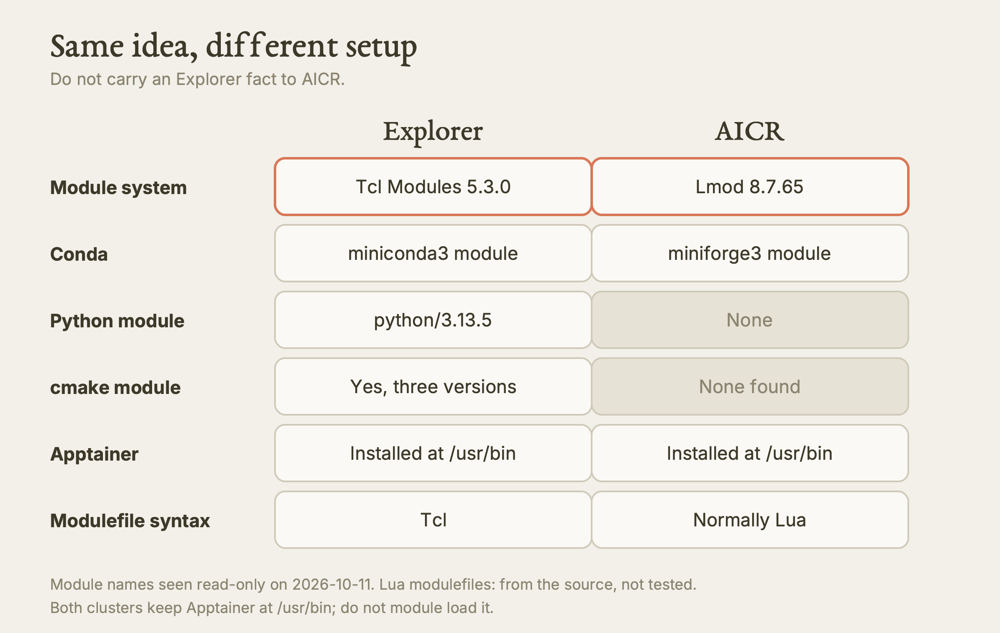
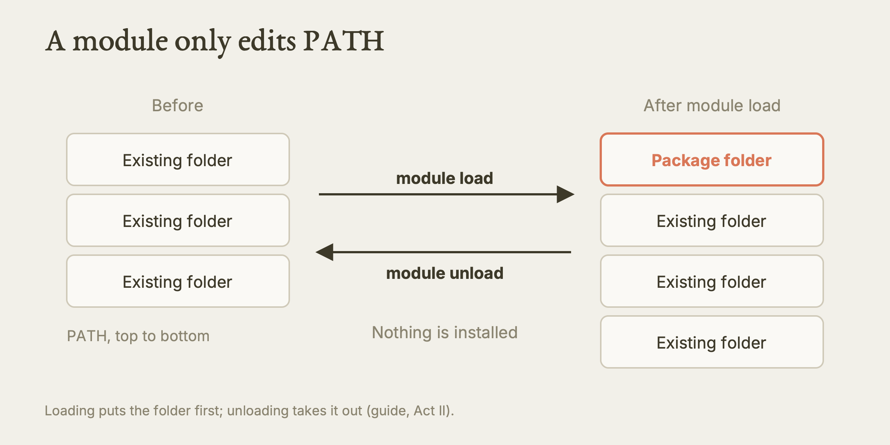
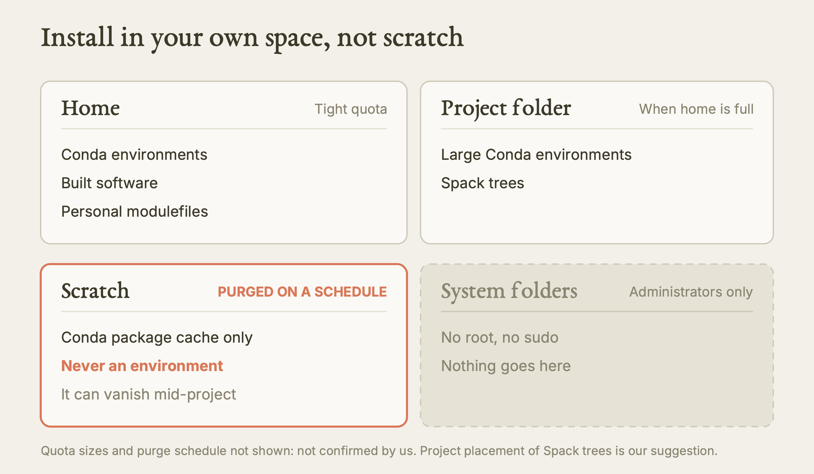
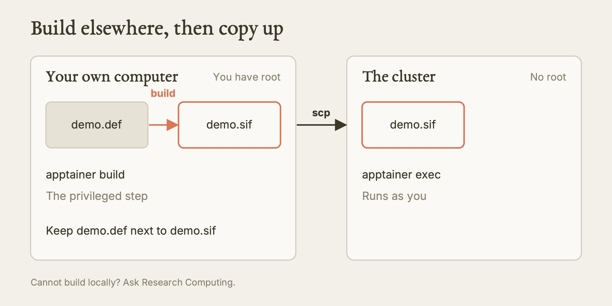
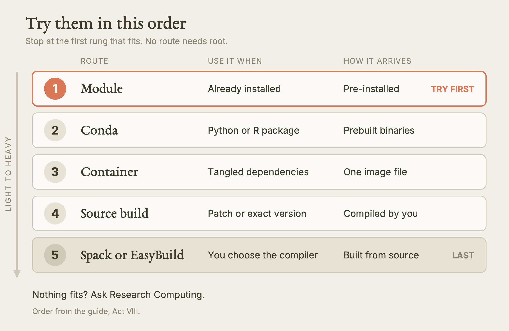

# Installing Software on an HPC Cluster

This guide teaches you how to get research software running on a shared cluster where you have no root access, and how to pick the right route (module, Conda, container, source build, Spack or EasyBuild) before you waste an afternoon on the wrong one.

**Watch the film:** https://youtu.be/l2RwXl8W-sA (video 8 of the series "Research Computing on Explorer and AICR"; unlisted link).

**Based on:** Northeastern University Research Computing's training lesson *Installing Software on an HPC Cluster*, presented by Ghanghoon "Will" Paik: https://github.com/northeastern-rc-training/Intro-to-Software-Installation-2026. **This is our own rewrite, not a copy.** The structure follows our film; the wording, examples and exercises are ours; we added what we learned using it (real output, corrections, gaps). The original remains the authority; it is © its authors (the repository carries no license).

---

**What this is.** A written lesson on installing software on a shared research cluster. You do not have `sudo`, so every install goes into your own space and has to coexist with hundreds of other users. The lesson covers six routes: environment modules, Conda, Spack, EasyBuild, a build from source with your own module file, and Apptainer containers. It ends with an order in which to try them.

**Why it matters.** Most lost time on a cluster comes from picking a heavy route for a light problem: compiling a toolchain when a module already existed, or filling a home quota with a Conda environment that then vanished from scratch. The order of the routes is the most useful thing in the lesson.

**What we found.** We logged in read-only on 2026-10-11 and checked what the original assumes. Explorer uses classic Tcl **Modules 5.3.0** and does have a `python/3.13.5` module, a Conda module (`miniconda3`) and a system-wide `apptainer`. The AICR cluster is different: it uses **Lmod 8.7.65**, has `miniforge3` instead of a Conda module, has no `python` module, and has `apptainer` and `singularity` at `/usr/bin`. The original's module-file and EasyBuild instructions (Tcl syntax, `--modules-tool=EnvironmentModules`) are written for the Tcl system, so they are Explorer instructions, not AICR instructions. We also list several places where the original is silent or where its sources disagree.

**What is NOT verified.** We ran no install, no `srun`, no `conda create`, no `spack`, no `eb`, no `apptainer pull` or `exec`, and no build. Everything outside the module and command-presence checks in the table near the end is "from the source, not run by us". We did not test the transfer host name the original gives, and nothing here has been tried on AICR beyond a login-node look.

---

## Which cluster is this about?

Every statement below is labelled **Explorer** (Northeastern's general research cluster), **AICR** (the GPU cluster), or **Both**. Do not carry an Explorer fact to AICR. Where a statement carries no label, it is a general idea that holds anywhere.

| Fact | Explorer | AICR |
|---|---|---|
| Module system | Classic Tcl Environment Modules, release 5.3.0 | Lmod (Lua based), version 8.7.65 |
| Conda | `miniconda3/24.11.1`, `miniconda3/25.9.1`, `anaconda3/2024.06` modules; `conda` is not on the login PATH until you load one | `miniforge3/25.3.0-3` module; `conda` is not on the login PATH |
| Python module | `python/3.13.5` | None |
| Apptainer | `apptainer` at `/usr/bin`, version 1.4.5 | `apptainer` and `singularity` at `/usr/bin` |
| CUDA modules | `cuda/12.1.1`, `12.3.0`, `12.8.0`, `13.2.0` | `cuda/13.1.1`, `CUDA/13.3.0` |
| Other build tools we saw | `OpenMPI/4.1.6`, `cmake/3.30.2`, `4.2.3`, `4.4.0` | GCCcore, Autotools, `nvhpc/26.3` and OpenMPI-linked HDF5/NetCDF modules; no `cmake` module found |
| `spack`, `nvidia-smi` on login PATH | Neither | `nvidia-smi` yes; `spack` not checked |

All of this was captured on 2026-10-11 and will drift. Always re-run `module avail <name>` yourself.



*Explorer and AICR differ in module system, Conda module and Python module. Our diagram, drawn for this guide. [SVG](images/explorer-vs-aicr-modules.svg)*

---

## Act I: Why it is different on HPC

On your laptop you are the administrator. You can install to system folders, you are the only user, and your disk has no quota. A cluster removes all three.

**No root.** You cannot run `sudo`, `apt install` or `yum install`. System folders belong to the administrators and are shared by every user. Whatever you install lives in your own space: your home folder, a project folder, or scratch.

**A shared login node.** Everyone who connects lands on the same login node. A long compile or a memory-hungry install there slows it for all of them. Anything heavy runs in an interactive job or a batch job. (On Explorer the lesson's example is `srun --partition=short --cpus-per-task=4 --mem=8G --pty bash`. On AICR the partition names differ; see AICR's own guide.)

**A shared network filesystem.** Your home folder sits on a network filesystem seen by every node. That has two consequences.

- Quotas are tight. A Conda environment or a build tree is tens of thousands of small files.
- Small files are slow. The filesystem is tuned for big reads and writes. A Python environment does thousands of tiny lookups at start-up, which is one reason jobs can launch slowly.

**Compatibility.** Fast scientific software must link against the cluster's own compilers, MPI and math libraries. A generic binary downloaded from the internet ignores them, so it runs slower or fails to start across several nodes.

| On your laptop | On a cluster |
|---|---|
| You are root | You work in user space only |
| One user | Hundreds of users sharing nodes |
| Local disk, no quota | Network filesystem with quotas |
| One package manager | Modules, Conda, Spack, EasyBuild, containers |
| Any download will do | Builds need to fit the cluster's libraries |

---

## Act II: Environment modules

Before you install anything, check whether it is already there. Administrators build software once and expose it through **modules**.

A module installs nothing. It changes variables in your shell (`PATH`, `LD_LIBRARY_PATH` and similar) so that a package someone already built becomes visible. Because loading and unloading is reversible, it is also the clean way to switch between versions.

```bash
module avail                 # everything available
module avail miniconda3      # only names that start with miniconda3
module show miniconda3       # what loading it would change
module load python/3.13.5    # put it on your PATH for this shell
module list                  # what is loaded now
module unload python/3.13.5  # remove one
module purge                 # remove all
```

Loading puts the package's folder at the front of `PATH`. Unloading takes it out again. That is the whole mechanism.



*A module only edits PATH. Our diagram, drawn for this guide. [SVG](images/module-load-changes-path.svg)*

**Explorer versus AICR.** The commands above work on both, but the systems underneath differ.

- Explorer runs the classic Tcl Environment Modules (release 5.3.0, which we saw). The original lesson says so, and so does our check. Tutorials written for Lmod may show commands that differ.
- AICR runs Lmod 8.7.65. Lmod adds `module spider`, which searches names that are hidden until their prerequisites are loaded. On AICR, if `module avail` does not show what you expect, try `module spider <name>` (Lmod's own feature, not tested by us).
- Names and versions are cluster-specific. A version in any tutorial, including this one, is an example. Check live.

The fastest install is the one you do not do. If a module exists, load it and stop. Do not install a second copy.

---

## Act III: Conda

Conda is where most researchers start, especially for Python and R. It installs into your own folders, handles non-Python libraries, and needs no root.

### Getting Conda

Load the cluster's Conda module; do not install your own unless none exists.

- **Explorer:** `module load miniconda3` (versions `24.11.1` and `25.9.1` exist; `anaconda3/2024.06` also exists). After the load, `conda` is available. Before it, `conda` is not on the login PATH. We confirmed this.
- **AICR:** there is no `miniconda3`. Use `module load miniforge3/25.3.0-3` (the version we saw). Create environments once, before you submit jobs, not inside the job script.

### The basic loop (Explorer form)

```bash
module load miniconda3
conda create -n demo-env python=3.11 numpy scipy
source activate myenv
python -c "import numpy; print(numpy.__version__)"
```

The last line is a smoke test. Run it every time you build an environment. We recommend `source activate` rather than `conda activate` on Explorer, because `conda activate` needs the shell setup that `conda init` writes, which the next sections tell you to avoid.

### Channels, and a licence reason

A channel is a package repository. The community channel `conda-forge` has broader and newer coverage than Anaconda's default channels. There is also a licence reason: Anaconda's terms restrict use of its default channels by large organisations, and many universities avoid them. Switch to conda-forge and remove `defaults`:

```bash
conda config --add channels conda-forge
conda config --remove channels defaults
```

This edits `~/.condarc`, which is a persistent file. If an agent is helping you, it should ask first.

### The pitfalls

1. **Solve environments off the login node.** Dependency solving is heavy. Use an interactive job.
2. **Mind the quota.** Environments are many small files. Check your usage before and after.
3. **Never keep environments on scratch.** Scratch is purged on a schedule, so an environment there can disappear mid-project. Keep it in home or a project folder.
4. **Only the package cache may go to scratch.** The cache regenerates, so redirecting just that is safe. In `~/.condarc`:

   ```yaml
   pkgs_dirs:
     - /scratch/$USER/conda/pkgs
   ```

5. **If home is too small, put the environment in a project folder** with the `-p` flag: `conda create -p /projects/<project>/envs/myenv`.
6. **To free space, you can delete the package cache** (`rm -rf ~/.conda/pkgs`). That is a delete, so confirm before you run it. Conda also has `conda clean --all`, which our sources mention in a different lesson.
7. **Do not let `conda init` write into `~/.bashrc`.** It adds a block that activates Conda at every login. That slows every login and can break batch jobs. If the block is already there (between the lines `# >>> conda initialize >>>` and `# <<< conda initialize <<<`), comment the whole block out.
8. **Activate inside the job script.** A job should state its own software:

   ```bash
   #SBATCH -N 1
   #SBATCH --cpus-per-task=4

   module load miniconda3
   source activate myenv
   python my_analysis.py
   ```

   That script is **Explorer**. On **AICR** one real job died using `source activate` in a batch script, and the cause was never established. Instead, put the environment's `bin` first on `PATH` (for example `export PATH=$HOME/.conda/envs/<env>/bin:$PATH`) or call the interpreter by its full path, and echo `which python` into the log. This skips Conda's own activation scripts, so it suits plain Python and pip wheels, not packages that set variables on activation.



*Where an install lives, and why scratch is the wrong place. Our diagram, drawn for this guide. [SVG](images/where-an-install-lives.svg)*

### Record what you built

```bash
conda env export > environment.yml     # exact, includes build strings
conda env create -f environment.yml    # rebuild the same environment on another machine
```

Build strings are platform specific. For sharing across machines, `conda env export --from-history` gives a cleaner list of what you asked for (a suggestion from a different Northeastern lesson, not from this one). Commit the file to git.

---

## Act IV: Spack

Spack is a package manager made for HPC. Unlike Conda it builds from source by default, and you choose the compiler, the MPI library and the build options. It can keep many versions and variants side by side.

**An honest warning first.** Spack and EasyBuild are heavy. They mean long compiles, large folders and real upkeep. If a module or Conda covers you, use that. Reach for Spack only when you need control at the source level and accept the maintenance.

### The spec

Spack describes a build as one line, the **spec**:

```text
<package> @<version> %<compiler> +mpi
```

Read it as: the package, at this version, built with this compiler, with the MPI option switched on. Spack resolves the whole dependency tree and builds each piece to match. The versions in this example are illustrative. Check what is real with `spack info <package>` and `module avail gcc`.

### The workflow

```bash
git clone -c feature.manyFiles=true https://github.com/spack/spack.git
. spack/share/spack/setup-env.sh    # loads Spack into this shell
spack list hdf5                     # search
spack info hdf5                     # versions and variants
spack install <package> +mpi             # build the package and everything it depends on
spack load <package>                     # put it on your PATH for this shell
```

A clean install with many dependencies compiles for a long time. Run `spack install` inside a job with several cores, never on the login node.

### Spack environments

A Spack environment groups specs for one project:

```bash
spack env create myproject
spack env activate demo-project
spack add hdf5 +mpi
spack add petsc
spack install
```

It writes a `spack.yaml`. Commit it to git and you can rebuild elsewhere.

**Explorer note.** `spack` was not on the Explorer login PATH when we checked, so you clone it yourself, as above. Large Spack trees are big; put them in project space, not home (our suggestion, derived from the quota warnings in the original).

---

## Act V: EasyBuild

EasyBuild solves a similar problem with a different philosophy. System administrators use it widely to build and maintain a cluster's central software.

### Recipes and toolchains

EasyBuild builds from recipe files called **easyconfigs** (`.eb`). As a user you almost never write one. Thousands ship with EasyBuild, so you search for a name and install it. A fixed recipe means two people get the same build.

A **toolchain** is a named bundle of compiler, MPI and math libraries. `gompi`, for example, is GCC plus OpenMPI. A package name usually includes the toolchain it was built against.

### Install EasyBuild once, in a Conda environment

The original says there is no EasyBuild module on the cluster it describes (Explorer). So install it into a small Conda environment:

```bash
module load miniconda3
conda create -n easybuild python=3.11
source activate easybuild
pip install easybuild
```

### Build a package

```bash
source activate easybuild
eb --search HDF5
eb <name>.eb -r \
   --modules-tool=EnvironmentModules \
   --module-syntax=Tcl \
   --installpath=$HOME/easybuild
```

`--search` lists the recipes EasyBuild already knows. `-r` also builds the dependencies. The recipe name and version in this example are illustrative.

Three flags matter, and EasyBuild's defaults get all three wrong for a Tcl system:

| Flag | Why you need it on a Tcl-modules cluster |
|---|---|
| `--modules-tool=EnvironmentModules` | EasyBuild assumes Lmod by default |
| `--module-syntax=Tcl` | Lua modulefiles will not load on a Tcl system |
| `--installpath=$HOME/easybuild` | You cannot write to system folders |

To avoid retyping them, put them in `~/.config/easybuild/config.cfg`:

```ini
[config]
modules-tool = EnvironmentModules
module-syntax = Tcl
installpath = /home/<username>/easybuild
```

**AICR warning.** These three flags describe a Tcl system, which is Explorer. AICR runs Lmod, where EasyBuild's *defaults* may be what you want and `--module-syntax=Tcl` would be wrong. We did not test EasyBuild on either cluster. Note that AICR's own shared modules appear to be EasyBuild-style (names like `GCCcore/15.2.0` and `CUDA/13.3.0`), which suggests administrators use it, but that is our inference from the module names.

### Load the result

EasyBuild's output is a modulefile. Point `module` at it and load it like any other package:

```bash
module use $HOME/easybuild/modules/all
module load <name>/<version>-<toolchain>
```

### Spack versus EasyBuild

| | Spack | EasyBuild |
|---|---|---|
| How you ask | A spec on the command line | A named recipe |
| Dependencies | A flexible graph it solves | A fixed toolchain |
| Output | `spack load`, or a module | Always a modulefile |
| Strength | Flexible versions and variants | Strict, repeatable, toolchain-based builds |

The original adds a candid note from experience: neither is the recommended first choice. Both are heavy to set up and painful to maintain, and Spack in particular can be frustrating when builds break. We agree.

---

## Act VI: Building from source, with your own module files

Sometimes nothing prebuilt exists, or you need a patch, an exact version, or a build option no package manager exposes. Then you compile it.

### Find the build system

Read the project's `README` or `INSTALL` file first. It names the build system and its flags, and it beats any generic recipe. Two systems are common, regardless of the language the project is written in.

```bash
# Autotools (a configure script)
./configure --prefix=$HOME/software/demo-tool
make -j 8
make install

# CMake
module load cmake
cmake -B build -DCMAKE_INSTALL_PREFIX=$HOME/software/demo-tool
cmake --build build -j 8
cmake --install build
```

A few projects use neither: they ship a bare `Makefile` or a custom script. Follow what the project says.

`cmake` is a module on **Explorer** (we saw `3.30.2`, `4.2.3`, `4.4.0`). We found no `cmake` module on **AICR**, so check there first.

### What makes it an HPC build

1. **Always give an install prefix** in your own space. You cannot install to `/usr/local`. `$HOME/software/<tool>/<version>` is a good habit.
2. **Load compilers and libraries as modules before you configure**, so the build links to the cluster's optimised versions.
3. **Point parallel or numerical code at the cluster's MPI and BLAS/LAPACK**, not a slow generic fallback. Flags differ by project.
4. **Run the compile in a job.** `make -j 8` is a multi-core workload. Match the `-j` number to the cores you were given.
5. **Expose the result** (next section).

### Make the build findable

A new prefix is invisible to your shell. For a quick test, export the paths by hand:

```bash
export PATH=$HOME/software/demo-tool/bin:$PATH
export LD_LIBRARY_PATH=$HOME/software/demo-tool/lib:$LD_LIBRARY_PATH
```

For anything you reuse, write a **modulefile** so one `module load` does the work.

### Write a personal modulefile (Tcl, so Explorer)

```bash
mkdir -p $HOME/modulefiles
module use $HOME/modulefiles      # also add this line to ~/.bashrc so it persists
```

Create `$HOME/modulefiles/demo-tool/1.0`:

```tcl
#%Module
## demo-tool 1.0 personal modulefile
prepend-path PATH            $HOME/software/demo-tool/bin
prepend-path LD_LIBRARY_PATH $HOME/software/demo-tool/lib
module-whatis "demo-tool 1.0, personal build"
```

The first line must be exactly `#%Module`. It is a fixed marker that tells `module` this is a modulefile. Without it, the file is ignored. The folder name (`demo-tool`) is the module name and the file name (`1.0`) is the version.

```bash
module avail demo-tool
module load demo-tool/1.0
module unload demo-tool/1.0     # reverses everything
```

Editing `~/.bashrc` is a persistent change. A `module use` or `PATH` line there is tolerated; `module load` or activation lines are not (see Act III). A batch job should also repeat the `module use` line itself so it describes its own needs.

### A personal stack

One modulefile grows into a stack: one folder per tool, one file per version.

```text
$HOME/modulefiles/
  demo-tool/
    1.0
    2.0
  otherlib/
    3.4
```

You can now hold `demo-tool/1.0` and `demo-tool/2.0` side by side and switch with one load. A modulefile may load other modules, such as the compiler runtime it needs (a line like `module load gcc/<version>`). A file named `.version` in a tool's folder names the default.

**AICR.** Lmod modulefiles are normally written in Lua, not Tcl. Do not copy the Tcl file above to AICR without checking. We did not test personal modulefiles on either cluster.

---

## Act VII: Apptainer containers

A **container** packs an application together with its whole operating system into one image file (`.sif`). It runs the same way anywhere. Apptainer (formerly Singularity) is the container tool built for shared clusters.

### Why not Docker

Docker normally needs root-level privileges, which is a security problem on a shared system. Apptainer runs a container as you, with no extra privilege. It works with the scheduler and shared filesystem, supports GPU and MPI work, and can pull and convert Docker images.

### Use an existing image

Apptainer is installed system-wide on both clusters; do not `module load` it. On **Explorer** we saw `apptainer version 1.4.5-3.el9` at `/usr/bin/apptainer`. On **AICR** we saw both `apptainer` and `singularity` at `/usr/bin`, but no Apptainer module.

```bash
apptainer pull alpine.sif docker://alpine:3.20
apptainer exec alpine.sif cat /etc/os-release
apptainer shell lolcow.sif
```

`pull` fetches an image into a `.sif`. `exec` runs one command inside it. `shell` opens an interactive shell inside it. The `.sif` is one file: copy it, archive it, share it.

Two cautions from the wider Northeastern material, not from this lesson: pull on a compute node rather than the login node (the original is vague about where), and pin the image tag instead of using `latest` if the result must be reproducible.

### Build your own image

Building a `.sif` from scratch generally needs root. You do not have it on the cluster. So build where you do have it (your laptop or a workstation with Apptainer installed), then copy the finished image up.

A definition file describes the image:

```text
# example.def
Bootstrap: docker
From: ubuntu:22.04

%post
    apt-get update && apt-get install -y python3 python3-pip
    pip3 install numpy

%runscript
    python3 "$@"
```

```bash
# on your own machine, where you have root
apptainer build demo.sif demo.def

# copy it up
scp example.sif <username>@<transfer-host>:/path/in/your/space/

# on the cluster
apptainer exec demo.sif python3 analysis.py
```



*A container is built off the cluster, then copied up. Our diagram, drawn for this guide. [SVG](images/container-built-off-cluster.svg)*

The privileged step stays on a machine you control. Only the unprivileged run happens on the cluster. If you cannot build locally, ask Research Computing (rchelp@northeastern.edu) rather than improvising a workaround. Keep the `.def` file next to the `.sif` and commit it, because the definition file is the record of how the image was made.

### When a container is the right tool

Use one when a native install has a long, fragile dependency chain, when system library versions conflict, when your group already publishes an image, or when you want one portable file to move between clusters or cite in a paper. The costs are image size and the effort of building or finding a good image.

---

## Act VIII: Choosing the tool

None of the six routes needs root. They differ in effort and flexibility.

| Tool | Builds from source? | Best for | Main drawback |
|---|---|---|---|
| Environment modules | No (pre-installed) | Software the cluster already provides | Limited to what administrators installed |
| Conda | No (prebuilt binaries) | Python and R, quick setups | Generic binaries; heavy on quota |
| Spack | Yes | Source-level control, many variants | Heavy, slow, hard to maintain |
| EasyBuild | Yes | Repeatable toolchain builds | Heavy, toolchain-bound, mostly an admin tool |
| Source build | Yes | Patches, rare tools, total control | Most manual work, most ways to go wrong |
| Apptainer | No (an image) | Hard dependencies, portability | Build the image elsewhere, then copy it up |

The order to try them:

1. **Check for a module.** `module avail <name>`. The best install is no install.
2. **A Python or R package?** Use Conda, with the quota and login-node precautions.
3. **Tangled dependencies, or you need isolation or portability?** Build a container on your own computer, then run it on the cluster.
4. **Need a patch, an exact version, or a build option nothing else exposes?** Build from source.
5. **Need to choose the compiler, MPI or variants yourself, and ready to maintain the result?** Only then, Spack or EasyBuild.



*The decision order, light to heavy. Our diagram, drawn for this guide. [SVG](images/decision-ladder.svg)*

If none of that fits, ask Research Computing.

**Recap.** No root and a shared filesystem mean every install lives in your own space, off the login node, mindful of quota. Check for a module first. Conda for Python and R, with environments in persistent space and activation inside the job script. Spack and EasyBuild are the heavy last resort. For source builds, give a prefix, use the cluster's modules, compile in a job, and write your own module file. For containers, build the `.sif` locally, copy it up, and run it as yourself.

---

## Terms

| Term | In our words |
|---|---|
| Root | The administrator account that can write to system folders. You do not have it. |
| Module | A package an administrator already built, loaded by name and version. |
| User space | Your home, project and scratch folders: the only places you can install. |
| Build from source | Compiling a program's code yourself, with your own options. |
| Modulefile | A small text file that tells the `module` command which variables to change. |
| Container | An application packed with its operating system into one image file. |

---

## Try it

Read-only first. Nothing here installs anything.

1. **Find out which module system you are on. (Tested by us, 2026-10-11, on both clusters.)** Run `module --version`. On Explorer we saw "Modules Release 5.3.0". On AICR we saw "Modules based on Lua: Version 8.7.65". You should see one of these, or a newer number.
2. **Check before you install. (Tested by us, 2026-10-11.)** Run `module avail python`, then `module avail miniconda3` (Explorer) or `module avail miniforge3` (AICR). On Explorer you should see `python/3.13.5` and two `miniconda3` versions. On AICR you should see `miniforge3/25.3.0-3` and no `python` module.
3. **See what is not on your PATH yet. (Tested by us, 2026-10-11.)** Run `command -v conda spack apptainer`. On Explorer, `conda` and `spack` print nothing; `apptainer` prints `/usr/bin/apptainer`. This confirms that `conda` needs a module load first.
4. **Preview a module's effect. (From the source, not run by us.)** Run `module show miniconda3`. You should see lines that prepend paths. Then `module load miniconda3`, `echo $PATH`, `module unload miniconda3`, `echo $PATH` and compare. The change is gone after the unload.
5. **Build a tiny Conda environment in a job. (From the source, not run by us.)** In an interactive job, create `conda create -n tryit python=3.11 numpy`, activate it with `source activate tryit`, and run the numpy smoke test. Then `conda env export > environment.yml` and read the file. You should see pinned versions with build strings.
6. **Run a container once. (From the source, not run by us.)** On a compute node, pull the small public `lolcow` image shown in Act VII, run the `exec` command, and note the size of the resulting `.sif`. Check the size against your quota before pulling anything bigger.

---

## What we tested, and what we only read

| Item | Status |
|---|---|
| Explorer is on Modules 5.3.0; AICR is on Lmod 8.7.65 | Tested by us, 2026-10-11, read-only on login nodes |
| Module names and versions in the table at the top (Python, Conda family, CUDA, OpenMPI, cmake) | Tested by us, 2026-10-11 |
| `conda`, `spack`, `nvidia-smi` missing from Explorer's login PATH; `conda` missing on AICR's; `nvidia-smi` present on AICR | Tested by us, 2026-10-11 |
| `apptainer 1.4.5` on Explorer; `apptainer` and `singularity` on AICR | Tested by us, 2026-10-11 (presence and version only) |
| Every install command (Conda, Spack, EasyBuild, `configure`, `cmake`, `apptainer pull/build/exec`) | Read only; not run by us |
| Personal modulefile and the `#%Module` rule | Read only; not run by us |
| Anything about quotas, the scratch purge schedule, the transfer host | Read only; not tested |
| Anything on a compute node, in a job, or through OnDemand | Not tested |

---

## Where the original is wrong, outdated, or silent

We are fair to it: it is a clear lesson and its advice on order is sound. These are the gaps we found.

1. **It describes Explorer only, and it says "this cluster".** On AICR the module system is Lmod, there is no `miniconda3`, no `python` module, and its Tcl modulefile and EasyBuild-flag instructions do not apply as written. We would say which cluster every time.
2. **Its sample module list is out of date or incomplete for what we saw.** It shows `python/3.13.5` as an example; that does exist on Explorer, so the claim is fine, but its examples never mention `anaconda3`, `cuda` or `OpenMPI`, which Explorer also offers.
3. **`source activate` versus `conda activate`.** The original shows both as equal. Our rule files prefer `source activate` on Explorer because `conda activate` depends on `conda init`. On AICR, neither is safe in a batch script (one real job died; the cause is unverified). We would put the environment's `bin` on `PATH` there.
4. **Where to pull container images.** It says pulling is "fine on the cluster" without naming a node type. Other Northeastern lessons say use a compute node. We follow the stricter one.
5. **It is silent on pinning image tags**, on keeping the `.def` beside the `.sif`, and on binding project or scratch folders into a container. Only the home folder is bound automatically on Explorer (from other Northeastern material); you bind others explicitly. Reproducibility guides cover this; this lesson does not.
6. **The transfer host.** It uses `xfer.discovery.neu.edu`, which looks like a legacy name from before Explorer. We did not test it. Check Research Computing's current documentation before you rely on it.
7. **Quota advice is vague.** It says quotas are tight but gives no number and no command to read your usage. A different lesson gives 75 GB for home; we mark that as unconfirmed, and we do not repeat a command we could not run.
8. **Home is the default for large trees.** Its examples install Spack-style and EasyBuild builds into `$HOME`, while its own text warns that home fills up. We would put big trees in a project folder (our inference).
9. **`conda env export`.** It calls the plain export "exact". True, but build strings tie it to one platform. For sharing, `--from-history` is cleaner (a note from a sibling lesson).
10. **It says nothing for AICR at all**, and nothing on GPU software stacks (a CUDA module, driver compatibility, `--nv` for containers). For GPU work, read the Explorer and AICR guides in this series.
11. **Its versions are illustrative**, as it says itself. Treat every version number, including ours, as a snapshot from 2026-10-11.

---

## Your turn

Paste this into Claude:

> I need to run [name the software] on a shared HPC cluster where I have no root access and a tight home quota. Walk me down the decision order: is it likely a module, a Conda package, a container image, a source build, or a Spack/EasyBuild job? Give me the exact commands for the first option that fits, where each file should live, and what I must not run on the login node. Then check two things yourself. Run module avail for the name before you believe any install is needed. And confirm every path it gave you is in your own space, never the system's user local directory.

---

## Sources

- Original lesson and sample files (Northeastern University Research Computing, presented by Ghanghoon "Will" Paik): https://github.com/northeastern-rc-training/Intro-to-Software-Installation-2026
- Research Computing documentation: https://rc-docs.northeastern.edu/en/latest/index.html
- Research Computing help: rchelp@northeastern.edu and https://rc.northeastern.edu/getting-help/
- Our film: https://youtu.be/l2RwXl8W-sA (Video 8 of "Research Computing on Explorer and AICR")
- Our agent rules: `skills/hpc/HPC.md` (Section 8, and Appendix A items 7 to 11, 20) and `skills/aicr/AICR.md` (Section 10, and Appendix A item 13)
- Our captured read-only output, 2026-10-11: `films/REAL-OUTPUTS.md`
