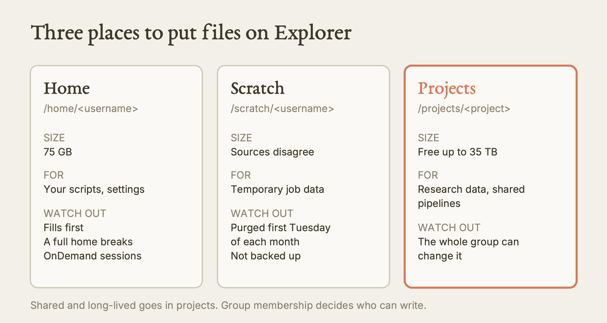
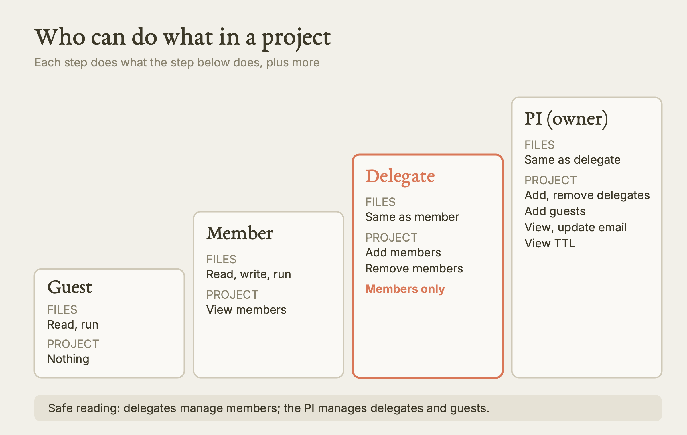
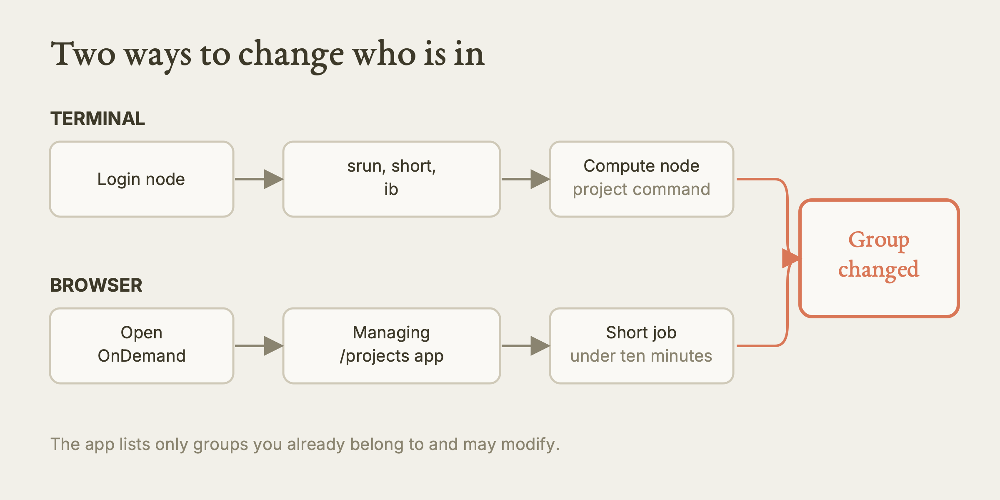
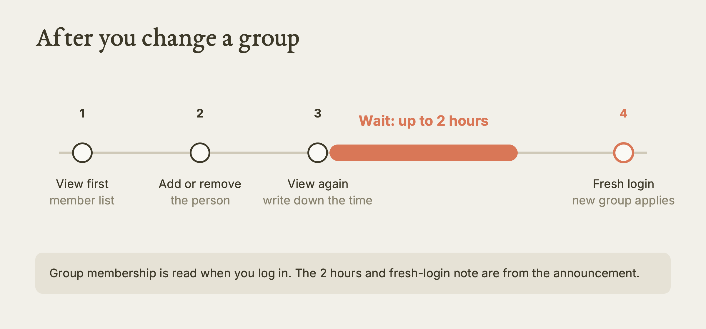

# Managing /projects on Explorer

This lesson teaches you where a research group's shared data lives on Northeastern's Explorer cluster, who may do what with it, and how the PI or a delegate changes who has access.

**Watch the film:** Film built, not yet published. Series: Explorer lectures (position not yet assigned). (Unlisted link, when it exists.)

**Based on:** Northeastern University Research Computing's training lesson *Managing /projects on Explorer*, presented by Gayathri Ayyar Manjula: https://github.com/northeastern-rc-training/Managing-Projects-on-Explorer. **This is our own rewrite, not a copy.** The structure follows our film; the wording, examples and exercises are ours; we added what we learned using it (real output, corrections, gaps). The original remains the authority; it is © its authors (the repository carries no license).

---

**What this is.** A lab on Explorer keeps its long-lived, shared files in a folder under `/projects`. Who can read and write that folder is decided by membership in a group. A command called `project` lets the group's owner (the PI) and any delegate the PI has named change that membership themselves, with no help ticket. This guide explains the three storage areas, the roles, the command, and the habits that keep the group tidy.

**Why it matters.** Group membership decides who can read, overwrite or lose your lab's data. A student who left two years ago and still has write access is a risk. A new student who waits a week for a ticket is a cost. Knowing the roles and the command removes both problems, and knowing what the command cannot do stops you from promising things it does not do.

**What we found.** We checked the lesson against Research Computing's other pages and against the live cluster. We confirmed that the `project` command exists on Explorer (it is on the login PATH at `/shared/EL9/explorer/explorer/bin/project`). We added a newer route the lesson predates: an Open OnDemand app called Managing /projects, announced 2026-08-25, which does the same job from a browser. We added the 2-hour delay and the fresh-login note for changes. We found two places where the sources disagree (can a delegate add guests, and how big is scratch), and we give the safe reading for each.

**What is NOT verified.** We did not run `project` itself, because it needs a compute node and, for changes, someone who is a PI or delegate. We did not use the OnDemand app. We did not run `groups` or `getfacl` on Explorer. Everything about the command's behaviour is "from the source, not run by us". We also do not know whether `project ... add members` can create an account for someone who has none.

---

## Act I: Storage

Every Explorer user sees three places to put files. They differ in size, in how long things last, and in who can see them.

| Place | Size | Use it for | Danger |
|---|---|---|---|
| `/home/<username>` | 75 GB | Your scripts, settings and small personal files | It fills first. A full home breaks Open OnDemand sessions. |
| `/scratch/<username>` | The sources disagree (see below) | Temporary job data | Everything is purged on the first Tuesday of each month. It is not backed up. |
| `/projects/<project>` | Free up to 35 TB | Research data, large files, shared pipelines | Whoever is in the group can change it. |



*The three storage areas on Explorer. Our diagram, drawn for this guide. [SVG](images/storage-areas.svg)*

Read the table as a decision. If a file must survive next month, it does not belong in scratch. If a file must be shared with your lab, it does not belong in home. Large shared datasets go in `/projects`.

A research group gets a projects space by asking for it through Research Computing's storage request form (the original lesson links the form; use the link on the Research Computing site rather than a copy of it from us). Storage up to 35 TB is free for research groups.

### The scratch size is unsettled

The lesson says each user gets 50 TB of scratch. Research Computing's scratch policy page says 20 TB and 20 million files. We could not tell which is current. The file-count limit only appears on the policy page, and it can bite long before the size limit does if you keep millions of small files. Do not quote either number to anyone. Check your own quota, and ask rchelp@northeastern.edu if it matters for a decision.

### What we know about backups

Only scratch is stated to be not backed up. No source we read says whether `/home` or `/projects` is backed up. If a file is irreplaceable, keep a copy somewhere else too: three copies, on two kinds of storage, one of them off site.

## Act II: Roles

Access to a project is a ladder. Each rung can do everything the rung below it can, plus something more.

| Role | What it can do on the files | What it can do with `project` |
|---|---|---|
| Data custodian | Nothing. It is only an email address. | Receives quota warnings and TTL notices. It does not need to be a cluster user, and a group may have none. |
| Guest | Read and run files. Cannot write. | Nothing. |
| Member | Read, write and run. | View the member list. Cannot change anyone. |
| Delegate | Everything a member can. | Add and remove members. See the safe reading below for guests. |
| PI (owner) | Everything a delegate can. | Add and remove delegates, add guests, view and update the group email, view the TTL. |



*The roles ladder, using the safe reading for delegates. Our diagram, drawn for this guide. [SVG](images/roles-ladder.svg)*

Two roles deserve a note. A guest is the right role for an outside collaborator who only needs to read your data. They cannot overwrite it by accident. And research computing recommends that every PI name at least one delegate, usually a lab manager or a senior postdoc, so that routine changes do not wait for the PI.

### The delegate and guest conflict: the safe reading

The lesson describes a delegate as able to add and remove members and guests. The lesson's own command table says only the PI can add guests, and our other source says delegates add and remove members. Also, there is no command anywhere in the sources to remove a guest.

The safe reading, and the one we follow: **a delegate manages members only. The PI manages delegates and guests.** If you are a delegate and need a guest added or removed, ask the PI, or ask rchelp@northeastern.edu. Do not tell anyone a delegate can do it until you have seen it work.

### TTL: an expiry on the paperwork, not on your data

When a project is created, Research Computing gives it a TTL, "time to live". It marks how long Research Computing is committed to supporting the project. When it runs out, Research Computing emails the PI and the data custodian to ask: is the project still active, and has anything changed, such as a new PI?

The TTL does not lock anyone out and does not delete anything. Treat the email as a check-in. Reply to it. If the email goes to an address nobody reads, that is a problem, which is why the group email matters (see Act III).

## Act III: Commands

### Where you must run it

The `project` command does not run on a login node. You first move to a compute node in the `short` partition:

```bash
srun -p short --constraint=ib --pty bash
```

The prompt changes to show a compute node name. The `--constraint=ib` part asks for a node on the InfiniBand network, which the command needs.

Two cautions. First, this asks the scheduler for a real allocation, so do it in your own terminal, and leave the session when you are done. Second, an agent or a script cannot hold an interactive session; for those, the single-command form used by our rules is `srun -p short --constraint=ib --time=00:10:00 project <name> view members`. We have not verified that form on Explorer, so treat it as unverified.

Tab completion works. Type `project <name>` and press Tab to see the next words.

### The shape of every command

```text
project <project_name> <action> <subcommand> <users>
```

The action is `view`, `add`, `remove` or `update`. The subcommand is the thing acted on: `members`, `delegates`, `guests`, `groupemail` or `ttl`. The users are a list, where it applies. Several users go in as one comma-separated list with no spaces: `ana,ben,chloe`. A space breaks the argument.



*Two routes to the same change. Our diagram, drawn for this guide. [SVG](images/two-routes.svg)*

### Looking (read-only)

| Command | Who may run it |
|---|---|
| `project <name> view members` | Any member |
| `project <name> view delegates` | Delegate or PI |
| `project <name> view guests` | Delegate or PI |
| `project <name> view groupemail` | PI only |
| `project <name> view ttl` | PI only |

Looking changes nothing, so do it freely. Do it before every change, and again after.

### Adding

| Command | Who may run it |
|---|---|
| `project <name> add members <users>` | Delegate or PI |
| `project <name> add delegates <users>` | PI only |
| `project <name> add guests <users>` | PI only |

A worked case. A new student, `<new-user>`, joins your lab. Anyone allowed to add members runs:

```bash
project <project> view members
project <project> add members <new-user>
project <project> view members
```

The first line shows who is there now. The second adds the student. The third should show the new name. Three rotation students at once is still one command: `project <project> add members <user1>,<user2>,<user3>`.

After adding, wait. Group changes can take up to 2 hours to reach the whole cluster, and the new person may need to log in again before their session sees the new group, because group membership is read when you log in. The announcement states this for the OnDemand app. We assume the same for the command (inferred).



*The timeline of a membership change. Our diagram, drawn for this guide. [SVG](images/change-timeline.svg)*

### Removing

| Command | Who may run it |
|---|---|
| `project <name> remove members <users>` | Delegate or PI |
| `project <name> remove delegates <users>` | PI only |

Removing a delegate only demotes them. They stay a member. To take someone out entirely, run both: `remove delegates` first, then `remove members`.

Removing a member is a change to shared data access. Before you run it, check the name against `view members`, and be sure you are removing the right person. If someone's work is on the project, make sure it is copied or handed over first. We cannot tell you whether a removal is undone by adding the person back; the sources do not say.

### Updating the group email

```bash
project <project> update groupemail <data-custodian-email>
```

PI only. The address does not have to belong to a cluster user. It is where quota warnings and TTL notices go.

### The browser route: Managing /projects in Open OnDemand

Since 2026-08-25, Research Computing offers the same job as an Open OnDemand app. On the Explorer OnDemand dashboard, open Files, then **Managing /projects**. You pick the group from a drop-down, type the usernames (comma-separated, no spaces), and click Launch. The app submits a short job on the `short` partition that should finish in under ten minutes, and its output log shows who was in the group and what changed. It only lists groups you already belong to and may modify. If a project is missing from the drop-down, email rchelp@northeastern.edu.

This route needs no `srun` and no terminal. It is the easier choice for people who dislike the command line. We have not used it, so we cannot show you what the screens look like.

### Two checks that don't use `project`

```bash
groups <username>
getfacl /projects/<project>
```

`groups` lists every group a person belongs to, which tells you whether a change reached them. `getfacl` prints the access control list on the project folder, which is what the filesystem will actually enforce. In the lesson's example, the owner is root, the group is the project, the group has read, write and execute, and "other" has nothing. That "other has nothing" setting is the design: access comes from the group. Do not "fix" sharing by opening the folder to others (`chmod o+...` or `chmod 777`). Add the person as a member or a guest instead.

Both commands are read-only. We have not run them on Explorer ourselves.

### Four habits

1. **Review the list after anyone leaves.** Run `view members` each term, and remove people who have gone.
2. **Use guest, not member, for readers.** Least access that does the job.
3. **Name a delegate.** The PI should not be the bottleneck for every change.
4. **Keep the group email current.** A quota warning sent to a dead address is a warning nobody sees.

## Terms

| Term | In our words |
|---|---|
| `/projects` | The shared, long-lived storage area for a research group, free up to 35 TB. Not the same as scratch. |
| `project` command | The terminal tool for viewing and changing a project's membership. Runs on a compute node, not a login node. |
| PI | The principal investigator, the owner of the project. Has full control of its roles. |
| Delegate | A member the PI trusts to handle day-to-day membership. We read this as members only. |
| TTL (time to live) | An administrative date by which Research Computing checks in with the PI. It does not delete data or restrict access. |
| `ib` constraint | A request for a node on the InfiniBand network, which the `project` command needs. |

## Try it

1. **Check the command exists. Tested by us (2026-10-11).** On an Explorer login node, run `command -v project`. You should see the path `/shared/EL9/explorer/explorer/bin/project`. This only looks up the command; it does not run it.
2. **See your groups. From the source, not run by us.** On the login node, run `groups`. You should see a list of group names, and your lab's project group should be among them. If it is not, ask your PI or a delegate to add you.
3. **Read the folder's access rules. From the source, not run by us.** Run `getfacl /projects/<project>`. You should see an owner, a group named for your project, and a line for "other". Predict first: should "other" have any access? (The lesson's example says no.)
4. **List your project's members. From the source, not run by us.** In your own terminal, run `srun -p short --constraint=ib --pty bash`, then `project <project> view members`. You should see the usernames of the group, and the prompt should show a compute node. Type `exit` when finished.
5. **Practise with the cluster's planning tools, read-only. From the source, not run by us.** If you are the PI, run `project <project> view delegates` and `project <project> view guests`. Compare the two lists with the people you expected.
6. **Add and then remove a test member, only if you are a PI or delegate and have a real person who needs it. From the source, not run by us.** Run `view members`, add one named person, run `view members` again, and write down the time. Then check with that person after a couple of hours. Do not add people just to test.

## What we tested, and what we only read

| Claim | Status |
|---|---|
| `project` exists at `/shared/EL9/explorer/explorer/bin/project` on the login PATH | Tested by us, 2026-10-11 |
| `srun -p short --constraint=ib --pty bash` gets you a node where `project` works | From the source, not run by us |
| All `view`, `add`, `remove` and `update` subcommands, and who may run them | From the source, not run by us |
| `groups` and `getfacl` output | From the source, not run by us |
| The Managing /projects OnDemand app, the 2-hour delay and the fresh-login note | From Research Computing's announcement, not run by us |
| Storage sizes (75 GB home, 35 TB projects) | From the source; scratch size disputed |

## Where the original is wrong, outdated, or silent

- **Delegate and guests.** The lesson says a delegate can add and remove guests, then its own table says only the PI can add guests. No remove-guest command is documented. We use the safe reading: delegates manage members, the PI manages guests and delegates.
- **Scratch size.** The lesson says 50 TB. The policy page says 20 TB and 20 million files. Do not quote a number; check your own quota.
- **The OnDemand route is missing.** The lesson predates, or does not mention, the Managing /projects app. It is the simplest way for many people, and it comes with the 2-hour delay and fresh-login note that the lesson does not give.
- **Silent on timing.** The lesson never says how long a change takes to work. Plan for up to 2 hours, and a new login.
- **Silent on new accounts.** It does not say whether `add members` works for someone who has no Explorer account. We do not know. Ask rchelp@northeastern.edu before promising it to a new student.
- **Silent on checking `/projects` usage.** No command to see how full the project folder is appears in the lesson. A `check-quota` command exists, but the only path documented for it is `/home`. We would ask Research Computing before relying on it for `/projects`.
- **Silent on undoing a mistake.** The lesson does not describe what happens if you remove the wrong person. Check the name first.
- **The usernames in examples** (including `jsmith`, `bpatel`, and the presenter's own) are illustrations. Use the real Northeastern usernames of your people. For your own login name, the access form's UserID is what worked for us once, and it may differ from your email prefix.
- **Agents.** No source says whether automated access to Explorer is allowed. If you let an agent look, restrict it to read-only commands, and let a human decide any membership change.

## Your turn

Paste this into Claude:

> I manage a research group's /projects directory on Explorer. Walk me through: (1) how to get onto an IB compute node, (2) how to view current members, (3) how to add a new grad student as a member, and (4) one best practice for keeping membership clean over time.

Then check whatever it tells you against this guide. Look for the comma rule, the compute node, and the "view before and after" habit.

## Sources

- Original lesson: https://github.com/northeastern-rc-training/Managing-Projects-on-Explorer (Northeastern University Research Computing, presented by Gayathri Ayyar Manjula).
- Research Computing announcement, Managing /projects through Open OnDemand, 2026-08-25: https://rc.northeastern.edu/2026/08/25/managing-projects-through-open-ondemand-ood/
- Research Computing documentation, managing projects: https://rc-docs.northeastern.edu/en/latest/managingprojects/index.html (group commands: `.../managingprojects/commands.html`; terminology: `.../managingprojects/terminology.html`).
- Research Computing help: rchelp@northeastern.edu.
- Our film: Film built, not yet published.
- Our agent rules: `skills/hpc/HPC.md` (sections on storage and projects, and Appendix A).
