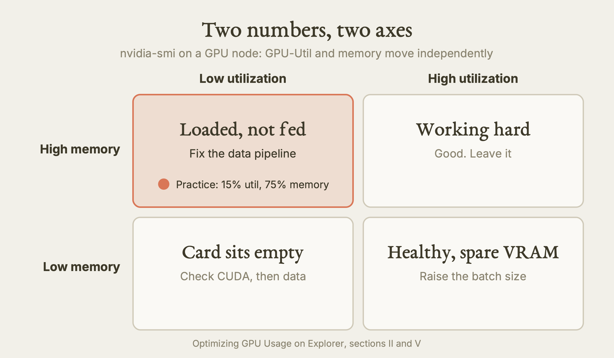
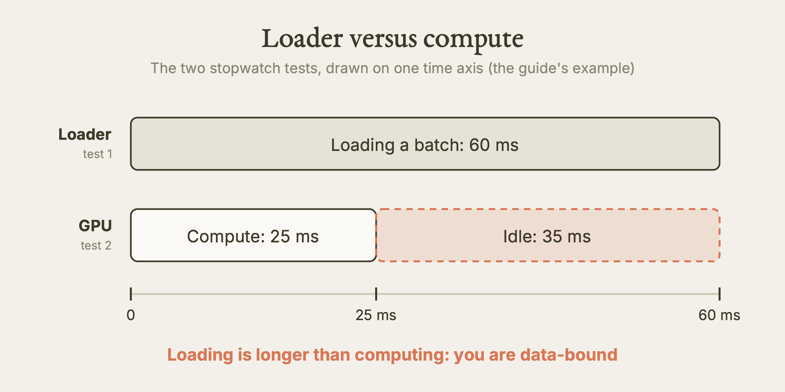
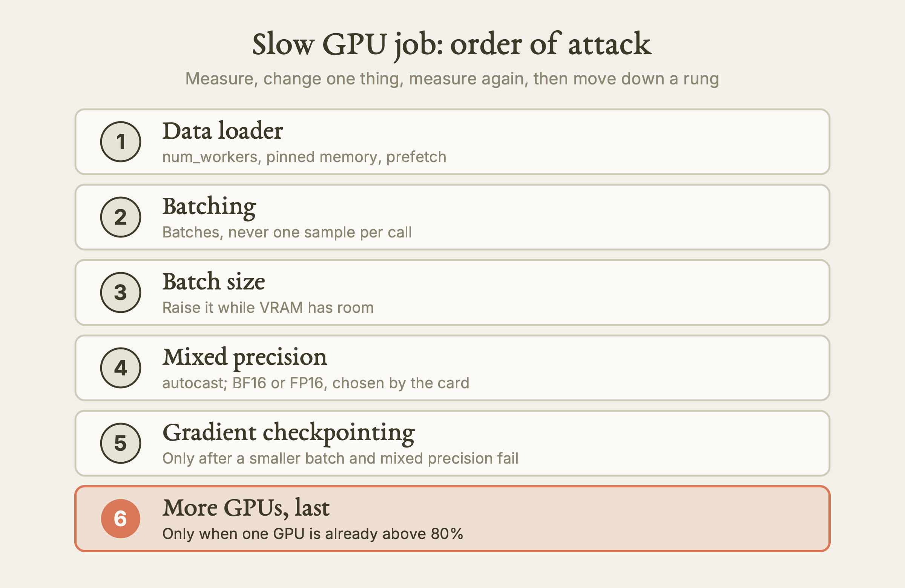

# Optimizing GPU Usage on Explorer

This guide teaches you how to check that a GPU job really used the GPU, how to measure it, and how to fix the handful of problems that waste most GPU time on Northeastern's Explorer cluster.

**Watch the film:** No film yet. (Our sibling film for the other cluster is *Optimizing GPU Usage on AICR*, https://youtu.be/8oinGvzgzgc, unlisted link. It teaches the same loop on AICR; section "Explorer versus AICR" below says what changes.)

**Based on:** Northeastern University Research Computing's training lesson *Optimizing GPU Usage on Explorer* (the notebook text is titled "GPU Profiling and Performance Optimization on Explorer"), presented by Arsalan Akhter: https://github.com/northeastern-rc-training/Optimizing-GPU-Usage-on-Explorer. **This is our own rewrite, not a copy.** The structure follows our film for the AICR version of the same lesson; the wording, examples and exercises are ours; we added what we learned using it (real output, corrections, gaps). The original remains the authority; it is (c) its authors (the repository carries no license).

---

**What this is.** A written lesson on GPU efficiency for researchers on Explorer. A GPU job that finishes without an error has not necessarily used the GPU. The lesson gives you a fixed order of work: confirm the card, watch it, profile it, feed it, fill it, and only then think about more cards.

**Why it matters.** GPU time is scarce and a stalled job holds its card and your queue place while doing nothing. The fixes are usually small: a loader setting, a batch size, one wrapper around the forward pass. Measuring first tells you which one, and stops you from requesting four GPUs for a problem that four GPUs would make four times more expensive.

**What we found.** We read the original lesson and its scripts completely, checked its Explorer facts against the live login node on 2026-10-11 (read-only), and compared it with our AICR film and the rule files we use. Corrections and gaps: the original's reference table lists two GPU types, but `partition gpu` has five (`v100-sxm2`, `v100-pcie`, `a100`, `h200`, `t4`); it says there is no `python` module, but there is a `python/3.13.5` module; its two precision scripts choose the number format differently; two Slurm templates break if pasted as written; one script it points to is not in the repository; and it never mentions IdleBot. Details in "Where the original is wrong, outdated, or silent".

**What is NOT verified.** We ran nothing on a GPU node. Every command that needs a compute node (`srun`, the demo scripts, profiling, `gpu-logs`, `nsys`) comes from the original and is marked as not run by us. The speed and utilisation numbers in the original are the author's illustrations; we did not reproduce them.

---

## The lesson

Words used here and defined in the glossary at the end: GPU utilization, VRAM, DataLoader, profiler, BF16, DDP.

### Opening: the idea

A finished job is not proof of a busy GPU. Code that cannot find a GPU quietly runs on the CPU. Code that finds one may keep it waiting for data most of the time. Both look like success in the log.

One rule runs through everything below: **measure first, change one thing, measure again.** The lesson is a set of measuring tools and a short list of fixes for what they show.

### I. Do You Have The GPU?

Three ways a GPU job goes wrong without an error message:

- You asked for one kind of card and got another, with different memory and abilities.
- The software cannot see a GPU (wrong node, wrong environment) and uses the CPU instead.
- A setting left in your shell hides or changes the card you were given.

**How Slurm hands you a GPU.** You need two things in the request: a GPU-enabled partition and a `--gres` line that names the card. A minimal batch script looks like this (our example, not the original's file):

```bash
#!/bin/bash
#SBATCH --job-name=gpu_check
#SBATCH --partition=gpu
#SBATCH --nodes=1
#SBATCH --ntasks=1
#SBATCH --cpus-per-task=8
#SBATCH --gres=gpu:v100-sxm2:1
#SBATCH --mem=32G
#SBATCH --time=01:00:00
#SBATCH --output=logs/%x_%j.out
#SBATCH --error=logs/%x_%j.err

source /scratch/<username>/<project>/gpu_env/bin/activate
python check_gpu.py
```

Points to take from it:

| Line | What to know |
|---|---|
| `--gres=gpu:v100-sxm2:1` | Names the type. A bare `--gres=gpu:1` may give you a different card. Name the type when it matters. |
| `--mem=32G` | This is CPU memory. The GPU's own memory (VRAM) comes with the card. Raising `--mem` never fixes a CUDA out-of-memory error. |
| `--cpus-per-task=8` | Your data-loading workers run on these cores (more in Act IV). |
| `logs/` | Create the folder yourself before `sbatch`: `mkdir -p logs`. Slurm opens the output file before your script body runs, so a `mkdir` inside the script can be too late (inferred; the original says either works). |
| no `module load cuda` | For PyTorch installed from pip wheels, the wheel carries its own CUDA runtime and the node already has the NVIDIA driver. Do not load a CUDA module for it. |

**Which partitions.** These limits come from the original and from `sinfo` on the login node (2026-10-11); `sinfo` is the authority if they change.

| Partition | Time limit | Use it for |
|---|---|---|
| `gpu-short` | 2 h | Quick tests, profiling, debugging. Prioritised. |
| `gpu-interactive` | 2 h | Interactive work, including Open OnDemand. |
| `gpu` | 8 h | Normal training jobs submitted with `sbatch`. |
| `multigpu` | 24 h (original) | Several GPUs per job. Needs an approved access request. |
| `sharing` | 1 h | Community-lent GPUs. Short tests only. |

**Ask the cluster what exists.** Do not guess a `--gres` string.

```bash
sinfo -p gpu -o "%G"
sinfo -p gpu -O "NodeList,Gres:30,GresUsed:30"
```

The first lists the GPU types and counts on a partition. The second shows, per node, what is installed and what is in use. A node marked `MIXED` has some CPUs busy; that says nothing about whether a GPU is free, so read the `GresUsed` column.

On 2026-10-11 the first command (in a longer form we ran on the login node) showed these GPU types on partition `gpu`: `v100-sxm2` (4 per node on most nodes), `v100-pcie` (2), `a100` (3 or 4), `h200` (8), and `t4` (4).

**Verify at runtime, every time.** The original ships a check script (`scripts/01_gpu_verify.py`). It does five things, and you can write your own to do the same:

1. Ask PyTorch whether CUDA is available.
2. Print how many GPUs it sees, their names and their memory.
3. Print `CUDA_VISIBLE_DEVICES`.
4. Run `nvidia-smi` and compare.
5. Send a small tensor to the GPU and back.

`torch.cuda.is_available()` only says PyTorch can see a card. The round trip shows it can use one. Do not report "GPU OK" from a script that only tests whether the `CUDA_VISIBLE_DEVICES` variable exists; that never touches CUDA.

If CUDA is not available, check in this order: (1) you are on a login node, which has no GPU, so ask for a compute node; (2) your environment is not active, so you have a CPU-only PyTorch (run `which python`; it must point inside your environment); (3) a typo in `--gres`.

**`CUDA_VISIBLE_DEVICES`.** Slurm sets it to the numbers of the GPUs that are yours: `0` is one card, `0,1` is two. Do not set it yourself unless you mean to use a subset. In an interactive session it can be unset, which the original calls normal; our rule files say not to use the variable as proof either way. Use the tensor round trip.

**Idle GPUs are policed on Explorer.** The original is silent on this. IdleBot emails you after about 15 minutes of under-use and the job is cancelled after about an hour (from our rule file `HPC.md`; "under-use" has no published percentage). Treat a stalled GPU job as one that will be killed.

### II. Seeing The GPU Live

The first profiler is `nvidia-smi`. Two numbers matter:

- **GPU-Util:** the share of the last second in which at least one GPU kernel was running. Under 50% means something is wrong.
- **Memory:** how much of the GPU's VRAM is allocated.

They are independent. Read them as two axes:

| | Low utilization | High utilization |
|---|---|---|
| **High memory** | Model loaded, nothing feeding it. Fix the data pipeline. | Working hard. Good. |
| **Low memory** | The card sits empty. Check CUDA and data first. | Healthy, with unused VRAM. Raise the batch size. |



*Utilization and memory are independent axes; read both. Our diagram, drawn for this guide. [SVG](images/utilization-memory-2x2.svg)*

Practice question: utilization 15%, memory 75%. The model is loaded and the card is barely computing, so the CPU side is not feeding it. That is data starvation, covered in Act IV.

A human can watch it live with `watch -n 1 nvidia-smi` in a second terminal on the compute node. A coding agent should not (the command never exits); inside the job script log a bounded sample instead (our rule file gives the form), and read the post-job report in Act VII.

**`nvitop`** is a richer live view: per process, with memory trend, power and temperature. It is useful on a shared node to confirm that your Python process, not someone's leftover, is using the GPU. On Explorer you install it into your own venv with pip (the original's setup script does).

**Bands we use** (the original uses 50, 60, 70 and 80 in different places; ours is one reconciled set, from `HPC.md`): below 50% utilization is a problem; below 60%, suspect the data pipeline and fix it before the next run; 60% to 70% is amber; 70% or more is acceptable; 80% to 100% is the target. For memory, 60% to 90% is healthy and under 40% means room to raise the batch.

**Where `nvidia-smi` runs.** On 2026-10-11 `nvidia-smi` was not on the Explorer login node's PATH (the command was missing there). It is for use on a GPU node inside your job or interactive session.

### III. The Profiling Toolchain

`nvidia-smi` tells you there is a problem. A profiler tells you where the time went. Use the lightest tool that answers your question, and stop as soon as you know.

| Layer | Tool | The question it answers |
|---|---|---|
| Live system | `nvidia-smi`, `nvitop` | Is the GPU busy? How full is VRAM? |
| Framework | PyTorch Profiler | Which operator or layer takes the GPU time? |
| Timeline | Nsight Systems (`nsys`) | In what order do CPU threads, kernels and copies run? |
| One kernel | Nsight Compute (`ncu`) | Is this kernel limited by memory or by compute? |

You rarely need the last two. The original's worked path: `nvidia-smi` shows 18% utilization with 72% memory; the PyTorch Profiler shows the data loader on top with no GPU time; a timeline shows long gaps with file reads in them; the fix, more loader workers, was already visible at the framework step.

**Profile in a short interactive session, not through the batch queue.** Get a session on `gpu-short`, activate your environment, run 20 to 50 steps, change one thing, repeat. Move to `sbatch` only when the code is tuned and needs hours. A rule of thumb from the original: if it runs in under 30 minutes interactively, do not bother with `sbatch`. A typical request (from the original; not run by us):

```bash
srun --partition=gpu-short --gres=gpu:v100-sxm2:1 --cpus-per-task=8 \
     --mem=32G --time=01:00:00 --pty bash
```

**PyTorch Profiler.** Profile a small window, 10 to 20 steps, never the whole run. Record CPU and CUDA activity, step the profiler each iteration, then print the table sorted by total CUDA time. Run a few untimed warm-up steps first, or kernel start-up cost will dominate the table. Read it in this order:

1. Gaps between GPU kernels: the GPU is idle and the CPU is not keeping up.
2. Large `aten::copy_` rows: data is moving between CPU and GPU too often.
3. CPU time far above CUDA time: the work is not really on the GPU.
4. DataLoader functions at the top: the data pipeline is the bottleneck.

In the original's example, `DataLoader.__next__` took 1.843 s of CPU time and no CUDA time over 20 calls, while all GPU work together took under 0.6 s. After fixing the loader it dropped to 0.024 s. These are the author's illustrations.

**Nsight Systems.** Use it when order matters. Trace a short run (one or two epochs, or limit the duration), write the report to `/scratch/<username>`, not your home directory, and open the `.nsys-rep` file in the Nsight Systems program on your laptop. What the original says to look for:

| Timeline pattern | Meaning |
|---|---|
| GPU row mostly empty with short bursts | Data arrives late. More workers and prefetch. |
| File `read()` calls filling the gaps | Reading from the network filesystem during training. Overlap loading with compute; store data as a few large files. |
| Host-to-device copies scattered through each step | Data moved inside the loop. Use pinned memory. |

The original has two more rows we would not act on without checking (see the corrections section). We did not find out whether `nsys` or `ncu` are on Explorer's login PATH or provided by a module; check with `module avail` or ask Research Computing before relying on them.

### IV. Data Starvation

The most common cause of low utilization is not the model. It is a pipeline that cannot supply data as fast as the GPU eats it. Picture a very fast cook who has to wait at the counter for each delivery: the cook is fine, the deliveries are slow.

**Two stopwatch tests, no profiler needed.**

1. Time 50 batches coming out of your loader, with no GPU work.
2. Time 50 forward and backward steps on synthetic data created directly on the GPU, calling `torch.cuda.synchronize()` before you stop the clock.

If loading takes longer than computing, you are data-bound, and no model change will help until you fix the loader. If compute takes 25 ms and loading takes 60 ms, the GPU idles for 35 of every 60 ms.



*The two stopwatch tests side by side: when loading is longer than computing, the GPU waits. Our diagram, drawn for this guide. [SVG](images/loader-vs-compute.svg)*

**The four DataLoader settings.**

| Setting | What it does | Starting value |
|---|---|---|
| `num_workers` | CPU processes that load data in parallel. The default `0` loads one batch at a time in the main process. | `--cpus-per-task` minus 1 |
| `pin_memory=True` | Page-locked RAM, so the copy to the GPU is faster. | Always on a GPU job |
| `persistent_workers=True` | Keeps workers alive between epochs, avoiding repeated process start-up. | On whenever workers is above 0 |
| `prefetch_factor` | Batches each worker prepares ahead of time. Costs CPU memory. | 2, raise if still slow (the original's example uses 4) |

So `--cpus-per-task` should be `num_workers + 1`, and at least 4. Raise `--mem` modestly when you raise workers and prefetch (inferred: each worker holds batches in RAM). The original's own code snippet pairs `num_workers=8` with `--cpus-per-task=8`; its stated rule gives 7. Follow the rule.

**Never feed the GPU one item at a time.** Every GPU call has a fixed cost (launch, transfer set-up, synchronisation). Ten thousand single-sample calls pay it ten thousand times; one batched call pays it once.

**The original's illustration** (ResNet-50 on an A100): about 18% utilization and 420 images per second with no workers; about 55% and 1,300 with 8 workers and pinned memory; about 82% and 1,950 with prefetching added. No script in the repository produces these numbers, so use them to see the direction, not as a promise.

**Storage.** On Explorer `/home`, `/scratch` and `/projects` are all network filesystems. Keep data in `/scratch/<username>` or a `/projects` directory, packed as a few large files, not millions of small ones, and never in `/home`. For molecular dynamics, write fewer, larger output files.

### V. Memory vs Utilization

Fixing the wrong one wastes a day. Utilization low means the GPU is waiting. Memory low means VRAM is unused. Memory high is only a problem near the edge, where the job crashes with an out-of-memory error.

| You see | It means | Try |
|---|---|---|
| Low util, low memory | Card sits empty | Verify CUDA, then data pipeline |
| Low util, high memory | Loaded, not fed | Data pipeline or synchronisation |
| High util, low memory | Healthy, unused VRAM | Raise the batch size |
| High util, high memory | Good | Leave it |
| Out-of-memory crash | Batch too large | Smaller batch, mixed precision, gradient checkpointing |

**Batch size** is the simplest lever. Doubling it roughly doubles throughput until you are compute-bound, if the memory is there. If `nvidia-smi` shows memory around 20% and nothing fails, double the batch and measure again. Find the ceiling by trying sizes (a binary search) and leave a margin: a forward and backward test ignores the optimizer's memory.

**Mixed precision.** By default PyTorch uses 32-bit numbers. Modern GPUs run 16-bit numbers much faster on dedicated hardware, and 16-bit values take half the space. Wrap the forward pass and the loss in `autocast`, and leave `loss.backward()` outside it. Do not cast the whole model by hand; the safe parts (master weights, loss, softmax, normalisation) stay 32-bit under `autocast`, and training diverges often without that.

| Format | Where to use it on Explorer | Trade-off |
|---|---|---|
| FP32 | Baselines and debugging | Slowest, most memory |
| BF16 | A100 and newer (H100-class; the H200 is in the same family, inferred) | Keeps FP32's range, so no loss scaler; coarser precision |
| FP16 | V100 and T4 (no BF16 hardware) | Finer precision but small range, so it needs `GradScaler` |

Choose by the card's compute capability (major 8 or higher means BF16), not by `torch.cuda.is_bf16_supported()`. The original's own memory script says that call returns true even on a V100. Be honest about gains: total memory does not halve (optimizer state and master weights are unchanged), and the speed-up depends on how much of your work is matrix and convolution maths. The original quotes "up to 8x" for matrix operations; one of its scripts says 1.5 to 3x for a whole step. Quote neither as what you will get.

**Gradient checkpointing** trades compute for memory: activations are recomputed during the backward pass instead of stored. The original claims about 60% to 70% less activation memory for about 30% more compute (uncited). Use it only after a smaller batch and mixed precision have failed, for example when the batch is forced below 8 or you fine-tune a very large model on one card. In Hugging Face it is one call.

**Watching memory.** Log peak VRAM per epoch with `torch.cuda.max_memory_allocated()` and compare it with the card's total. After catching an out-of-memory error, delete the big objects and call `torch.cuda.empty_cache()`.

### VI. More Than One GPU

Adding GPUs multiplies the efficiency you already have; it does not create it. A job at 20% on one card is a four-card job at 20% that uses four times the allocation.

| Situation | More GPUs help? |
|---|---|
| One GPU already above 80% | Yes |
| One GPU under 60% | No. Fix that first. |
| Model does not fit in one GPU's memory | Needed, but plain data-parallel copying does not solve it (see below) |
| Job limited by reading data | No. More GPUs compete for the same filesystem. |


*Fix one card before adding more; extra cards multiply the waste. Our diagram, drawn for this guide. [SVG](images/eighty-percent-rule.svg)*

**Data parallelism (DDP).** Each GPU holds a full copy of the model and takes a different mini-batch. After the backward pass they combine their gradients into one average (an all-reduce) and each applies the same update. Inside one node this is fast; between nodes it is slower. Stay on one node first.

Because every GPU holds a full model copy, DDP does not help when the model is too big for one card. That needs tensor or pipeline parallelism, which the original does not teach; ask Research Computing.

**Check your code is written for it.** A plain script given four GPUs uses one and wastes three. Confirm that `torch.distributed.is_available()` is true, that the process group is initialised, and that `torch.cuda.device_count()` matches what you requested.

**The rules for DDP code** (from the original): launch with `torchrun`, not by running `python`; use `DistributedDataParallel`, not the older `DataParallel`; wrap the model after moving it to its device; use `DistributedSampler` and call `set_epoch` each epoch; backend `nccl`.

**Three numbers must agree** (our rule, inferred from the original's template): `--gres=gpu:<type>:N`, `--ntasks-per-node=N`, and `torchrun --nproc_per_node=N`. Keep `--nodes=1`. The multi-node launch is not in the original; do not improvise one.

**Measure scaling.** Efficiency = throughput / (number of GPUs x single-GPU throughput) x 100. Above 80% the extra cards pay. Below 70%, stop and look for a communication or reading bottleneck. The original does not describe the band between 70% and 80%.

### VII. The Loop

Every bottleneck above shows up in roughly this order of frequency and ease of fix. The loop:

1. **Baseline:** run the job, record throughput (samples per second), utilization and wall time.
2. **Profile:** a short window.
3. **Diagnose:** data, memory, compute or communication.
4. **Fix one thing.** Only one, or you cannot tell what helped.
5. **Re-profile.** Did the bottleneck move?
6. **Record the gain** against the baseline.
7. **Repeat** until you reach diminishing returns.

**A decision guide.**

- Utilization under 50%: the data pipeline, first (is `num_workers` still 0?).
- 50% to 80%: look at memory. Under 50%, raise the batch. Between 50% and 85%, try mixed precision. Over 90%, shrink the batch or use checkpointing. Memory fine: profile.
- Over 80% and memory healthy: you are in good shape. Think about more GPUs only if one is truly saturated.
- Out-of-memory: the original's order is smaller batch, then mixed precision, then checkpointing.



*The order of attack, one change at a time, with more GPUs at the bottom. Our diagram, drawn for this guide. [SVG](images/order-of-attack.svg)*

**After the job: `gpu-logs <jobid>`.** Explorer has a report that gives GPU utilization over time for a finished job (the AICR equivalent is `jobstats`; it does not exist on Explorer, and `gpu-logs` is the Explorer one). It was on the login PATH on 2026-10-11, but it needs a compute node to run, so we have not run it. Read three things: the average utilization (aim above 70%), the shape of the line (flat and high is healthy; bouncing low is data starvation; flat and low means the workload is too small for the card), and the average VRAM (low means room for a bigger batch). Our rule file adds: it keeps about 7 days and covers public nodes only, so run it soon. If average utilization is under 60%, fix it before the next submission.

**Before you submit, check:**

- Your check script passed and you know the device name and VRAM.
- A short run showed utilization above 70%.
- `num_workers` is set and equals `cpus-per-task` minus 1; pinned memory is on; persistent workers and prefetch are set.
- The batch uses at least half the VRAM.
- Mixed precision is on, in the right format for the card.
- The request names the GPU type; `--cpus-per-task` is at least 4.
- `logs/` exists before `sbatch`.
- You profiled 20 to 50 steps and read the result.

### VIII. Your Domain

- **PyTorch and TensorFlow:** every act applies.
- **Hugging Face and other packaged tools:** Acts I, II and IV apply. In Hugging Face Trainer, the fixes are arguments: `bf16=True`, `gradient_checkpointing=True`, and `dataloader_num_workers` set from your CPU count.
- **Molecular dynamics (GROMACS, NAMD, AMBER):** verify the card, expect trajectory writing to limit you, write fewer larger files. Multi-GPU scales within a node and drops across nodes for small systems. Use `nvidia-smi` and `nvitop`; the PyTorch profilers do not apply.
- **Custom CUDA code:** everything applies, and Nsight Compute shows per-kernel detail.

**Getting help:** rchelp@northeastern.edu, office hours, and a booked consultation (via the Research Computing website).

### Explorer versus AICR

The same lesson exists for AICR, and the two clusters differ in ways that change what you type. Do not carry lines from one to the other.

| Topic | Explorer (this guide) | AICR (our other film) |
|---|---|---|
| GPU choice | Named in `--gres`: `v100-sxm2`, `v100-pcie`, `a100`, `h200`, `t4` (partition `gpu`) | The partition fixes the card (B200 or RTX PRO 6000); bare `--gres=gpu:1` is correct |
| Partitions | `gpu-short`, `gpu-interactive`, `gpu`, `multigpu`, `sharing` | `b200-devel`, `rtx-devel` (4 h), `b200-batch`, `rtx-batch` (24 h) |
| Python / PyTorch | A venv from system `python3` plus pip wheels; no CUDA module for the wheels | `module load cuda` plus a conda module environment |
| Modules | Classic Tcl Modules 5.3.0; a `python/3.13.5` module exists on 2026-10-11 | Lmod; no `python` module |
| After a job | `gpu-logs <jobid>` | `jobstats <jobid>` (from Princeton Research Computing; not on Explorer) |
| Idle GPUs | IdleBot: email after about 15 minutes, cancel after about an hour | Idle GPU jobs are cancelled |
| `nvidia-smi` on login node | Not on PATH (2026-10-11) | On PATH |

---

## Terms

- **GPU utilization:** the share of the last second in which the GPU ran any work at all.
- **VRAM:** the GPU's own memory, where your model and your batch live. Separate from the `--mem` you request.
- **DataLoader:** the part of PyTorch that reads, batches and hands data to the GPU.
- **Profiler:** a tool that tells you where the time went.
- **BF16:** a 16-bit number format that keeps the range of 32-bit floats, at lower precision.
- **DDP:** distributed data parallel, one copy of the model per GPU, with gradients averaged between them.

---

## Try it

1. **Read the GPU types on Explorer. Tested by us (2026-10-11).** On the login node run `sinfo -p gpu -o "%G"`. You should see a list of `gpu:<type>:<count>` entries including `v100-sxm2`, `a100`, `h200` and `t4`. Note which types you could ask for and what each count means. This does not use a compute node.
2. **See what is and is not on the login node. Tested by us (2026-10-11).** Run `command -v gpu-logs seff nvidia-smi`. You should see paths for `gpu-logs` and `seff`, and nothing for `nvidia-smi`. This is why GPU checks go inside a job.
3. **Check the Python situation. Tested by us (2026-10-11).** Run `module avail python`. On the date we tried it, you should see a `python/3.13.5` entry. Compare that with the original's claim of no python module.
4. **Write the verification check. From the source, not run by us.** In an interactive `gpu-short` session, write a short Python file that does the five checks from Act I, then run it. You should see the card's name, its memory, and a successful tensor round trip. Then deactivate your environment and run it again; watch it fall back to CPU.
5. **Run the two stopwatch tests. From the source, not run by us.** On your own loader, time 50 batches with no GPU work, then 50 steps on synthetic GPU data. Say whether you are data-bound, and write your baseline numbers down before you change anything.
6. **Change one thing. From the source, not run by us.** Set `num_workers` to `cpus-per-task` minus 1 and nothing else. Measure utilization again. After a batch run, read `gpu-logs <jobid>` and describe the shape of the line.

---

## What we tested, and what we only read

| Item | Status |
|---|---|
| GPU types and counts on partition `gpu`; partition time limits (`gpu` 8 h, `gpu-short` 2 h, `gpu-interactive` 2 h, `sharing` 1 h) | Tested by us, read-only on the login node, 2026-10-11 |
| `gpu-logs`, `seff`, `sacct` on the login PATH; `nvidia-smi` not on the login PATH | Tested by us, 2026-10-11 |
| Modules 5.3.0; a `python/3.13.5` module; CUDA modules exist | Tested by us, 2026-10-11 |
| `gpu-logs` output, `srun` sessions, the demo scripts, profiling, `nsys`, DDP launches | Only read; not run by us |
| Performance numbers (utilization and images per second, profiler times, 60% to 70% checkpointing saving) | Quoted from the original as illustrations; not reproduced |
| IdleBot timings | From our rule file `HPC.md`; not observed |

---

## Where the original is wrong, outdated, or silent

- **Missing script.** The quick-reference table points to `scripts/07_gpu_logs_guide.py`. The repository has scripts 01 to 06 only, so the post-job step has no demo and the `gpu-logs` "activity" column is unexplained.
- **Precision scripts disagree.** Script 05 picks BF16 or FP16 with `torch.cuda.is_bf16_supported()`; script 06 explains that this reports true even on a V100 and picks by compute capability instead. Use 06's method.
- **A pasted Slurm template breaks.** Both templates (`v100_single_gpu.slurm` and `ddp_multigpu.slurm`) put a comment after a trailing backslash on the training command. Bash then treats the backslash as an escaped space, ends the command early, and tries to run the next argument as a command ("command not found"). Remove the comment after the backslash. The templates also call `train.py` and `train_ddp.py`, which are not provided, and flags (`--fp16`, `--bf16`, `--data-dir`) your own script must define.
- **GPU types table is out of date.** The "at a glance" table lists V100 and A100 only. We saw five types on `gpu`, including `h200` (8 per node). The verify script prints "Unrecognised GPU" for anything not matching the cards it knows, so expect that message on an H200 (inferred from reading it).
- **Python module.** The reference table says there is no `python` module. A `python/3.13.5` module was listed on 2026-10-11. The venv approach still works and is what the lesson uses.
- **`nvidia-smi` is not on the login node's PATH.** The lesson never says where it runs; it runs on GPU nodes.
- **Thresholds are inconsistent.** The lesson uses 50%, 60%, 70% and 80% in different places for "too low". Pick one set, say which, and use it consistently. Ours is in Act II.
- **`num_workers` versus CPUs.** The stated rule is CPUs minus 1, but its snippets use 8 workers on 8 CPUs.
- **`logs/` created inside the script.** The lesson says either location works; create it before `sbatch`.
- **Two questionable nsys fixes.** "Do `.to(device)` in the DataLoader worker" goes against normal practice (loader workers do not normally make CUDA tensors; pinned memory handles the transfer), and tuning `--nproc_per_node` or `find_unused_parameters` is not the usual cure for a gradient-sync gap. Do not act on these without checking.
- **No mention of IdleBot,** the policy that cancels idle GPU jobs on Explorer. Add it to your mental checklist.
- **Uncited claims.** The 20% to 40% pinned-memory gain, the "up to 8x" figure, the checkpointing percentages and the ResNet-50 table have no source and no script behind them.
- **Missing topics.** Nothing on job arrays, tensor or pipeline parallelism, multi-node DDP, or how to get `nsys` and `ncu` on Explorer.

---

## Your turn

Paste this into Claude:

> Here is my PyTorch training loop and my Slurm script: [paste both]. I run it on one GPU. Walk me through the optimization loop: what to measure for a 50-step baseline, how to profile 20 steps, and which of these to try first and why: DataLoader num_workers and pin_memory, a larger batch, BF16 autocast, gradient checkpointing, or a second GPU. Give me the exact code changes for your first pick only.

Then check two things yourself. Did it ask you to measure before it changed anything? And did it change exactly one thing?

---

## Sources

- Original lesson and code: https://github.com/northeastern-rc-training/Optimizing-GPU-Usage-on-Explorer (Northeastern University Research Computing; presenter Arsalan Akhter).
- Research Computing documentation: https://rc-docs.northeastern.edu/en/latest/index.html ; help: rchelp@northeastern.edu ; https://rc.northeastern.edu/getting-help/
- Multi-GPU partition access: https://rc-docs.northeastern.edu/en/latest/gpus/multigpu-partition-access.html
- Our AICR film (sibling): https://youtu.be/8oinGvzgzgc (unlisted link). No film yet for Explorer.
- Our agent rules: `skills/hpc/HPC.md` (Sections 3, 6 and 12) and `skills/aicr/AICR.md`.
- Our captured read-only output from 2026-10-11: `films/REAL-OUTPUTS.md`.
