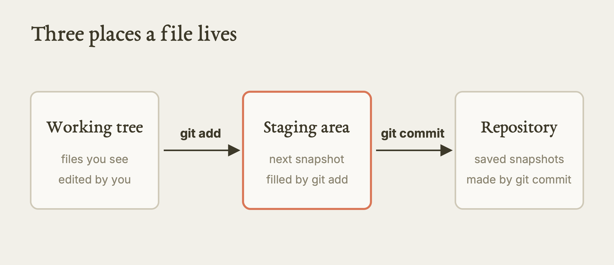
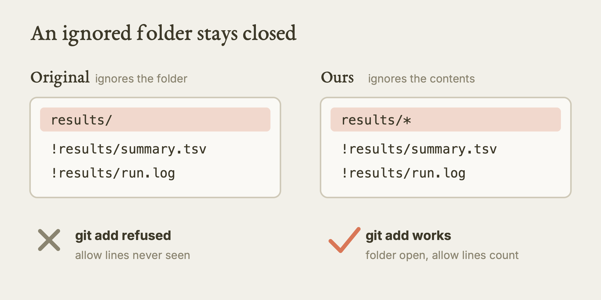
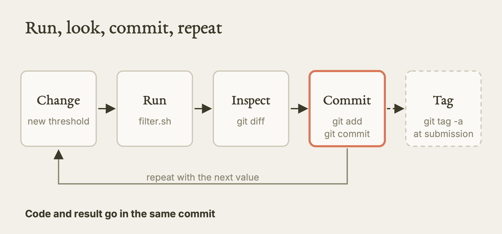
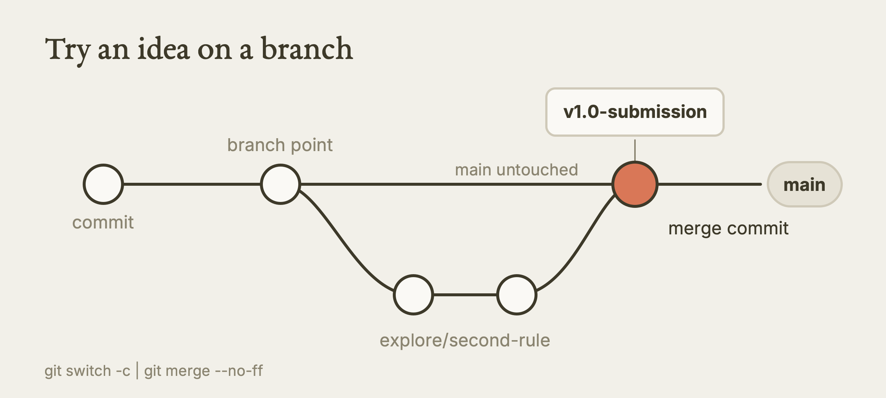
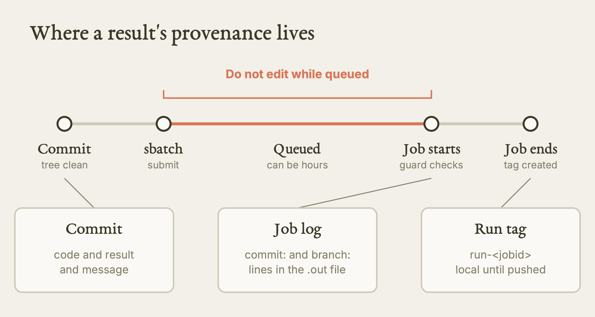

# Scientific Reproducibility II: Version Control

This lesson teaches you to use Git so that every result you produce, on a laptop or on a cluster, can be tied to the exact code and settings that made it.

**Watch the film:** No film yet. Read the sibling film first if you have not: [Scientific Reproducibility](https://youtu.be/68LPUyZrRYs) (the lesson that comes before this one; unlisted link).

**Based on:** Northeastern University Research Computing's training lesson *Scientific Reproducibility II* (Git for research, with a Slurm step): https://github.com/northeastern-rc-training/Scientific-Reproducibility-II-2026. **This is our own rewrite, not a copy.** The structure follows the original's order of ideas, reorganised; the wording, the example project and the exercises are ours; we added what we learned reading it against real cluster output and against Git's own rules (corrections, gaps). The original remains the authority; it is © its authors (the repository carries no license).

---

**What this is.** A written lesson on version control for research code. You will start a Git repository, save snapshots of your work, compare and rewind them, try risky ideas on a branch, mark the exact code behind a paper, and make a Slurm job refuse to run on code you have not saved. The example is a small filtering script on a table of numbers. It needs only `bash`, `git` and `awk`.

**Why it matters.** Six months after you submit a paper, a reviewer asks which threshold you used. Without history, you guess from file names such as `final_v2`. With history, you read the answer. On a cluster this matters more, because jobs run later, on another machine, from files you may have edited since. A job log that names its commit lets a stranger rerun your work.

**What we found.** We read the original against our cluster rules and against how Git behaves. Four things need correcting before you copy it. (1) Its `.gitignore` ignores a whole `results/` folder and then tries to let two files back in. Git does not allow that, so the commit step fails. (2) It says every command runs on Linux and Mac, but `date --iso-8601` and `sed -i 's/a/b/'` are GNU-only and behave differently on a Mac. (3) Its Slurm script asks for a partition called `compute`, which does not exist on Explorer. (4) Its safety check runs when the job starts, not when you submit, so a queued job can run newer code than the one you committed. We give a fix for each.

**What is NOT verified.** We did not run the Git steps, the example project or any job on Explorer or AICR; no session record of ours covers them. The only cluster facts here that we captured ourselves are the partition lists and module systems in the last table of the Slurm section, from read-only commands on 2026-10-11. We did check the `.gitignore` behaviour with a throwaway repository on a Mac while writing, but that is not in our session records, so we do not count it as tested. There is no film for this lesson yet.

---

## Part 1. Why keep history at all

Picture a folder with `filter.sh`, `filter_v2.sh`, `filter_final.sh` and `results_for_paper_FINAL/`. You cannot tell which script made which table. Version control replaces that folder with one script and a timeline.

| Without history | With Git |
|---|---|
| File names carry the version | Each change is a dated entry with an author and a message |
| "Which code made figure 3?" has no answer | You mark that exact commit with a tag |
| Two people overwrite each other | Each person works on a branch |
| A bad edit is hard to undo | You restore the earlier file or revert the change |
| A reviewer asks "did you try 0.5?" | You open the branch where you tried it |
| A colleague leaves and someone must rerun the job | The repository holds the code, the settings and the commands |

### The mental model

Git stores **snapshots**, not edits. A **commit** is a full picture of your tracked files at one moment, plus a pointer to the commit before it. Your history is a chain of those pictures. A **branch** is a movable name for one chain. A **tag** is a fixed name for one commit.

```
a3f8c21 --- b7d2e14 --- d9c1f37   <- main
               \
                e5a0b99          <- explore/idea
```

Three places hold your files, and most beginner trouble comes from mixing them up.

| Place | What it is | How a file gets there |
|---|---|---|
| Working tree | The files you see and edit | You edit them |
| Staging area | The list of changes going into the next snapshot | `git add` |
| Repository | The saved snapshots | `git commit` |



*The three places a file can be, and the command that moves it between them. Our diagram, drawn for this guide. [SVG](images/three-places.svg)*

## Part 2. What you need, and where to run it

You need `git`, `bash` and `awk`. Nothing else, and no modules. Check first.

```bash
for tool in git bash awk grep sort uniq wc cut; do
  command -v "$tool" >/dev/null && echo "OK       $tool" || echo "MISSING  $tool"
done
git config --global user.name
git config --global user.email
```

If the last two print nothing, set them once (use your own name and address):

```bash
git config --global user.name  "Your Name"
git config --global user.email "you@example.edu"
```

Where to run it:

- **Your laptop** is the easiest place to learn Git. Everything in Parts 3 to 9 works there.
- **A cluster login node** is fine for Git itself: Git commands are tiny. Do not run a real analysis there. If your script does heavy work, run it as a job (Part 10) or in an interactive session on a compute node.
- **Open OnDemand** (a web page that starts a notebook or a desktop for you on a compute node) is the other documented route on Explorer. We did not test it.

A note that applies to every cluster step in this lesson. **Explorer and AICR are different clusters.** Their usernames, partitions, storage and module systems differ. Where we show a cluster command we say which cluster it is for.

## Part 3. A small project of our own

We use a tiny example so you can see every line. It is ours, and we have not run it on a cluster. It reads a table of measurements, drops rows below a threshold, and writes a summary. The table has one row per sample and one number per row.

```bash
mkdir -p demo-filter/{data,scripts,results,slurm}
cd demo-filter

# a small made-up table: sample name, then a reading
printf 'sample\treading\n' > data/readings.tsv
for i in 1 2 3 4 5 6 7 8 9 10 11 12; do
  printf 'S%02d\t%d\n' "$i" $(( (i * 37) % 100 )) >> data/readings.tsv
done
```

This writes 12 rows with readings that depend only on the row number, so everyone gets the same file. Now the script. It takes the threshold as an argument, so you never have to edit it with `sed`.

```bash
cat > scripts/filter.sh << 'EOF'
#!/usr/bin/env bash
# filter.sh: keep samples whose reading is at least THRESHOLD.
# Usage: bash scripts/filter.sh [THRESHOLD]   (default 30)
set -euo pipefail

THRESHOLD="${1:-30}"          # the one tunable value, set here or on the command line
INPUT="data/readings.tsv"
OUTPUT="results/summary.tsv"
LOG="results/run.log"

mkdir -p results
{
  echo "start:     $(date -u +%Y-%m-%dT%H:%M:%SZ)"
  echo "input:     $INPUT"
  echo "threshold: $THRESHOLD"
  echo "commit:    $(git rev-parse HEAD 2>/dev/null || echo 'not tracked')"
} | tee "$LOG"

awk -v t="$THRESHOLD" 'BEGIN{OFS="\t"} NR==1{print; next} $2>=t' "$INPUT" > "$OUTPUT"

echo "kept:      $(awk 'NR>1' "$OUTPUT" | wc -l) of $(awk 'NR>1' "$INPUT" | wc -l)" | tee -a "$LOG"
EOF
chmod +x scripts/filter.sh
```

Two choices to notice. We print the date with `date -u +%Y-%m-%dT%H:%M:%SZ`, which works the same on Linux and Mac. The original used `date --iso-8601=seconds`, which is GNU-only. And the script writes the Git commit into its own log, so the log says which code ran.

## Part 4. Start tracking, and decide what to leave out

Run `git init` before the first run of your analysis, not after. It creates a hidden `.git/` folder, which is Git's database. One per project.

```bash
git init
git branch -M main          # make sure the first branch is called main
git status                  # shows untracked files
```

### The `.gitignore` file, and the trap in the original

Track the code that makes results, not the results. Put the things you do not want in a file named `.gitignore`.

The original ignores the whole `results/` folder and then lists two files it wants back (`!results/summary.tsv`). **That does not work.** Git does not look inside an ignored folder, so it never sees the "allow" lines. When you then run `git add results/summary.tsv`, Git refuses and tells you to use `-f`. This follows from Git's documented rule that a file cannot be re-included if its parent directory is excluded.

The fix is to ignore the folder's contents, not the folder:

```
# .gitignore
results/*
!results/summary.tsv
!results/run.log

data/*.fastq
data/*.fastq.gz
data/*.bam
slurm-*.out
.DS_Store
*.swp
*~
```



*The .gitignore trap: ignore the folder's contents, not the folder. Our diagram, drawn for this guide. [SVG](images/gitignore-trap.svg)*

`results/*` ignores everything inside `results/`; the two `!` lines then work, because the folder itself is not ignored. Notes on the rest:

- The original also ignores `*.log`. That would hide `results/run.log`, and a `!` line cannot beat a more general rule listed above it in every case. We left `*.log` out on purpose. Add it back only if you do not want to track `run.log`.
- Slurm writes `slurm-<jobid>.out` (a hyphen) by default. The original's job script writes `results/slurm_%j.out` (an underscore), which that pattern does not match. Under our `results/*` rule both are already ignored.
- Never commit passwords, tokens, keys or private data. List them in `.gitignore` before the first `git add`.
- Big raw data does not belong in Git. Keep it in project storage and track a small file that says where it is. For large files, the original mentions Git LFS (up to about 2 GB) and DVC.

Check what Git will ignore: `git check-ignore -v results/summary.tsv` prints the rule that ignores a file, or nothing if the file is tracked-eligible.

### The README comes before the first commit

A README is a note to anyone who clones the repo, including you in a year. Ours is short:

```
# demo-filter
Keeps samples whose reading is at least a threshold.

Requirements: bash, awk, git.

To reproduce the paper's table:
    git clone <repository-url>
    cd demo-filter
    git checkout v1.0-submission
    bash scripts/filter.sh 30
    # writes results/summary.tsv and results/run.log

Parameters: THRESHOLD, default 30, the only tunable value.
Data: data/readings.tsv (12 rows, included).
```

Name the tag to check out. Do not leave the reader to guess.

## Part 5. Save a snapshot

Three commands, used dozens of times a day.

| Command | What it does |
|---|---|
| `git status` | Shows what changed since the last commit |
| `git add <file>` | Puts a change in the staging area |
| `git commit -m "message"` | Saves the staged changes as a snapshot |

```bash
git status
git add .gitignore README.md scripts/filter.sh data/readings.tsv
git commit -m "Add filter script, README, gitignore and sample data"
git log --oneline
```

We name the files instead of typing `git add .`. A folder that holds data, tokens or logs can slip into the commit with `add .`. Stage what you mean to stage.

## Part 6. Run, look, commit the state that made the result

```bash
bash scripts/filter.sh 30
head results/summary.tsv
git add results/summary.tsv results/run.log
git commit -m "analysis: baseline run, threshold 30"
```

Now the result and the code that made it sit in the same commit. The log inside the commit even names the commit before it. Anyone can read the threshold from the message.



*The loop for every result: run, look, commit. Our diagram, drawn for this guide. [SVG](images/commit-loop.svg)*

### Habits for good commits

- **One logical change per commit.** If your message needs the word "and", make two commits. `git add -p` lets you stage part of a file.
- **Say why, not only what.** "Raise threshold 30 to 50; noise floor measured by a collaborator" beats "change number".
- **Look before you commit.** `git diff` shows unstaged changes; `git diff --staged` shows what is about to be saved.
- **Use a consistent message style.** The original suggests the pattern `type(scope): summary` with types like `feat`, `fix`, `data`, `analysis`, `docs`, `config`. Any style works if everyone uses it, because then `git log --grep="analysis"` finds things.

## Part 7. See what changed, and read the history

```bash
# change the threshold by editing the command, not the file:
bash scripts/filter.sh 50
git diff results/summary.tsv           # rows that disappeared
git add results/summary.tsv results/run.log
git commit -m "analysis: threshold 30 -> 50, stricter filter"
```

Tools for reading the past:

| Command | Answers |
|---|---|
| `git log --oneline` | What happened, one line each |
| `git log --stat` | Which files each commit touched |
| `git log --grep="threshold"` | Which commits mention a word |
| `git log -p -- scripts/filter.sh` | Every change to one file |
| `git blame scripts/filter.sh` | Who last changed each line, and when |
| `git diff HEAD~1 -- <file>` | What the last commit changed in a file |

Three aliases save typing. They go in your global config and apply to every repository:

```bash
git config --global alias.lg   'log --oneline --graph --all --decorate'
git config --global alias.st   'status --short --branch'
git config --global alias.last 'log -1 --stat'
```

## Part 8. Branches: try things without risking the working version

A reviewer asks you to try a different rule. You do not know yet whether it goes in the paper. Do not edit your main script directly. Make a branch.

```bash
git switch -c explore/second-rule
git branch --list
```

Edit, run, commit as usual. The `main` branch is untouched, and switching back restores its files:

```bash
git switch main
```

When you decide the idea belongs, **merge** it. The `--no-ff` option keeps a visible merge point in the history:

```bash
git merge explore/second-rule --no-ff -m "Merge explore/second-rule: used for revision"
git log --oneline --graph --all
git branch -d explore/second-rule      # delete the branch label; the commits stay
```

`git branch -d` only deletes a branch whose work is already merged, so it is the safe form. We never use the force form (`-D`) without asking whoever owns the repo.



*A branch for a speculative change, then a merge with a visible merge point. Our diagram, drawn for this guide. [SVG](images/branch-and-merge.svg)*

**Conflicts.** If two branches changed the same lines, Git stops and marks the file with `<<<<<<<`, `=======` and `>>>>>>>`. Open the file, keep the version you want, delete the markers, then `git add` the file and `git commit`.

**Shelving unfinished work.** If you must switch tasks with half-done edits, `git stash` sets them aside and `git stash pop` brings them back. The original's summary table lists `stash` but never demonstrates it; we only note it here and did not run it.

## Part 9. Tags, and getting an old result back

### Tag what you submit

Before a paper goes out, tag the exact commit behind your numbers.

```bash
git tag -a v1.0-submission -m "Code submitted to journal; threshold 50"
git tag -l -n1
```

Tags and branches are not sent by a plain push. Uploading to a remote such as GitHub changes something outside your machine, so do it deliberately and with the repository owner's agreement:

```bash
git push origin main
git push origin v1.0-submission
```

### Answer the reviewer

"What did you get with threshold 30?" Find the commit, then restore only the one file you need:

```bash
git log --oneline --grep="threshold 30"
git checkout <hash> -- scripts/filter.sh
bash scripts/filter.sh 30
git checkout HEAD -- scripts/filter.sh     # put today's version back
```

A note on that pattern. `git checkout <hash> -- file` overwrites the file in your working tree. Commit or stash anything you care about first. In newer Git, `git restore --source=<hash> -- file` does the same job with a clearer name (we did not run either).

**Undoing mistakes safely.** `git commit --amend` fixes the last commit if it has not been pushed. `git revert <hash>` adds a new commit that undoes an old one, which is safe on shared work. Never use `git reset --hard` on a branch other people use; it throws work away.

**Notebooks.** Jupyter notebooks carry their outputs, which makes noisy diffs. The original suggests `nbstripout` or Jupytext (both from pip). We did not try them.

## Part 10. Git with Slurm: every job traces to a commit

Two rules for cluster work:

1. **Commit before you submit.** Every job must trace to a specific commit.
2. **Print the commit in the job log.**

The original adds a guard to the job script: if the working tree has uncommitted changes, the job refuses to run. Here is our version. It is for a job on a cluster, so we label it plainly: **from the source, adapted by us, not run by us.**

```bash
#!/bin/bash
#SBATCH --job-name=demo_filter
#SBATCH --partition=<partition>        # see the table below; not "compute"
#SBATCH --ntasks=1
#SBATCH --cpus-per-task=1
#SBATCH --mem=1G
#SBATCH --time=00:10:00
#SBATCH --output=results/slurm_%j.out
#SBATCH --error=results/slurm_%j.err

# Reproducibility header
echo "job:     $SLURM_JOB_ID"
echo "node:    $SLURM_NODELIST"
echo "date:    $(date -u +%Y-%m-%dT%H:%M:%SZ)"
echo "commit:  $(git rev-parse HEAD)"
echo "branch:  $(git rev-parse --abbrev-ref HEAD)"

# Guard: refuse to run on uncommitted changes
if ! git diff --quiet || ! git diff --staged --quiet; then
  echo "ERROR: uncommitted changes. Commit, then resubmit." >&2
  exit 1
fi

bash scripts/filter.sh 30
git tag "run-$SLURM_JOB_ID" -m "Slurm job $SLURM_JOB_ID"
echo "tagged run-$SLURM_JOB_ID"
```

Create the `results/` folder before you submit, because Slurm opens the output files before your script runs. The original's script is meant to be submitted with `sbatch slurm/run_pipeline.sh`; look at your queue with `squeue -u $USER`.



*Where a job's provenance lives, and the window in which edits can change what runs. Our diagram, drawn for this guide. [SVG](images/submit-timeline.svg)*

### Which partition

The original's `--partition=compute` does not exist on Explorer. Use a name from a real list. These are from read-only `sinfo` runs we did on the login nodes on 2026-10-11:

| Cluster | CPU-only partitions we saw | Time limit |
|---|---|---|
| Explorer | `short` (the default, marked with `*`), `sharing` | `short` 2 days, `sharing` 1 hour |
| AICR | `cpu` (the default) | 1 day |

This job needs one CPU, so on Explorer `short` is a sensible choice and on AICR `cpu` is. AICR's other partitions hold GPUs (`rtx-*`, `b200-*`); a CPU-only script does not belong there. Check with `sinfo` before you copy a name, since partitions change.

### Four weak spots in the guard

1. **It runs when the job starts, not when you submit.** A job can wait in the queue for hours. If you edit the script in that time, the job may run the newer state. The recorded `git rev-parse HEAD` is the newer commit, not the one you thought you submitted. Rule: submit from a clean tree and do not edit while jobs are queued. (Our reading of the logic; not tested.)
2. **A clean tree means the previous result must be committed too.** In the original, a run writes tracked files. The next submission is blocked until they are committed. Commit them, or stop tracking outputs.
3. **The tag changes the repository from inside the job.** On a shared checkout, two jobs can both try to write tags. Tag only from a checkout you own.
4. **A tag the job creates exists only in that checkout.** It does not reach GitHub until someone pushes it.

A stronger variant, ours and untested: check the tree at submit time and pass the hash into the job.

```bash
git diff --quiet && git diff --staged --quiet || { echo "commit first"; exit 1; }
sbatch --export=ALL,SUBMIT_COMMIT="$(git rev-parse HEAD)" slurm/job.sh
```

Inside the job, compare `$SUBMIT_COMMIT` to `git rev-parse HEAD` and stop if they differ. That closes weak spot 1.

### What a complete job record holds

Our cluster rules ask every job to leave behind: job ID, node and partition, start and end times, commit, branch and run tag, the exact command and the script itself under version control, every parameter, every random seed, input paths with checksums, the software versions, the hardware used, the output folder, and the exit status. The guard above covers about four of these. You add the rest.

## Part 11. Commands you will use every day

```bash
git status                       # what changed
git diff <file>                  # line-by-line changes
git add <file>                   # stage a file
git commit -m "clear message"    # save the snapshot
git log --oneline                # the history
git switch -c explore/idea       # new branch
git switch main                  # back to main
git merge explore/idea --no-ff   # bring it back
git branch -d explore/idea       # clean up
git tag -a v1.0 -m "..."         # mark a moment
git checkout <hash> -- <file>    # restore one file from history
git log --grep="word"            # find commits by message
```

---

## Terms

| Term | Meaning |
|---|---|
| Repository | The project folder plus its hidden `.git/` database of snapshots |
| Working tree | The files you see and edit right now |
| Staging area | The list of changes that will go into the next commit |
| Commit | A saved snapshot with a message and a pointer to the one before |
| Branch | A movable name for a chain of commits, used for safe experiments |
| Merge | Joining the work of one branch into another |
| Tag | A fixed name for one commit, used to mark a paper or a job |
| `.gitignore` | A file listing what Git should not track |
| Remote | A copy of the repository on a server such as GitHub |

## Try it

1. **From the source, not run by us (safe, local).** Do Parts 3 to 6 in a fresh folder on your laptop. You should see `git log --oneline` list two commits, and `results/summary.tsv` contain only rows with a reading of 30 or more.
2. **From the source, not run by us (read-only first).** In a new repository, write `results/` then `!results/summary.tsv` in `.gitignore`, create that file, and run `git add results/summary.tsv`. You should see Git refuse and mention the ignored path. Change the first line to `results/*` and add again; it should now succeed.
3. **From the source, not run by us.** Make a branch, change your threshold rule, commit, switch back to `main`, and confirm with `git lg` (the alias from Part 7) that `main` did not move.
4. **From the source, not run by us.** Tag a commit `v1.0-submission`, make another commit, then use `git checkout v1.0-submission -- scripts/filter.sh` to get the tagged script back. Run it and then restore the latest version. You should be able to explain what each step changed.
5. **From the source, not run by us (needs a cluster and a job).** Save the job script from Part 10 on Explorer with `--partition=short`, or on AICR with `--partition=cpu`, with the tree clean. Ask your supervisor or RC before you submit if you are unsure. You should see the commit hash in the `.out` file and a `run-<jobid>` tag in `git tag`. Then edit a tracked file and submit again; the job should print the error and exit.

## What we tested, and what we only read

| Item | Status |
|---|---|
| Explorer partitions `short`, `sharing`; AICR partition `cpu`; Explorer uses Modules 5.3.0, AICR uses Lmod | Tested by us (2026-10-11), read-only `sinfo` and `module` output on the login nodes |
| Every Git command and the example project | Read only; not in our session records |
| `.gitignore` re-include trap | Checked once on a Mac with a throwaway repo while writing; not in our records; also follows from Git's documented rule |
| The Slurm job script and guard | Read only; not run by us on either cluster |
| `sbatch --export` check at submit time | Our idea; not tested |
| Open OnDemand route, Git LFS, DVC, nbstripout, Jupytext | Read only |

## Where the original is wrong, outdated, or silent

| Point | What it says | What we would do |
|---|---|---|
| `.gitignore` | Ignores `results/`, then re-allows two files | Use `results/*` so the `!` lines work; otherwise `git add` is refused without `-f` |
| `*.log` in the same file | Would also hide `run.log` | Leave it out if you track `run.log` |
| "Runs on any Linux or Mac" | Uses `date --iso-8601` and `sed -i 's/a/b/'` | Both are GNU-only. Use `date -u +%Y-%m-%dT%H:%M:%SZ`, and pass the value as an argument instead of editing with `sed` |
| `--partition=compute` | Does not exist on Explorer | Use `short` on Explorer or `cpu` on AICR, after checking `sinfo` |
| Job script options | Sets a mail address that is the presenter's, no safety margin for memory or time beyond defaults | Use your own address or none; size memory and time from a small test |
| Guard at job start | A queued job can run a later state | Submit from a clean tree; optionally check at `sbatch` time |
| Example data | Run results are committed so the guard blocks the next submit | Commit them first, or do not track outputs |
| Tag from the job | Not discussed on shared checkouts | Tag only from a checkout you own |
| Workspace paths | Uses `/projects/username` and a personal username | Use `/projects/<project>` and your own `<username>` |
| `git stash` | Listed, not shown | Learn it from the Pro Git book |
| Scope | No seeds, no checksums, no environment file | Record seeds, input checksums and software versions too (see "complete job record") |
| Closing line | Mentions "Containers & Singularity" as next | Explorer has `apptainer`; our read-only check shows it on the login node (version 1.4.5) |

## Your turn

There is no film for this lesson, so there is no film prompt. This one is ours. Open the folder of a real project you have, or a copy of it. Ask Claude (or a colleague) to do this, read-only first: "List every file in this folder. For each, say whether it is code, a setting, a result or raw data, and whether it should be tracked in Git. Then write a `.gitignore` that keeps the results out but lets one small summary file through, and tell me whether your `.gitignore` really lets that file through. Do not run anything and do not change any file." Read the answer. Then check one claim yourself with `git check-ignore -v`.

## Sources

- Original lesson (Northeastern University Research Computing): https://github.com/northeastern-rc-training/Scientific-Reproducibility-II-2026
- Pro Git (free): https://git-scm.com/book
- Git documentation on `gitignore` patterns: https://git-scm.com/docs/gitignore
- The Turing Way (reproducibility handbook): https://book.the-turing-way.org
- Sibling film, the lesson that comes first: https://youtu.be/68LPUyZrRYs (unlisted link)
- Our agent rules: `skills/hpc/HPC.md` (Section 9, Reproducibility; Section 12, Slurm traps) and `skills/aicr/AICR.md`; our digest `skills/evidence/E-software-reproducibility-local-llm.md` (S23 entries, conflicts C15 and C21)
- Our real read-only cluster output: `films/REAL-OUTPUTS.md` (2026-10-11)
- Help: rchelp@northeastern.edu
