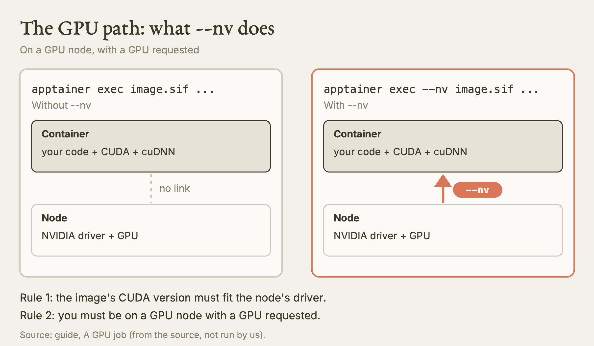
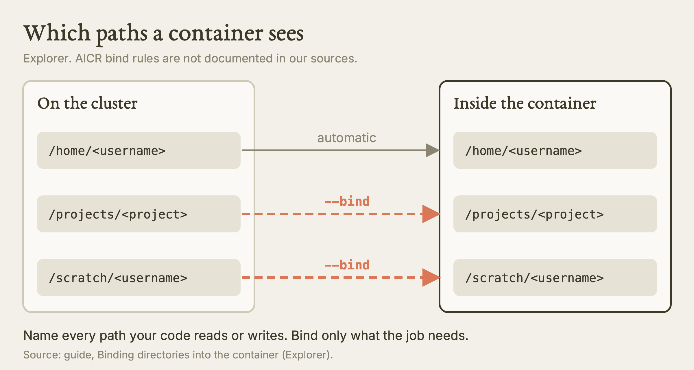
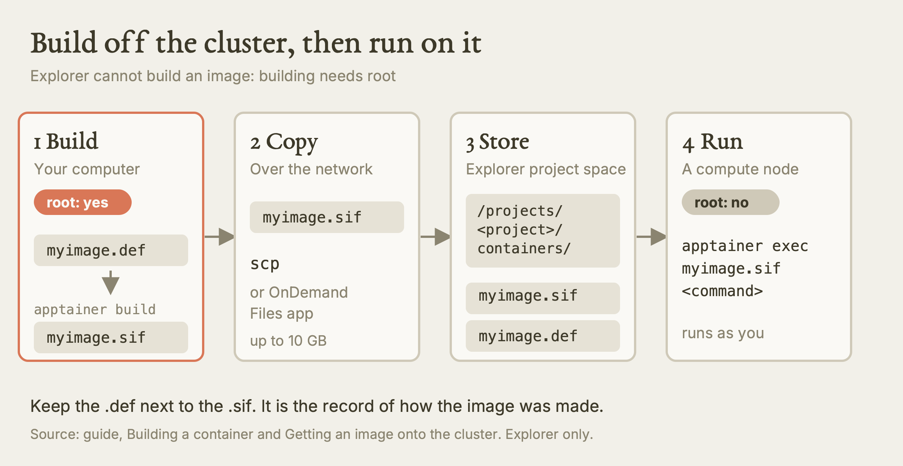
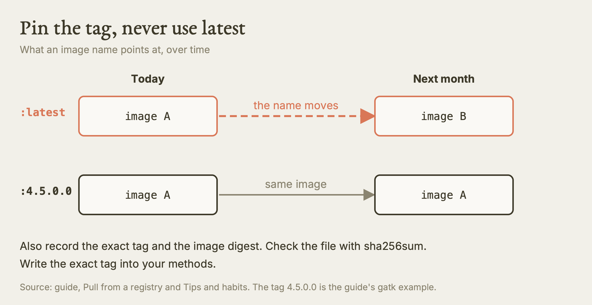

# Scientific Reproducibility III: Containers

This guide teaches you what a software container is, how to run one on a Research Computing cluster with Apptainer, and how to build, fetch and record one so that someone else can repeat your results.

**Watch the film:** No film yet. Two sibling films cover neighbouring ground: [Scientific Reproducibility](https://youtu.be/68LPUyZrRYs) (the record a job should leave behind) and [Installing Software on an HPC Cluster](https://youtu.be/l2RwXl8W-sA) (modules, conda and an Apptainer act). Both are unlisted links.

**Based on:** Northeastern University Research Computing's training lesson *Scientific Reproducibility III (container images)*, Spring 2026 series (no presenter is named in the repository): <https://github.com/northeastern-rc-training/Scientific-Reproducibility-III-2026>. **This is our own rewrite, not a copy.** There is no film for this lesson yet, so the structure follows the original's flow, reorganised; the wording, examples and exercises are ours; we added what we learned using it (real output, corrections, gaps). The original remains the authority; it is © its authors (the repository carries no license).

## Executive summary

**What this is.** A container is one file that holds a program together with everything it needs to run: libraries, settings and a runtime. On Northeastern's Explorer cluster you run containers with Apptainer. You build the file on a machine where you have administrator rights, copy the finished file to the cluster, and run it there as yourself.

**Why it matters.** Software that works on your laptop often breaks on a cluster, and software that works today often breaks after a system update. A container freezes the whole software stack, so a collaborator, a reviewer or you in two years can run the same thing. It also saves you from long installs with clashing library versions, and it is the easiest way to get a GPU stack (CUDA and friends) that matches your code.

**What we found.** We checked the live clusters on 2026-10-11 (read-only, login nodes). Explorer has `apptainer 1.4.5` installed system-wide at `/usr/bin/apptainer`; you do not load a module for it. AICR has both `apptainer` and `singularity` at `/usr/bin`. The original's GPU batch example asks for 2 GPUs for 12 hours on the `gpu` partition; Explorer's `gpu` partition has an 8 hour limit, and our rules say one GPU per job there, so we do not repeat those numbers. The original's example recipe installs packages without pinning versions, which undercuts the reproducibility the lesson is about. We also add the missing habits: pin the image tag, record the image digest, keep the recipe next to the image.

**What is NOT verified.** We did not run a container, pull an image, build one, or submit any job. Everything that needs a compute node, a GPU, a Docker Hub pull, the Sylabs remote builder or Open OnDemand is "from the source, not run by us". We confirmed only that the tool exists and which version. We have no documentation of container policy on AICR, so we do not say how binds or storage work there.

## The idea: what a container is

A container is a single file (an *image*) that packages an application and what it depends on: libraries, configuration files, binaries and a small runtime. The software inside behaves the same on any machine that can run the image. Think of a shipping box that you seal once and open anywhere, and the contents do not change.

Three names float around, and they overlap:

| Name | What it is | Where you meet it |
| --- | --- | --- |
| Docker | The most common container tool | Laptops, cloud servers, most published images |
| Singularity | The older name of the HPC container tool | Older papers and docs; on AICR the `singularity` command exists |
| Apptainer | The current name of the same HPC tool | Explorer, and AICR |

Apptainer exists because Docker's normal setup needs administrator-level power, which is a security problem on a machine shared by thousands of people. Apptainer runs the container as you, with your permissions and no more. Apptainer can read Docker images, so the huge public stock of Docker images works for you too.

On the cluster the image is stored as a `.sif` file (Singularity Image Format).

## Why use a container

| Benefit | What it means for you |
| --- | --- |
| Reproducible | The exact software stack is captured. Results tie to a named, versioned image. |
| Portable | The same file runs on your laptop (with Apptainer), on Explorer, on another cluster, or in the cloud. |
| No dependency fights | Two tools that need incompatible library versions each get their own image. |
| Root only at build time | You cannot be administrator on the cluster, but you can be on your own machine. Do the privileged step there. |
| Shareable | One file you can hand to a collaborator, archive with your data, or point a reviewer at. |
| Ready-made images | Registries (Docker Hub, Quay.io, NVIDIA NGC, BioContainers) host thousands of maintained images. |

Containers are not free. Images are large, and the first build takes effort. The sensible order is: look for a module first, then conda, then a container when the install is painful or you need a portable record. A container is also the right answer when another group already publishes an image for the tool you want.

## Running a container

Apptainer has three verbs for using an image:

| Command | Use it to |
| --- | --- |
| `apptainer exec <image> <command>` | Run one command inside the container, then return. This is the verb for jobs. |
| `apptainer shell <image>` | Open an interactive shell inside the container. This is the verb for poking around and testing. |
| `apptainer run <image>` | Run the container's built-in default action (its runscript). |

Check the tool before anything else. This is read-only and safe on a login node:

```
command -v apptainer
apptainer --version
```

Run containers on a compute node, not the login node. On Explorer, get an interactive session first:

```
srun --pty bash
```

Then open a shell in an image (the path is a placeholder):

```
apptainer shell /projects/<project>/containers/myimage.sif
```

Your prompt changes to `Apptainer>` to show you are inside. Type `exit` to leave. Anything you run inside is limited to what the image holds plus the folders you bind in (next section).

### A CPU job

Put the same command in a batch script. This is our own template; set the time and memory to what your work needs, and use your own email in place of the placeholder.

```
#!/bin/bash
#SBATCH --job-name=container_cpu
#SBATCH --partition=short
#SBATCH --nodes=1
#SBATCH --ntasks=1
#SBATCH --cpus-per-task=8
#SBATCH --mem=32GB
#SBATCH --time=04:00:00
#SBATCH --output=logs/%x-%j.out
#SBATCH --mail-user=<your-email>
#SBATCH --mail-type=END,FAIL

apptainer exec \
  --bind /projects/<project>:/projects/<project> \
  /projects/<project>/containers/myimage.sif \
  python /projects/<project>/code/analysis.py
```

Create the `logs` folder before you submit (`mkdir -p logs`), then submit with `sbatch run_container.sh`.

### A GPU job

A container can carry its own CUDA and cuDNN, so you do not have to match them to the modules installed on the node. Give the container access to the node's GPU driver with `--nv`:

```
apptainer exec --nv --bind /projects/<project>:/projects/<project> myimage.sif python train.py
```

Two rules decide whether this works:

1. The CUDA version inside the image must be compatible with the driver on the node. The NVIDIA CUDA release notes list which driver versions each CUDA version needs.
2. You must actually be on a GPU node, with a GPU requested. If a program inside the container says it cannot find a GPU, check first that `--nv` is in the command and that `nvidia-smi` works in the session. Only then change anything else.



*The --nv flag is the bridge from the container to the node's GPU. Our diagram, drawn for this guide. [SVG](images/gpu-path-nv.svg)*

For an interactive test on Explorer, use the GPU interactive partition and ask for one GPU:

```
srun --partition=gpu-interactive --gres=gpu:1 --ntasks=4 --mem=16GB --time=02:00:00 --nodes=1 --pty bash
```

The source names a specific type there (`gpu:v100-sxm2:1`). Naming a type is good practice when the card matters, because a bare `gpu:1` can land on a different card. List the types with `sinfo -p gpu -o "%G"`. Old cards such as V100 and T4 may not run current builds of some software.

For a batch GPU job, use a script like this (ours, one GPU, inside the partition limit):

```
#!/bin/bash
#SBATCH --job-name=container_gpu
#SBATCH --partition=gpu
#SBATCH --nodes=1
#SBATCH --gres=gpu:1
#SBATCH --cpus-per-task=8
#SBATCH --mem=64GB
#SBATCH --time=08:00:00
#SBATCH --output=logs/%x-%j.out

apptainer exec --nv \
  --bind /projects/<project>:/projects/<project> \
  /projects/<project>/containers/pytorch_image.sif \
  python /projects/<project>/code/train.py --epochs 50 --batch-size 64
```

**Where the original differs.** Its GPU batch example requests two V100 GPUs for 12 hours on `gpu`. On Explorer, the `gpu` partition we read on 2026-10-11 has an 8 hour limit (`sinfo`), so a 12 hour request cannot run there. The 2-GPU request also conflicts with our rule of one GPU per job on that partition and with the 80 percent rule: do not ask for more than one GPU until a single-GPU run uses over 80 percent of it and the code is written for multi-GPU. Also, a script that never says "GPU OK" proves nothing; print the device name from inside the container to confirm the GPU was used.

NVIDIA publishes tuned images for PyTorch, TensorFlow and others in its NGC catalog. They are a good starting point for deep learning.

**AICR.** AICR has `apptainer` and `singularity` at `/usr/bin` (seen on the login node). The AICR documentation we have says nothing about container policy, bind paths or storage, and on AICR the partition fixes the GPU type, so you do not add a type to `--gres`. Do not copy Explorer's paths or partition names there; ask AICR support.

## Binding directories into the container

A container sees its own filesystem, not the cluster's. To let it read your data and write results, you *bind* host folders into it with `--bind` (short form `-B`):

```
apptainer exec --bind /host/path:/path/in/container myimage.sif <command>
```

Binding the same path on both sides is the simplest habit, because your script's paths then mean the same thing inside and outside:

```
apptainer exec \
  --bind /projects/<project>:/projects/<project> \
  --bind /scratch/<username>:/scratch/<username> \
  myimage.sif <command>
```

Facts that bite:

| Fact | Detail (Explorer) |
| --- | --- |
| Your home directory is bound automatically | You do not need a bind for `/home/<username>` |
| `/projects` and `/scratch` are NOT bound automatically | Name every path your code reads or writes |
| Use absolute paths | Relative paths in a bind are a common source of confusion |
| Several binds | Repeat `--bind`, or comma-separate in one variable |



*On Explorer, only home is bound for you; name every other path. Our diagram, drawn for this guide. [SVG](images/what-a-container-sees.svg)*

You can set the `APPTAINER_BIND` environment variable instead of repeating the flag. The original writes it in `~/.bashrc`. We prefer to export it inside each job script, so the script carries its own record and you do not make a permanent edit to a shared startup file. If you do want it in `~/.bashrc`, that is a persistent change, so decide on purpose.

```
export APPTAINER_BIND="/projects/<project>:/projects/<project>,/scratch/<username>:/scratch/<username>"
```

Bind only what the job needs. Binding more gives the container more of your data to read, or damage.

## Building a container

You cannot build an image on Explorer, because building needs administrator rights. The rule is: build where you have root, then bring the finished `.sif` to the cluster. Never try a workaround on the cluster.



*Build where you have root, then bring the finished .sif to the cluster. Our diagram, drawn for this guide. [SVG](images/build-copy-run.svg)*

| Option | What you need | Our note |
| --- | --- | --- |
| Build on your own machine | Apptainer, Docker or Podman installed locally | The default choice |
| Build on a cloud VM you control | A VM where you have root | Same as above, rented |
| Apptainer remote builder | A free account at cloud.sylabs.io | A third party receives your recipe. Your decision, not an agent's. |
| Ask Research Computing | An email | Use this if you cannot build locally |

### The definition file

A `.def` file is the recipe. It is the complete, human-readable record of how the image was made, so it is the most valuable file for reproducibility. Here is a small example of ours with pinned versions:

```
Bootstrap: docker
From: python:3.11-slim

%post
    pip install --no-cache-dir numpy==1.26.4 pandas==2.2.2

%environment
    export LC_ALL=C

%runscript
    python --version

%labels
    Author <your-name>
    Version 1.0

%help
    Python 3.11 with numpy and pandas at fixed versions.
```

(The version numbers above are placeholders for illustration; pin the versions you actually tested.)

| Section | What it does |
| --- | --- |
| `Bootstrap` / `From` | Names the base image to start from |
| `%post` | Commands run once during the build (install packages here) |
| `%environment` | Variables set every time the container runs |
| `%runscript` | What `apptainer run` does |
| `%labels` | Metadata such as author and version |
| `%help` | Text shown by `apptainer run-help` |

Build it on your own machine:

```
apptainer build myimage.sif myimage.def
```

### Building from a Dockerfile

If you already have a Dockerfile (a Docker-style recipe, also called a Containerfile), build the Docker image on your own machine and convert it:

```
docker build -t myimage:1.0 .
apptainer build myimage.sif docker-daemon://myimage:1.0
```

You can also push the Docker image to a registry and pull it on the cluster. A Dockerfile starts from a base operating system image and uses `RUN` lines to install packages. A good Dockerfile ends with a line that imports your tool, so the build fails early if the install is broken.

### The remote builder

If you decide to use it, after you create an account and log in:

```
apptainer build --remote myimage.sif myimage.def
```

Large images can take several minutes. When a build fails, read the error text. It usually names the missing package or the typo.

## Getting an image onto the cluster

### Pull from a registry

`apptainer pull` downloads an image and converts it to a `.sif`. Pulling is heavy (it unpacks and compresses), so do it on a compute node:

```
srun --pty bash
apptainer pull docker://ubuntu:22.04
```

That writes `ubuntu_22.04.sif` in the current folder. To choose the output name:

```
apptainer pull --name myubuntu.sif docker://ubuntu:22.04
```

Other sources work the same way:

| Source | Example |
| --- | --- |
| Docker Hub | `apptainer pull docker://broadinstitute/gatk:4.5.0.0` |
| NVIDIA NGC (GPU images) | `apptainer pull docker://nvcr.io/nvidia/pytorch:24.01-py3` |
| BioContainers | `apptainer pull docker://biocontainers/samtools:v1.9-4-deb_cv1` |
| Sylabs library | `apptainer pull library://lolcow` |

**Always pin the tag.** Every example above names a version. Never use `latest` for anything you must reproduce, because `latest` points at a different image next month. Write the exact tag into your methods.



*A moving tag breaks reproducibility; a pinned tag does not. Our diagram, drawn for this guide. [SVG](images/pin-the-tag.svg)*

### Copy a locally built file

From your own computer, copy the `.sif` through the transfer node into project space:

```
scp myimage.sif <username>@<transfer-host>:/projects/<project>/containers/
```

The original gives `xfer.discovery.neu.edu` as the transfer host. Other material says Discovery was replaced by Explorer, so that name may be stale. Check the current transfer host in Research Computing's documentation before you use it. Alternatively, the Open OnDemand Files app uploads files up to 10 GB.

### Where to keep images

Store `.sif` files in `/projects/<project>/containers/`. Project space is shared with your lab and is not covered by the 75 GB home quota. Keep the `.def` file (or Dockerfile) next to the `.sif`, and commit it to version control. Archive the image with your data when the paper is done; do not delete it.

## Tips and habits

**Move the cache off home.** Apptainer keeps pulled layers and temporary build files in a hidden `.apptainer` folder in your home directory. Large pulls can fill the home quota and then your OnDemand sessions stop working. Point both locations at project or scratch space before any large pull:

```
export APPTAINER_CACHEDIR=/projects/<project>/apptainer-cache
export APPTAINER_TMPDIR=/projects/<project>/apptainer-tmp
```

The cache is only a cache. Deleting `~/.apptainer` is safe, because Apptainer recreates it. Still, ask yourself that nothing of yours is running before you delete anything, and `apptainer cache clean all` is the gentler tool.

**Test interactively first.** Before a long batch job, open `apptainer shell` on a compute node, run your commands by hand, check they find their files, and check the GPU if you need one. Then submit.

**Check the container did what you meant.** A job that finishes is not the same as a job that used the container, the binds and the GPU correctly. Print versions from inside: `apptainer exec myimage.sif python --version`.

**Record the image.** Write down the exact tag, and ideally the image digest, in your notes and methods. For a locally built image, the `.def` file plus the `.sif` is the record. A checksum of the `.sif` (`sha256sum myimage.sif`) lets a collaborator confirm they have the same file.

**Workflow managers.** Nextflow and Snakemake can run each step of a pipeline in its own container, so each tool in the pipeline carries its own version. That is a strong pattern for reproducible pipelines. Research Computing offers help setting it up.

**Getting help.** Email rchelp@northeastern.edu, go to office hours, or book a consultation (<https://rc.northeastern.edu/getting-help/>). The container documentation is at <https://rc-docs.northeastern.edu/en/latest/containers/index.html>.

## Terms

| Term | Our one-line meaning |
| --- | --- |
| Container | A sealed bundle of a program and what it needs, run in isolation |
| Image | The file the container is made from |
| Apptainer | The container tool for shared clusters; runs as you, not as root |
| `.sif` | The single-file image format Apptainer uses |
| Definition file (`.def`) | The text recipe that builds a `.sif` |
| Bind | Making a host folder visible inside the container |
| `--nv` | Flag that passes the node's NVIDIA GPU driver into the container |
| Registry | A website that stores images (Docker Hub, NGC, Quay.io) |
| Tag | The version label on an image, such as `:4.5.0.0`; `latest` is a moving target |
| Pull | Download an image and convert it to `.sif` |
| Root | Administrator rights; you have them on your laptop, not on the cluster |

## Try it

1. **Check the tool (read-only).** On the login node run `command -v apptainer` and `apptainer --version`. You should see `/usr/bin/apptainer` and a 1.4.x version on Explorer. **Tested by us (2026-10-11):** we saw `/usr/bin/apptainer` and `apptainer version 1.4.5-3.el9` on Explorer, and `apptainer` plus `singularity` at `/usr/bin` on AICR.
2. **Confirm no module is needed (read-only).** On Explorer, run `module avail apptainer`. You should not need to load anything. **Tested by us (2026-10-11):** the module list had no `apptainer` entry, and the binary was already on the path. On AICR the same search returned no module either.
3. **Read the partition limit before you write a GPU script (read-only).** Run `sinfo -o "%P %l"` and find the `gpu` row. You should see an 8 hour limit on Explorer. **Tested by us (2026-10-11):** `gpu` showed `8:00:00`, `gpu-interactive` and `gpu-short` showed `2:00:00`.
4. **Pull and shell into a small image.** In a compute-node session (`srun --pty bash`), set the cache variables, run `apptainer pull docker://ubuntu:22.04`, then `apptainer exec ubuntu_22.04.sif cat /etc/os-release`. You should see Ubuntu 22.04 even though the cluster runs Rocky Linux. **From the source, not run by us.**
5. **See a bind matter.** In the same session, run `apptainer exec ubuntu_22.04.sif ls /projects/<project>` with no bind, then again with `--bind /projects/<project>:/projects/<project>`. The first should fail or show nothing; the second should list your files. **From the source, not run by us.**
6. **Check the GPU inside a container.** In a `gpu-interactive` session with one GPU, run `apptainer exec --nv <pytorch-image>.sif python -c "import torch; print(torch.cuda.is_available(), torch.cuda.get_device_name(0))"`. You should see `True` and a card name. Run it again without `--nv` and watch it report `False`. **From the source, not run by us.**

## What we tested, and what we only read

| Claim | Status |
| --- | --- |
| Explorer has `apptainer` 1.4.5 at `/usr/bin`, no module needed | Tested by us (2026-10-11), login node, read-only |
| AICR has `apptainer` and `singularity` at `/usr/bin`, no `apptainer` module | Tested by us (2026-10-11), login node, read-only |
| Explorer `gpu` partition limit is 8 h; `gpu-short` and `gpu-interactive` 2 h | Tested by us (2026-10-11), `sinfo` |
| `exec`, `shell`, `run`, `--nv`, `--bind`, `pull`, `build` behaviour | Read only, from the original and official docs |
| Only `/home` is bound automatically | Read only |
| Image pulls from Docker Hub, NGC, Sylabs | Read only, not run |
| Remote builder behaviour | Read only, not run |
| Transfer host name and OnDemand 10 GB limit | Read only; host name looks stale |
| Anything on a compute node, a GPU, or in a job | Not tested |
| Container policy, bind paths, storage on AICR | Not documented in what we have |

## Where the original is wrong, outdated, or silent

- **GPU batch example breaks the partition limit.** It asks for 2 GPUs for 12 hours on `gpu`. On Explorer the limit is 8 hours, and our rule is one GPU per job there until a single GPU runs over 80 percent. We use one GPU and 8 hours.
- **Unpinned build.** The example definition installs packages with no versions. A rebuild next year can give different libraries. We pin versions and the base image tag.
- **`latest`.** The lesson tells you to use `docker://ubuntu:22.04`-style tags but does not say plainly that `latest` is unsafe. We say it.
- **Transfer host.** `xfer.discovery.neu.edu` may be stale, since Explorer replaced Discovery. Check the current documentation.
- **Where to pull.** Some of the neighbouring material says pulling is fine anywhere; the original says use a compute node. We follow the stricter reading.
- **Remote builder.** The original presents the Sylabs builder as an easy option. It needs an account and uploads your recipe to a third party, so it is your decision.
- **`.bashrc`.** The original suggests putting `APPTAINER_BIND` there. We export it inside the job script instead, so the record travels with the job.
- **Personal details.** The sample scripts include an email address and a username. Use placeholders.
- **Silent on AICR.** The lesson is Explorer-only. We have no container policy for AICR.
- **Silent on recording the image.** It does not tell you to save the image digest or a checksum. We do.
- **Silent on checking it worked.** A container that starts is not a container that used the GPU. Print the device name from inside.

## Your turn

No film yet, so there is no film prompt. Use this one yourself: pick one program you use in your research and ask Claude: "I run this program on the Explorer cluster. Is there a module for it, a conda package, or a published container image? Check `module avail` and the registries, tell me which option you would choose and why, and write the exact `apptainer pull` and `apptainer exec` commands with a pinned tag and my project binds. Do not run anything on the login node and do not submit any job."

## Sources

- Original lesson: <https://github.com/northeastern-rc-training/Scientific-Reproducibility-III-2026> (Northeastern University Research Computing, Spring 2026 series)
- Apptainer: <https://apptainer.org/>
- Research Computing container documentation: <https://rc-docs.northeastern.edu/en/latest/containers/index.html>
- Registries named in the lesson: Docker Hub (<https://hub.docker.com/>), Quay.io (<https://quay.io/>), NVIDIA NGC (<https://catalog.ngc.nvidia.com/>), BioContainers (<https://biocontainers.pro/>), Sylabs remote builder (<https://cloud.sylabs.io/builder>)
- NVIDIA CUDA release notes: <https://docs.nvidia.com/cuda/cuda-toolkit-release-notes/>
- Related films: [Scientific Reproducibility](https://youtu.be/68LPUyZrRYs), [Installing Software on an HPC Cluster](https://youtu.be/l2RwXl8W-sA)
- Our agent rules: `skills/hpc/HPC.md` (Section 8, Software and environments), `skills/aicr/AICR.md`
- Our captured output: `films/REAL-OUTPUTS.md` (2026-10-11)
